# Сервісний центр з ремонту техніки — платформа мікросервісів

Платформа складається з трьох контекстів однієї предметної області, кожен із власною базою даних —
дві реляційні (SQL Server) та одна документна (MongoDB). Сервіс **Repairs** реалізовано як
тришаровий веб-API на ADO.NET і Dapper, сервіс **Catalog** — як тришаровий веб-API на
Entity Framework Core (Code First, міграції), сервіс **Reviews** — за Clean Architecture з CQRS
(MediatR) на MongoDB. Усі три разом зі своїми базами, Redis, API-шлюзом на YARP і сервісом-агрегатором
запускаються однією командою через .NET Aspire; логи, трасування й метрики всіх компонентів видно в
Aspire Dashboard. Зовнішні клієнти працюють із REST через шлюз, а агрегатор звертається до сервісів
через gRPC. Довідникові дані Catalog кешуються у два рівні: у пам'яті процесу та в Redis.
Агрегатор має окремі політики стійкості (повтори, circuit breaker, таймаути) для кожного сервісу, а
кожен сервіс — бізнес-метрики та endpoints liveness і readiness.

## Зміст

1. [Предметна область](#предметна-область)
2. [Три контексти та їхні сутності](#три-контексти-та-їхні-сутності)
3. [Структура репозиторію](#структура-репозиторію)
4. [Запуск платформи через Aspire](#запуск-платформи-через-aspire)
5. [Gateway, Aggregator і спостережуваність](#gateway-aggregator-і-спостережуваність)
6. [gRPC і кешування](#grpc-і-кешування)
7. [Стійкість, метрики й health checks](#стійкість-метрики-й-health-checks)
8. [Схема рішення](#схема-рішення)
9. [API сервісу Repairs](#api-сервісу-repairs)
10. [Сервіс Catalog](#сервіс-catalog)
11. [Сервіс Reviews](#сервіс-reviews)
12. [ERD-діаграми](#erd-діаграми)
13. [Таблиця політики дублювання даних](#таблиця-політики-дублювання-даних)
14. [Розгортання баз даних](#розгортання-баз-даних)
15. [Перевірка після розгортання](#перевірка-після-розгортання)
16. [Збережувані процедури Проєкту №1](#збережувані-процедури-проєкту-1)
17. [Безпека та зміни схеми](#безпека-та-зміни-схеми)

## Предметна область

Сервісний центр приймає в ремонт смартфони, ноутбуки та іншу техніку. Приймальник оформлює
замовлення, майстер проводить діагностику, складає кошторис із запчастин і послуг та виконує
ремонт, касир приймає оплату, після чого пристрій видають клієнтові. Система веде замовлення від
приймання до видачі, підтримує каталог запчастин і послуг з цінами та збирає відгуки клієнтів.

## Три контексти та їхні сутності

Кожен контекст (Bounded Context) — окремий мікросервіс із **власною базою даних**. Спільних таблиць
немає, `FOREIGN KEY` між базами немає: на сутність іншого контексту посилається звичайний
стовпець (поле) з її ідентифікатором.

| Проєкт | Контекст | База даних | Технологія | Сутності, якими володіє контекст |
|--------|----------|-----------|------------|----------------------------------|
| №1 | **Repairs** — ремонти | SQL Server, `RepairsDb` | ADO.NET + Dapper, збережувані процедури | `Customer`, `RepairOrder`, `RepairOrderDetails`, `RepairOrderItem`, `RepairOrderStatusHistory`, залишок на складі |
| №2 | **Catalog** — каталог | SQL Server, `CatalogDb` | EF Core, Code First, Fluent API | `Brand`, `Category`, `CatalogItem`, `CatalogItemDetail`, `CatalogItemCategory` |
| №3 | **Reviews** — відгуки | MongoDB, `ReviewsDb` | MongoDB Driver, Clean Architecture, CQRS (MediatR) | `Review` (з вбудованими коментарями), `Discussion`, `DiscussionMessage`, `ItemRatingSummary` |

Кожна сутність належить рівно одному контексту. Позиція каталогу (`CatalogItem`) потрібна всім
трьом, але її власник — лише Catalog: Repairs тримає локальну копію для читання, Reviews —
ідентифікатор і копію назви. Докладно про контексти, агрегати та вибір ключів —
[`docs/contexts.md`](docs/contexts.md).

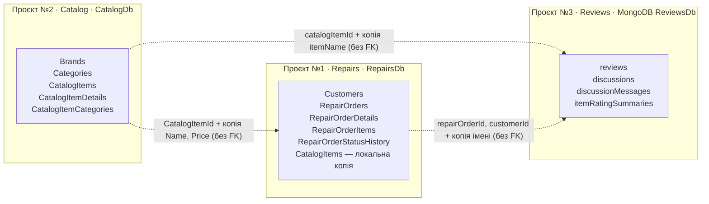

Пунктир — логічне посилання за ідентифікатором між базами (без `FOREIGN KEY`); справжні зовнішні
ключі існують лише всередині кожної бази.

## Структура репозиторію

```text
README.md                 опис домену, запуск, API, розгортання БД, таблиця дублювання, ERD
Platform.slnx             рішення з усіма проєктами платформи
Platform.AppHost/         оркестрація .NET Aspire (AppHost.cs): SQL Server, MongoDB, Redis, бази, сервіси, агрегатор і шлюз
Platform.ServiceDefaults/ спільні налаштування (Extensions.cs): Serilog, OpenTelemetry, resilience, /health/live і /health/ready, Correlation/, Grpc/ (interceptor), HealthChecks/, Metrics/
Platform.ApiGateway/      API-шлюз на YARP: маршрути в appsettings.json, журнал і метрики трафіку (Logging/)
Platform.Aggregator/      агрегатор: gRPC-клієнти (Clients/), політики стійкості (Resilience/), перевірки сервісів (HealthChecks/), кеш картки в Redis (Caching/), картка замовлення (Services/, Dtos/), контролер
Platform.Tests/           модульні тести агрегатора, політик стійкості, health checks, gRPC-interceptor і CorrelationId
Services/
├── Repairs/              сервіс контексту Repairs — ADO.NET + Dapper
│   ├── Repairs.Api/      контролери, Protos/ (gRPC-контракт), Grpc/ (gRPC-сервіс), Metrics/, HealthChecks/, обробник помилок, Program.cs
│   ├── Repairs.Bll/      сервіси, DTO, профілі AutoMapper, валідація, Diagnostics/
│   ├── Repairs.Dal/      інтерфейси й реалізації репозиторіїв, Unit of Work
│   ├── Repairs.Domain/   моделі, константи, доменні винятки
│   └── Repairs.Tests/    модульні тести
├── Catalog/              сервіс контексту Catalog — EF Core
│   ├── Catalog.Api/      контролери, Protos/ (gRPC-контракт), Grpc/ (gRPC-сервіс), Metrics/, HealthChecks/, обробник помилок, Program.cs
│   ├── Catalog.Bll/      сервіси, Caching/ (кеш L1 + L2), DTO, профілі AutoMapper, специфікації, валідатори, Diagnostics/
│   ├── Catalog.Dal/      DbContext, Configurations/, Migrations/, репозиторії, Unit of Work, Seeding/
│   ├── Catalog.Domain/   сутності з бізнес-правилами, доменні винятки
│   └── Catalog.Tests/    модульні тести
└── Reviews/              сервіс контексту Reviews — Clean Architecture, CQRS, MongoDB
    ├── Reviews.Domain/          сутності, value objects, доменні винятки, інтерфейс репозиторію
    ├── Reviews.Application/     команди й запити MediatR, обробники, behaviors, валідатори, DTO, AutoMapper, Diagnostics
    ├── Reviews.Infrastructure/  Mongo-контекст, BSON-мапінг, репозиторій, запити читання, сідінг, індекси
    ├── Reviews.WebApi/          контролери, Protos/ (gRPC-контракт), Grpc/ (gRPC-сервіс), Metrics/, HealthChecks/, обробник помилок, Program.cs
    └── Reviews.Tests/           модульні тести
docker-compose.yml        SQL Server 2025 + MongoDB 9.0 та автоматичний запуск скриптів
.env.example              шаблон паролів (.env у git не потрапляє)
global.json               версія .NET SDK
dotnet-tools.json         локальний інструмент dotnet-ef
docs/
├── contexts.md           предметна область, контексти, сутності, агрегати
├── duplication-policy.md політика дублювання та логічні посилання між базами
├── repairs-service.md    сервіс Repairs: шари, транзакції, помилки, валідація
├── catalog-service.md    сервіс Catalog: модель, репозиторії, специфікації, валідація, кешування, журнал
├── reviews-service.md    сервіс Reviews: шари, домен, CQRS, behaviors, MongoDB, помилки
├── platform.md           платформа: AppHost, ServiceDefaults, Gateway, gRPC, Aggregator, CorrelationId, HTTP проти gRPC
├── erd-p1.md             ERD Проєкту №1: зв'язки, обмеження, індекси
├── erd-p2.md             ERD Проєкту №2: зв'язки, обмеження, індекси
├── p3-mongo-model.md     модель MongoDB: вбудовування, посилання, гібрид
├── p3-documents/         приклади документів MongoDB у форматі JSON
└── img/                  зображення ERD, знімки Swagger, Aspire Dashboard, trace, логів, метрик і health checks
db/
├── p1/                   Проєкт №1 — RepairsDb
│   ├── schema.sql        таблиці, ключі, обмеження, індекси, view, роль застосунку
│   ├── procedures.sql    6 збережуваних процедур
│   ├── seed.sql          тестові дані (ідемпотентно)
│   └── queries.sql       запити перевірки: CRUD, пошук, пагінація, транзакції
├── p2/                   Проєкт №2 — CatalogDb (еталон схеми; базу створюють міграції сервісу Catalog)
│   ├── schema.sql        цільова схема: таблиці, ключі, обмеження, індекси, view
│   ├── seed.sql          еталон початкових даних
│   └── queries.sql       запити перевірки: зв'язки, пошук, обмеження
└── p3/                   Проєкт №3 — MongoDB ReviewsDb
    ├── collections.js    колекції, JSON Schema-валідація, індекси
    ├── seed.js           тестові документи (ідемпотентно)
    └── queries.js        запити перевірки та aggregation pipeline
```

## Запуск платформи через Aspire

Потрібні [.NET SDK 10](https://dotnet.microsoft.com/download) і запущений
[Docker](https://docs.docker.com/get-docker/). Файл `.env` для цього не потрібен.

Пароль SQL Server — параметр-секрет AppHost `sql-password`. Його можна задати заздалегідь у секретах
користувача (інакше Dashboard попросить ввести його під час першого запуску):

```powershell
dotnet user-secrets set "Parameters:sql-password" "<SA_PASSWORD>" --project Platform.AppHost
```

Необов'язково — ключ ліцензії Lucky Penny для AutoMapper і MediatR (без нього бібліотеки лише
пишуть попередження в журнал):

```powershell
dotnet user-secrets set "Parameters:luckypenny-license-key" "<LICENSE_KEY>" --project Platform.AppHost
```

Запуск усієї платформи:

```bash
dotnet run --project Platform.AppHost
```

Команда піднімає контейнери SQL Server, MongoDB і Redis, три сервіси, агрегатор і шлюз у порядку
«бази й Redis → сервіси → агрегатор → шлюз»:

- базу `RepairsDb` створює сам AppHost зі скриптів `db/p1/schema.sql`, `procedures.sql`, `seed.sql`;
- базу `CatalogDb` AppHost створює порожньою, а таблиці й початкові дані в ній з'являються під час
  старту сервісу Catalog — він застосовує міграції EF Core (див. [Сервіс Catalog](#сервіс-catalog));
- у базі `ReviewsDb` сервіс Reviews під час старту сам створює індекси й вставляє тестові відгуки
  (див. [Сервіс Reviews](#сервіс-reviews)).

У консолі з'являється посилання на Aspire Dashboard; усі одинадцять ресурсів — `mongo`, `ReviewsDb`,
`redis`, `sql`, `CatalogDb`, `RepairsDb`, `repairs-api`, `catalog-api`, `reviews-api`, `aggregator` і
`gateway` — мають перейти в стан **Running**. Перший запуск триває довше: завантажуються образи й
стартують сервери баз.

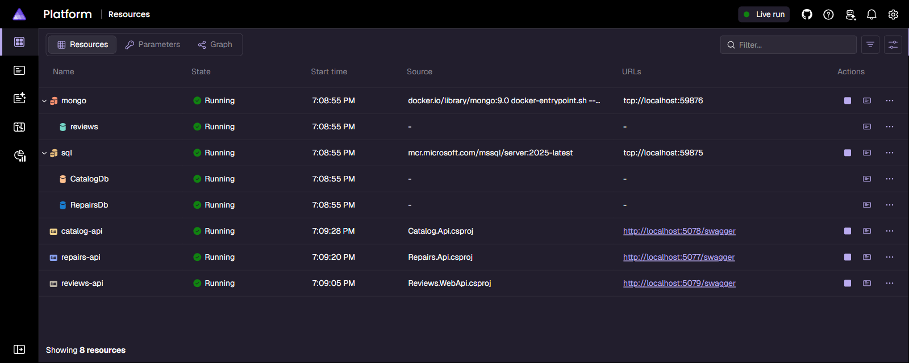

| Що | Адреса |
|----|--------|
| **Gateway — єдина точка входу** | `http://localhost:5000/api/...` |
| Aggregator — картка замовлення | `http://localhost:5000/api/aggregator/repair-orders/{id}/full` |
| Repairs — Swagger UI | `http://localhost:5077/swagger` |
| Catalog — Swagger UI | `http://localhost:5078/swagger` |
| Reviews — Swagger UI | `http://localhost:5079/swagger` |
| Aggregator — Swagger UI | `http://localhost:5080/swagger` |
| Health checks сервісу | `http://localhost:<порт REST>/health/live`, `/health/ready` |
| Aspire Dashboard | посилання з консолі (`https://localhost:17028/login?t=...`) |


Ресурси AppHost відповідають проєктам так:

| Ресурс | Проєкт | REST (HTTP/1.1) | gRPC (HTTP/2) |
|--------|--------|-----------------|---------------|
| `repairs-api` | `Services/Repairs/Repairs.Api` | 5077 | 5177 |
| `catalog-api` | `Services/Catalog/Catalog.Api` | 5078 | 5178 |
| `reviews-api` | `Services/Reviews/Reviews.WebApi` | 5079 | 5179 |
| `aggregator` | `Platform.Aggregator` | 5080 | — |
| `gateway` | `Platform.ApiGateway` | 5000 | — |
| `redis` | контейнер Redis | — | — |

Ресурси баз в AppHost мають імена `RepairsDb`, `CatalogDb` і `ReviewsDb` — ті самі, що й рядки
підключення сервісів, тому Aspire передає їх змінними оточення `ConnectionStrings__RepairsDb`,
`ConnectionStrings__CatalogDb` і `ConnectionStrings__ReviewsDb`. Пароль і TLS для контейнера MongoDB
Aspire налаштовує сам, так само як пароль і TLS для Redis (рядок підключення
`ConnectionStrings__redis`). Ім'я ресурсу є й адресою для service discovery: шлюз звертається до
`http://repairs-api`, а не до `localhost:5077`, агрегатор — до gRPC-endpoint `http://_grpc.repairs-api`.

Дані зберігаються в томах Docker і переживають перезапуск; скрипти, міграції та початкове наповнення
ідемпотентні, тож повторний старт нічого не дублює. Повернутися до початкових даних — зупинити AppHost і видалити том:

```bash
docker volume ls --filter name=platform.apphost
```

```bash
docker volume rm <назва тому>
```

Запустити API без Aspire, із базами з `docker compose`, можна, перевизначивши рядок підключення
змінною оточення (PowerShell):

```powershell
$env:ConnectionStrings__RepairsDb = "Server=127.0.0.1,1433;Database=RepairsDb;User Id=sa;Password=<SA_PASSWORD>;TrustServerCertificate=True"
dotnet run --project Services/Repairs/Repairs.Api
```

```powershell
$env:ConnectionStrings__CatalogDb = "Server=127.0.0.1,1433;Database=CatalogDb;User Id=sa;Password=<SA_PASSWORD>;TrustServerCertificate=True"
dotnet run --project Services/Catalog/Catalog.Api
```

Сервіс Catalog під час старту сам створює `CatalogDb`, якщо її ще немає, і застосовує міграції.

Сервіс Reviews з MongoDB з `docker compose` (пароль — `MONGO_ROOT_PASSWORD` з `.env`):

```powershell
$env:ConnectionStrings__ReviewsDb = "mongodb://root:<MONGO_PASSWORD>@127.0.0.1:27017/?authSource=admin&maxPoolSize=20&serverSelectionTimeoutMS=3000"
dotnet run --project Services/Reviews/Reviews.WebApi
```

Модульні тести:

```bash
dotnet test Platform.slnx
```

## Gateway, Aggregator і спостережуваність

Клієнт звертається до всіх сервісів через шлюз на порту 5000. Шлюз маршрутизує запит за префіксом
шляху, створює `X-Correlation-Id` (якщо клієнт не надіслав власний) і пише в журнал рішення про
маршрутизацію. Докладно про маршрути, ServiceDefaults, CorrelationId і агрегатор —
[`docs/platform.md`](docs/platform.md).

| Префікс | Сервіс |
|---------|--------|
| `/api/repair-orders`, `/api/customers` | `repairs-api` |
| `/api/repairs/catalog-items` | `repairs-api` (локальна копія позицій із залишком; шлюз перетворює шлях на `/api/catalog-items`) |
| `/api/catalog-items`, `/api/categories`, `/api/brands` | `catalog-api` |
| `/api/reviews` | `reviews-api` |
| `/api/aggregator` | `aggregator` |

Приклади запитів через шлюз (`-i` показує заголовок `X-Correlation-Id` у відповіді):

```bash
curl -i http://localhost:5000/api/repair-orders/1
```

```bash
curl -i "http://localhost:5000/api/catalog-items?page=1&pageSize=5"
```

```bash
curl -i "http://localhost:5000/api/reviews?catalogItemId=1"
```

```bash
curl -i http://localhost:5000/api/repairs/catalog-items/1
```

Власний ідентифікатор кореляції клієнт передає заголовком — він повертається у відповіді й
потрапляє в логи всіх сервісів ланцюжка:

```bash
curl -i -H "X-Correlation-Id: support-ticket-42" http://localhost:5000/api/customers/1
```

Картка ремонтного замовлення — агрегатор gRPC-викликами отримує замовлення з Repairs, а потім
паралельно (`Task.WhenAll`) — актуальні дані позицій з Catalog і відгуки з Reviews; готову картку
кешує в Redis на 30 с:

```bash
curl -i http://localhost:5000/api/aggregator/repair-orders/1/full
```

Відповідь містить `order`, `parts` (знімок ціни із замовлення і вкладений блок `catalog` з поточною
ціною й ознакою `priceChanged`), `reviews` і `warnings`. Якщо зупинити `reviews-api` у Dashboard,
той самий запит повертає 200 із замовленням і позиціями, без відгуків, і з
`"warnings": ["reviews-api is unavailable"]` (таку часткову картку агрегатор не кешує). Неіснуюче
замовлення — 404, а `repairs-api`, який недоступний або не зміг обробити виклик (наприклад, без бази),
— 503 у форматі `ProblemDetails`.

Усі застосунки підключають `Platform.ServiceDefaults`: Serilog пише JSON у консоль і передає кожен
запис в OpenTelemetry, тож у вкладці *Structured logs* видно атрибути `ServiceName`, `CorrelationId`,
`EnvironmentName`, `MachineName`, `ThreadId`, а також `TraceId` і `SpanId`. У вкладці *Traces* один
запит до агрегатора — це один trace від шлюзу через gRPC-виклики до SQL-, MongoDB- і Redis-запитів:

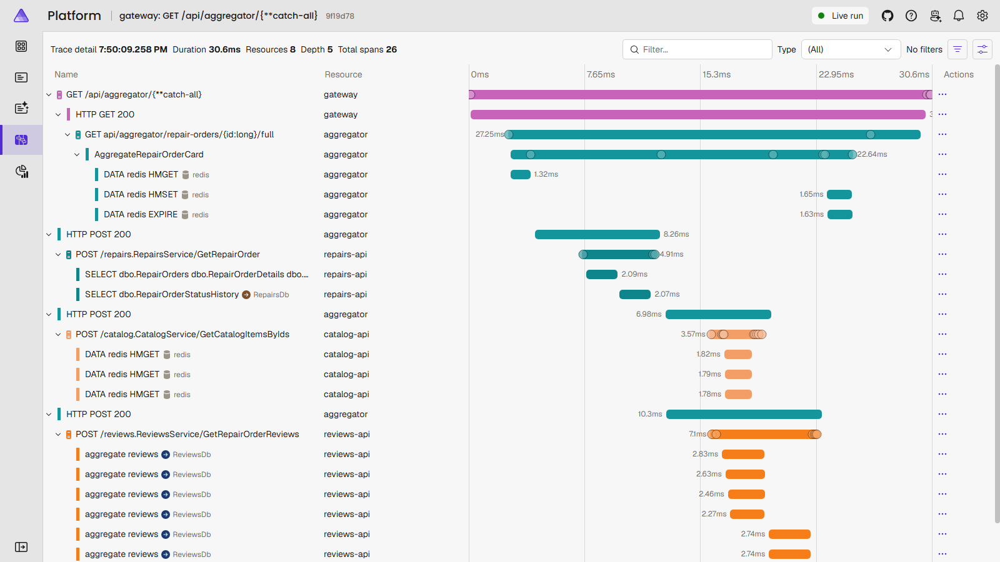

Фільтр *Structured logs* `CorrelationId contains <значення>` знаходить записи всіх сервісів одного
звернення — `X-Correlation-Id` доходить до сервісів і в метаданих gRPC-викликів:


## gRPC і кешування

Сервіси мають два API: REST для зовнішніх клієнтів (через шлюз) і gRPC для внутрішніх викликів
агрегатора. Контракти — у `Protos/` кожного API-проєкту, реалізації — у `Grpc/`; агрегатор генерує
клієнтів із тих самих `.proto`. Докладно — [`docs/platform.md`](docs/platform.md#grpc-контракти).

| Сервіс | Контракт | gRPC-методи |
|--------|----------|-------------|
| Repairs | `Services/Repairs/Repairs.Api/Protos/repairs.proto` | `RepairsService.GetRepairOrder` |
| Catalog | `Services/Catalog/Catalog.Api/Protos/catalog.proto` | `CatalogService.GetCatalogItem`, `GetCatalogItemsByIds`, `ListCategories` |
| Reviews | `Services/Reviews/Reviews.WebApi/Protos/reviews.proto` | `ReviewsService.GetReview`, `GetRepairOrderReviews` |

- gRPC-сервіси — адаптери над BLL: перевіряють вхід (`InvalidArgument`), перетворюють доменні винятки
  на `RpcException` (`NotFound`, `FailedPrecondition`), передають `CancellationToken` виклику.
- gRPC працює на окремому endpoint лише з HTTP/2 (порти 5177–5179), REST — на звичному HTTP/1.1.
- `GrpcServerLoggingInterceptor` з ServiceDefaults пише метод, peer, статус і тривалість кожного виклику.
- Агрегатор робить 3 gRPC-виклики замість колишніх `1 + N + (N + 1)` HTTP-запитів, другий і третій —
  паралельно; сервіс, який недоступний або не зміг обробити виклик (`Unavailable`, `DeadlineExceeded`,
  `ResourceExhausted`, `Unknown`), дає попередження замість помилки.

**Кеш Catalog** — дворівневий, у `Catalog.Bll/Caching/`: L1 — `IMemoryCache` з обмеженням розміру,
sliding і absolute expiration; L2 — Redis через `IDistributedCache` (Aspire-інтеграція
`AddRedisDistributedCache("redis")`). Читання: L1 → L2 → база, рівні заповнюються на зворотному шляху,
L1 живе коротше за L2. Будь-який запис у Catalog одразу видаляє пов'язані ключі (`catalog:item:{id}`,
версії списків). Якщо Redis недоступний, сервіс працює з L1 і базою. Агрегатор кешує готову картку в
Redis на 30 с (`aggregator:repair-order:{id}:card`), часткові картки не кешує. Докладно —
[`docs/catalog-service.md`](docs/catalog-service.md#кешування).

Повторний запит тієї самої категорії: перший іде в Redis і `CatalogDb`, другий обслуговує кеш у
пам'яті — у trace немає SQL-span:

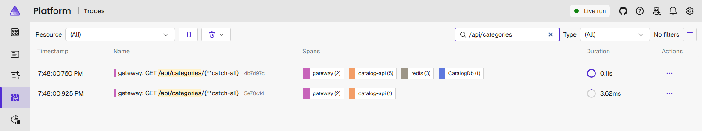


Метрика попадань у кеш (`Meter` `Catalog.Cache`, лічильник `cache.hits` з тегами `cache.level` L1/L2 і
`cache.entry`):


Перевірка вручну:

```bash
curl -i http://localhost:5000/api/catalog-items/3
```

```bash
curl -i -X PATCH http://localhost:5000/api/catalog-items/3/price -H "Content-Type: application/json" -d "{\"price\": 1234.50}"
```

```bash
curl -i http://localhost:5000/api/catalog-items/3
```

Друге читання повертає нову ціну: у журналі catalog-api видно `Cache invalidated "catalog:item:3",
reason "CatalogItemPriceChanged"`, потім промах L1 і L2 та SQL-запит.

### Порівняння HTTP і gRPC

Той самий запит картки через шлюз, 50 вимірів для 5 замовлень (методика —
[`docs/platform.md`](docs/platform.md#http-проти-grpc)):

| Варіант | Викликів до сервісів | p50 | p95 |
|---------|----------------------|-----|-----|
| HTTP, без кешів (до переходу на gRPC) | 8 | 21,7 мс | 38,8 мс |
| gRPC, картку зібрано заново | 3 | 29,0 мс | 49,8 мс |
| gRPC, повторний запит (картка з Redis) | 0 | 6,4 мс | 25,9 мс |

Окремий gRPC-виклик не повільніший за HTTP-виклик, а викликів утричі менше. Картка, зібрана заново,
довша на операції з Redis (перевірка й запис картки, читання L2 у Catalog), яких у HTTP-версії не
було; на localhost із невеликими повідомленнями транспорт займає малу частку часу. Повторний запит у
межах 30 с у 3,4 раза швидший за HTTP-версію, але цей виграш дає кеш картки (сервіси й gRPC на цьому
шляху не викликаються), а HTTP-версію виміряно без кешів.

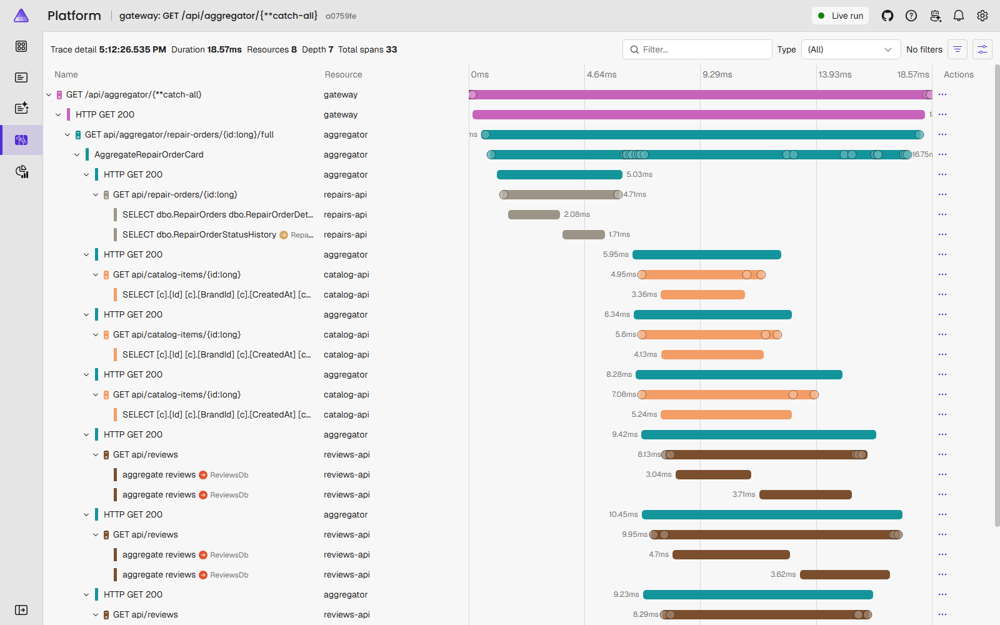

## Стійкість, метрики й health checks

Агрегатор переживає тимчасові збої сервісів завдяки повторам, а систематичні збої розмикають circuit
breaker, і запити відхиляються одразу. Без Redis сервіси працюють з базою даних. Кожен сервіс
публікує бізнес-метрики й має окремі endpoints liveness і readiness, а Dashboard показує стан усіх
ресурсів. Докладно про реалізацію — [`docs/platform.md`](docs/platform.md#стійкість-метрики-й-health-checks).

### Стійкість агрегатора

ServiceDefaults додає кожному `HttpClient` стандартний обробник стійкості
(`AddStandardResilienceHandler` у `ConfigureHttpClientDefaults`). Від зовнішньої до внутрішньої в ньому
працюють rate limiter, загальний таймаут, retry, circuit breaker і таймаут спроби, а повтори небезпечних
методів вимкнено (`Retry.DisableForUnsafeHttpMethods()`). gRPC-клієнти агрегатора створює та сама
фабрика. Для них стандартний обробник прибирається (`RemoveAllResilienceHandlers()`) і замінюється
власним із параметрами з `Platform.Aggregator/Resilience/UpstreamPolicies.cs`, тож обробники не
нашаровуються.

**Повтори HTTP і gRPC на одному каналі не поєднуються.** Помилки gRPC (`Unavailable`,
`DeadlineExceeded`) приходять статусом у трейлерах відповіді з HTTP 200, тому HTTP-обробник їх не
повторює. Для повторів за gRPC-статусами є `RetryPolicy` у `ServiceConfig` каналу. Перевірка показала,
що з `RetryPolicy` повтор HTTP-обробника (після 503 або таймауту спроби) ламає виклик. gRPC-клієнт
буферизує повідомлення для власних повторів, і повторно надісланий запит сервер отримує неповним
(`Internal: Incomplete message`). Без `RetryPolicy` HTTP-повтор працює. Тому кожен клієнт має рівно
один механізм повторів:

- `repairs-api` і `catalog-api` повторюють через `RetryPolicy` за статусами `Unavailable` і
  `ResourceExhausted`. HTTP-повтори для них вимкнено (`DisableForUnsafeHttpMethods()`), бо кожен
  gRPC-виклик є HTTP POST.
- `reviews-api` має один HTTP-повтор Polly з експоненційною затримкою і jitter. Повтори PUT, PATCH і
  DELETE лишаються вимкненими, а POST дозволено, бо агрегатор лише читає.

**Таймаут спроби теж повторюється.** Сам по собі він доходить до gRPC-клієнта як `Internal`, і
`RetryPolicy` такий виклик не повторила б. Тому в `repairs-api` і `catalog-api` перед resilience-handler
стоїть `Resilience/AttemptTimeoutHandler`: він віддає таймаут як помилку вводу-виводу, яку клієнт читає
як `Unavailable`. Повтори gRPC Polly не рахує: у метриці `OnRetry` видно лише `reviews-api`, а повторну
спробу критичного сервісу — за ще одним записом `Execution attempt` і подією `OnTimeout` перед ним.

| Параметр | `repairs-api` | `catalog-api` | `reviews-api` |
|----------|---------------|---------------|---------------|
| Критичність | критичний: без замовлення картки немає (503) | критичний: без позицій картка неповна | некритичний: без відгуків картка часткова |
| Повтори | gRPC: 4 спроби, пауза 0,5 → 4 с, множник 2 | gRPC: 5 спроб, пауза 0,2 → 2 с, множник 2 | HTTP: 1 повтор, 200 мс, експоненційно, jitter |
| Таймаут спроби | 5 с | 3 с | 2 с |
| Загальний таймаут HTTP | 6 с | 4 с | 5 с |
| Дедлайн gRPC-виклику | 11 с | 8 с | 6 с |
| `FailureRatio` | 0,3 | 0,3 | 0,7 |
| `MinimumThroughput` | 5 | 5 | 5 |
| `SamplingDuration` | 30 с | 30 с | 30 с |
| `BreakDuration` | 10 с | 15 с | 15 с |

Чому саме такі значення:

- **Repairs.** Таймаут спроби 5 с, бо холодний старт repairs-api (перше з'єднання з SQL Server)
  займав понад 2 с, і менший таймаут обривав перший запит. Довші паузи між повторами gRPC дають сервісу
  піднятися після перезапуску. Ланцюг розмикається лише на 10 с: без Repairs агрегатор однаково
  повертає 503, тож пробний запит варто робити частіше.
- **Catalog.** Читання позицій дешеве (кеш L1 і L2), тому спроб більше, а паузи коротші. Таймаут
  спроби 3 с має запас і над звичайною тривалістю виклику (десятки мілісекунд), і над першим зверненням
  без Redis (близько 1 с, див. нижче).
- **Reviews.** Клієнт швидко здається: спроба 2 с, один повтор, разом не більше 5 с, після чого
  повертається часткова картка. Breaker толерантніший (0,7), бо збій відгуків не ламає картку. Після
  розмикання запити вже не чекають таймауту.
- **Спільне.** `MinimumThroughput` 5, бо на стенді мало запитів, і зі стандартними 100 breaker не
  спрацював би. Нижчий `FailureRatio` критичних сервісів розмикає ланцюг раніше, щоб користувач не
  чекав серію таймаутів. `SamplingDuration` щонайменше вдвічі більший за таймаут спроби, цього
  вимагає валідація налаштувань.
- **Узгодженість таймаутів.** Загальний HTTP-таймаут не менший за «спроба × (повтори + 1)». Дедлайн
  gRPC — спільний бюджет усіх спроб `RetryPolicy`. Кількість спроб — верхня межа: після швидких відмов
  (`Unavailable`) вміщуються всі, а після зависань — стільки, скільки дозволяє дедлайн, але щонайменше
  дві (repairs: 2 × 5 с у межах 11 с; catalog: 3 с + 3 с і початок третьої в межах 8 с). Найгірший час
  картки — 11 с (Repairs) + max(8, 6) с = 19 с, що менше за 30 с таймауту шлюзу. Ці правила перевіряє
  `UpstreamPolicy.Validate()` під час старту агрегатора, а також тести `UpstreamPoliciesTests`.

Circuit breaker бачить лише те, що доходить до HTTP-рівня: мережеві помилки, таймаути спроб і 5xx.
gRPC-статус у трейлерах (HTTP 200) для нього є успіхом. Переходи ланцюга агрегатор пише в журнал
категорії `Platform.Aggregator.Resilience`: розмикання з рівнем Error і причиною, half-open і
закриття з рівнем Information. Polly публікує власні записи (категорія `Polly`) і метрики (Meter
`Polly`, підключено в ServiceDefaults): `resilience.polly.strategy.events` з тегами `event.name` і
`pipeline.name` (`repairs-api-standard`, `catalog-api-standard`, `reviews-api-standard`).

Перевірка зупинкою `reviews-api` у Dashboard (проксі Aspire при цьому не відмовляє, а тримає
з'єднання):

1. Перші картки приходять зі статусом 200 і `"warnings": ["reviews-api is unavailable"]` за 4,2 с:
   спроба 2 с, повтор, ще одна спроба 2 с.
2. Після п'ятої невдалої спроби ланцюг розмикається (`OnCircuitOpened`). Наступні картки приходять за
   15–30 мс, без звернення до reviews-api.
3. Через 15 с пробний запит (half-open) знову чекає 2 с і розмикає ланцюг. Після запуску reviews-api
   пробний запит проходить, ланцюг закривається (`OnCircuitClosed`), і картки знову повні.

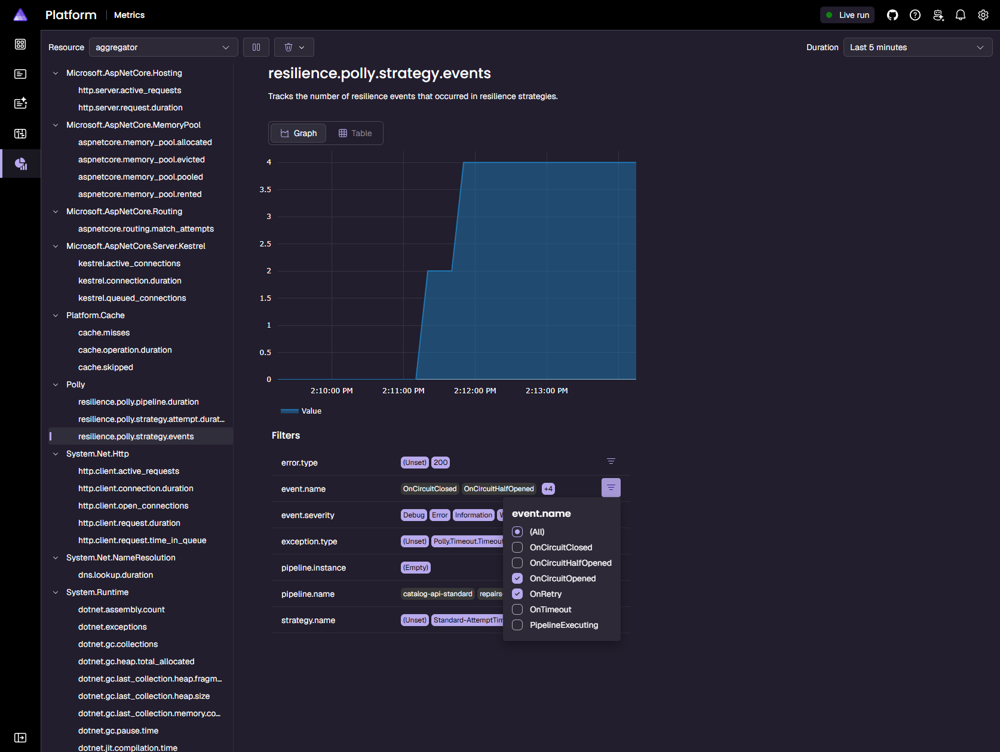

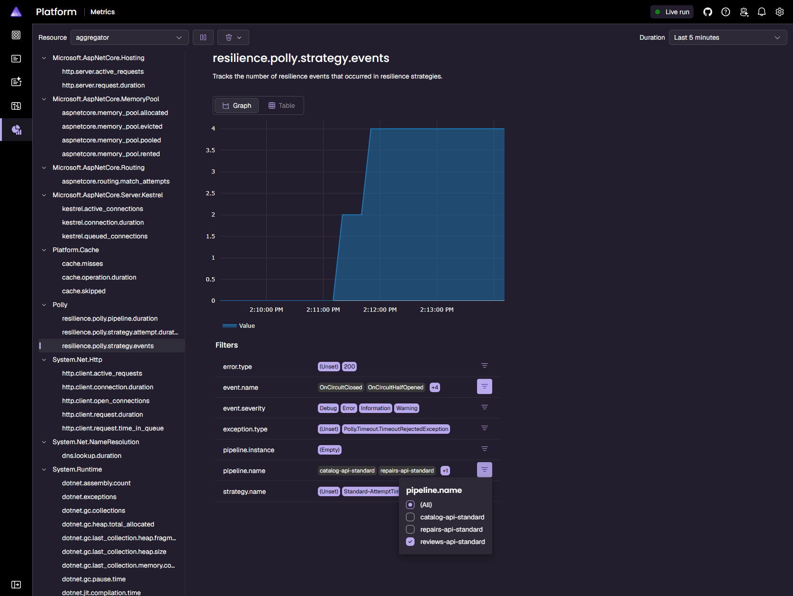

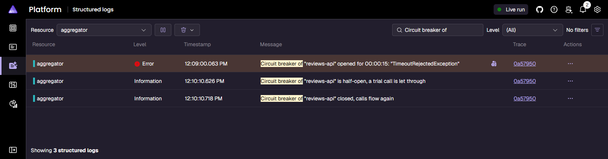

Перевірка критичних сервісів (процес призупинено, тому виклик зависає):

- `catalog-api` або `repairs-api` оживає, поки триває запит: перша спроба обривається таймаутом, повтор
  проходить, і картка повна — 200 за 4,6 с (catalog, зависання 4 с) і 6,5 с (repairs, зависання 6 с).
- `catalog-api` не відповідає: три спроби в межах дедлайну, часткова картка за 8 с. Щойно у вікні
  набирається `MinimumThroughput` спроб, ланцюг розмикається, і наступні картки приходять за
  мілісекунди.
- `repairs-api` не відповідає: дві спроби, 503 за 11 с, далі 503 одразу.
- SQL Server зупинено: картка повертає 503, а не 500.

### Кеш без Redis

Кеш є необов'язковою залежністю. Операції з Redis у `Catalog.Bll/Caching/TwoLevelCache.cs` і
`Platform.Aggregator/Caching/RepairOrderCardCache.cs` загорнуто в `try/catch`. Збій пишеться в журнал
(Warning) і в лічильник `cache.errors`, запит обслуговують L1 і база (агрегатор збирає картку з
сервісів), а наступні 30 с Redis не опитується. Поки Redis недоступний, команда чекає таймауту
клієнта, тому `AsyncTimeout` і `SyncTimeout` зменшено з 5 с до 1 с. Перший запит після зникнення
Redis тепер триває 1,1–1,7 с замість 6 с і вкладається в таймаут спроби агрегатора для Catalog (3 с).

### Бізнес-метрики

Кожен сервіс має клас метрик у `<Сервіс>.Api/Metrics/`. Клас зареєстровано як Singleton, а Meter з
назвою проєкту створюється через `IMeterFactory`. Meter-и сервісів і `Polly` підключено в
`Platform.ServiceDefaults/Extensions.cs`. Лічильник збільшується одразу після успішної операції.
Тривалість записується для всіх виконань, включно з невдалими, з тегом `status` = `success` або
`failure`. Gauge віддає знімок, який фонова служба (`MetricsSnapshotService`) оновлює раз на 30 с;
її запити до бази в traces не потрапляють.

| Meter | Інструмент | Тип, одиниця | Теги та їхні значення |
|-------|-----------|--------------|------------------------|
| `Repairs.Api` | `repair_orders.created` | Counter, `{order}` | `device.type`: Smartphone, Laptop, Tablet, Desktop, Tv, Appliance, Other |
| | `repair_orders.status_changed` | Counter, `{order}` | `repair_order.status`: Diagnosed … Issued, Cancelled |
| | `repair_orders.items_added` | Counter, `{item}` | — |
| | `repair_orders.operation.duration` | Histogram, ms | `operation`: create, add_item, change_status; `status` |
| | `repair_orders.open` | ObservableGauge, `{order}` | `repair_order.status`: Accepted, Diagnosed, Approved, InRepair, Ready, Paid |
| `Catalog.Api` | `catalog_items.created` | Counter, `{item}` | `catalog_item.type`: Part, Service |
| | `catalog_items.price_changed` | Counter, `{item}` | `catalog_item.type` |
| | `catalog_items.deleted` | Counter, `{item}` | — |
| | `catalog_items.operation.duration` | Histogram, ms | `operation`: create, update, change_price, delete; `status` |
| | `catalog_items.active` | ObservableGauge, `{item}` | `catalog_item.type` |
| `Reviews.WebApi` | `reviews.created` | Counter, `{review}` | `review.type`: repair, item; `review.rating`: 1–5 |
| | `reviews.replied` | Counter, `{review}` | — |
| | `reviews.comments_added` | Counter, `{comment}` | `author.kind`: staff, customer |
| | `reviews.operation.duration` | Histogram, ms | `operation`: create, reply, add_comment; `status` |
| | `reviews.published` | ObservableGauge, `{review}` | `review.type` |

Кожен тег має скінченний набір значень (не більше восьми). Ідентифікатори замовлень, клієнтів і
відгуків та мітки часу в теги не потрапляють: вони є в логах і traces, а в метриках кожна унікальна
комбінація тегів стала б окремим часовим рядом. Теги `operation` і `status` однакові в усіх сервісах.

Що відстежувати:

| Метрика | Норма | Привід розібратися |
|---------|-------|--------------------|
| `resilience.polly.strategy.events`, `OnCircuitOpened` | 0 | будь-яке розмикання: сервіс систематично відмовляє |
| `resilience.polly.strategy.events`, `OnRetry` | поодинокі | серія повторів до одного сервісу |
| `*.operation.duration`, p90 | десятки мілісекунд | понад 500 мс або зростання частки `status = failure` |
| `cache.errors` (`Catalog.Cache`, `Platform.Cache`) | 0 | Redis недоступний, запити йдуть у базу |
| `repair_orders.open` | залежить від завантаження майстерні | зростання `Ready` без зростання `Issued`: пристрої не забирають |

П'ять нових замовлень і зміна статусу: лічильник `repair_orders.created` за типом пристрою, розподіл
тривалості операцій (неуспішна зміна статусу дає `status = failure`) і gauge відкритих замовлень:

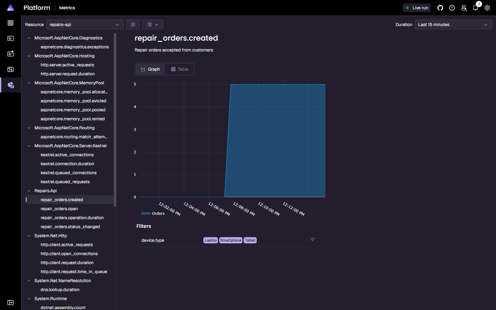

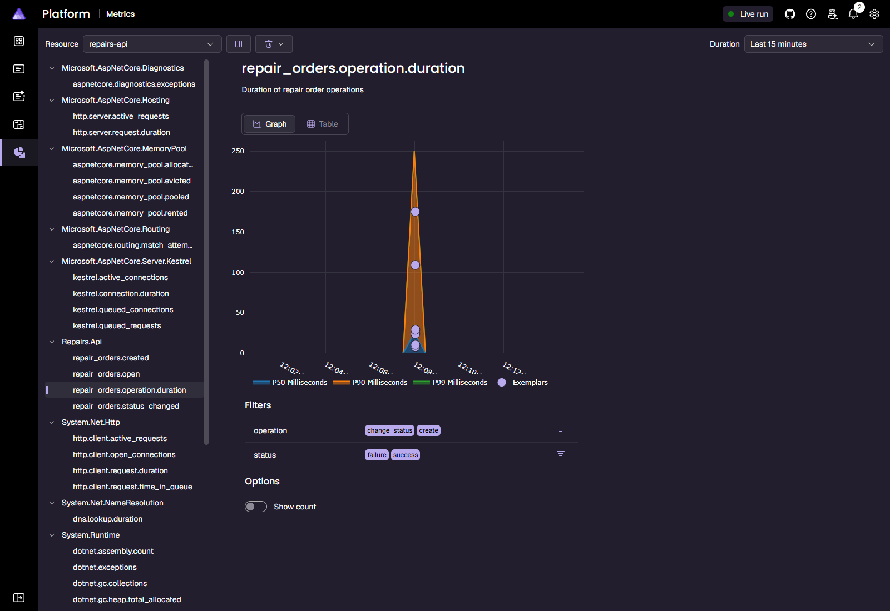

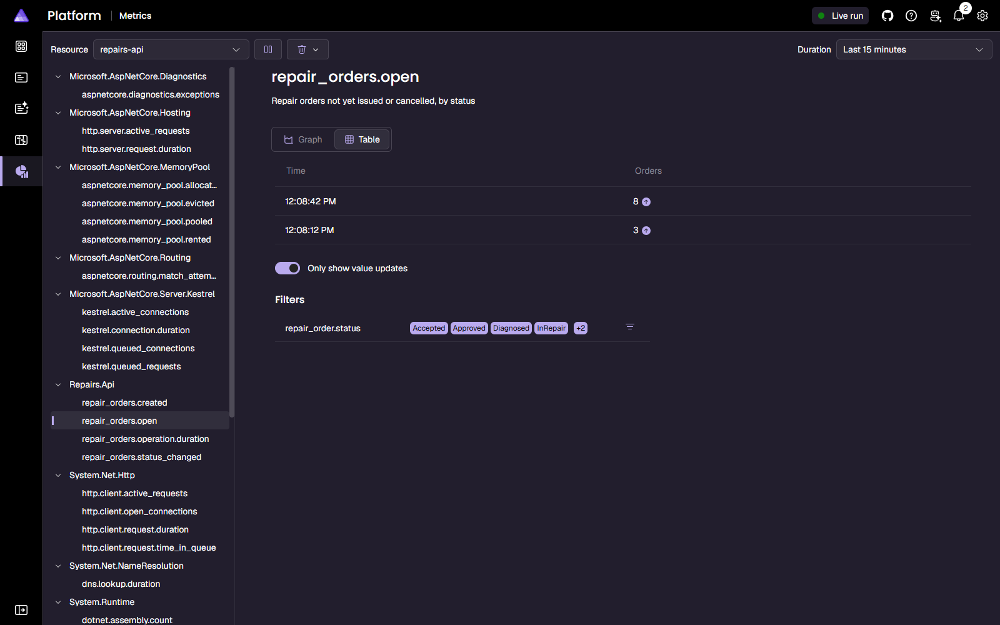

### Health checks

`MapDefaultEndpoints()` з ServiceDefaults публікує endpoints в усіх середовищах, бо їх опитують
оркестратори. Відповідь не містить текстів винятків і рядків підключення, лише тип помилки. Шлюз ці
шляхи не маршрутизує.

| Endpoint | Перевірки | Відповідь |
|----------|-----------|-----------|
| `/health/live` | лише `self` (тег `live`): процес живий, зовнішні залежності не перевіряються | 200, JSON, без звернень до баз |
| `/health/ready` | усі перевірки з тегом `ready`, JSON з деталями кожної | Healthy і Degraded → 200, Unhealthy → 503 |
| `/health` | усі перевірки, JSON | для діагностики |

| Ресурс | Перевірка | Що робить | Статус збою | Таймаут | Теги |
|--------|-----------|-----------|-------------|---------|------|
| усі | `self` | — | — | — | `live` |
| `repairs-api` | `repairs-db` | `SELECT 1` | Unhealthy | 5 с | `database`, `sql`, `ready` |
| `catalog-api` | `catalog-db` | `SELECT 1` | Unhealthy | 5 с | `database`, `sql`, `ready` |
| `catalog-api` | `redis-cache` | `PING` | Degraded | 3 с | `cache`, `redis`, `ready` |
| `catalog-api` | `cache` | статистика L1 і доступність L2 | Degraded | — | `cache` |
| `reviews-api` | `reviews-db` | `{ ping: 1 }` | Unhealthy | 5 с | `database`, `mongodb`, `ready` |
| `aggregator` | `repairs-api`, `catalog-api` | gRPC `Health.Check`, дедлайн 2 с | Unhealthy | 3 с | `grpc`, `downstream`, `ready` |
| `aggregator` | `reviews-api` | gRPC `Health.Check`, дедлайн 2 с | Degraded | 3 с | `grpc`, `downstream`, `ready` |
| `aggregator` | `redis-cache` | `PING` | Degraded | 3 с | `cache`, `redis`, `ready` |

Реєстрацію перевірок сервісів зібрано в `<Сервіс>.Api/HealthChecks/`. Сервіси підтримують
стандартний gRPC Health Checking Protocol (`AddGrpcHealthChecks()` і `MapGrpcHealthChecksService()`):
статус служби `""` будується з перевірок із тегом `ready`, і Degraded відповідає `SERVING`. Агрегатор
перевіряє сервіси власним `DownstreamGrpcHealthCheck` через `Health.HealthClient`. Ці клієнти не мають
повторів, а `RpcException` перетворюється на статус збою реєстрації й пишеться в журнал. Без
`reviews-api` агрегатор лише Degraded, бо повертає часткові картки.

Redis перевіряє власний `RedisCacheHealthCheck` (у ServiceDefaults), а не пакет
`AspNetCore.HealthChecks.Redis`. Перевірка з пакета ігнорувала таймаут і чекала відповіді клієнта
близько 5 с. Через це `/health/ready` catalog-api відповідав за 5,5 с, gRPC Health не вкладався в
дедлайн агрегатора, і агрегатор вважав catalog-api Unhealthy, хоча той працював. Тепер відключений
Redis визначається одразу, і `/health/ready` відповідає за 10–15 мс. Власну перевірку Redis
Aspire-інтеграції `AddRedisDistributedCache` (зі статусом Unhealthy) вимкнено (`DisableHealthChecks`).

В AppHost кожен проєкт має `WithHttpHealthCheck("/health/ready")`. Dashboard показує стан ресурсу, а
`WaitFor` чекає, поки залежність стане здоровою, а не лише запуститься. Aspire розрізняє тільки код
відповіді, тож Degraded (200) у Resources показано як здоровий стан; деталі видно в JSON
`/health/ready`.

Перевірка:

- **Redis зупинено.** `/health/ready` catalog-api й агрегатора повертає 200 зі статусом
  `Degraded`, сервіси відповідають, картки повні. Після запуску Redis статус знову `Healthy`.
- **SQL Server зупинено.** `/health/live` repairs-api і catalog-api повертає 200, а `/health/ready` —
  503. Агрегатор стає Unhealthy через `repairs-api` і `catalog-api`. Після запуску SQL Server усі
  ресурси здорові без перезапуску сервісів.

```bash
curl -i http://localhost:5078/health/ready
```

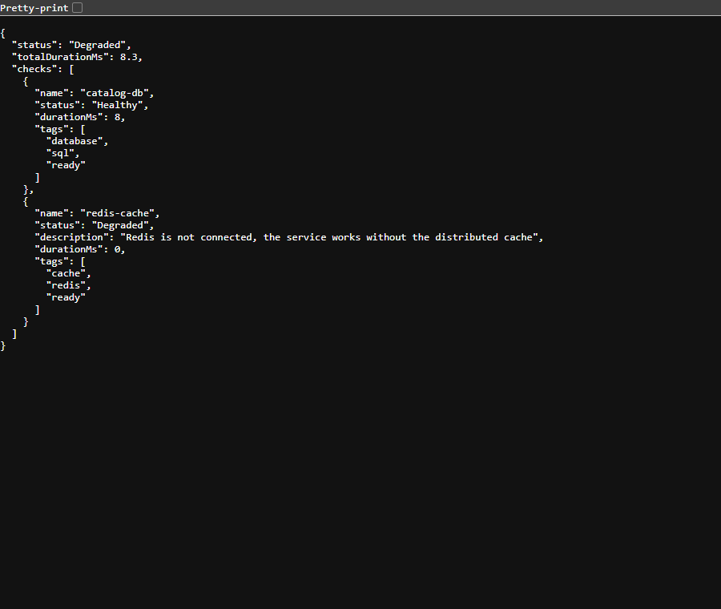

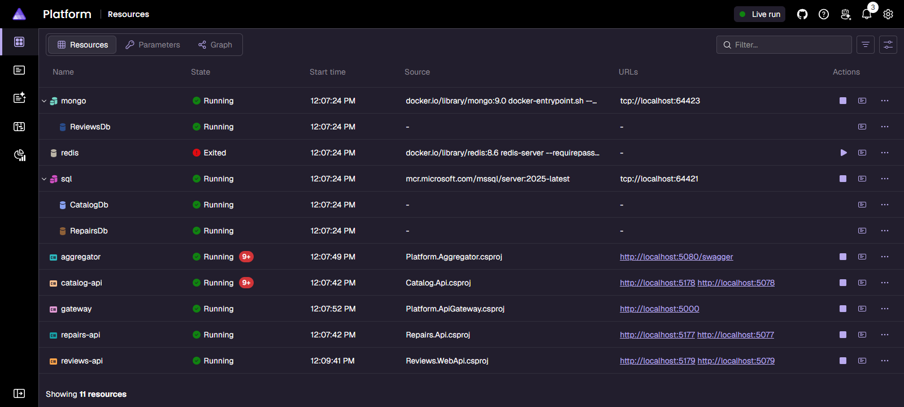

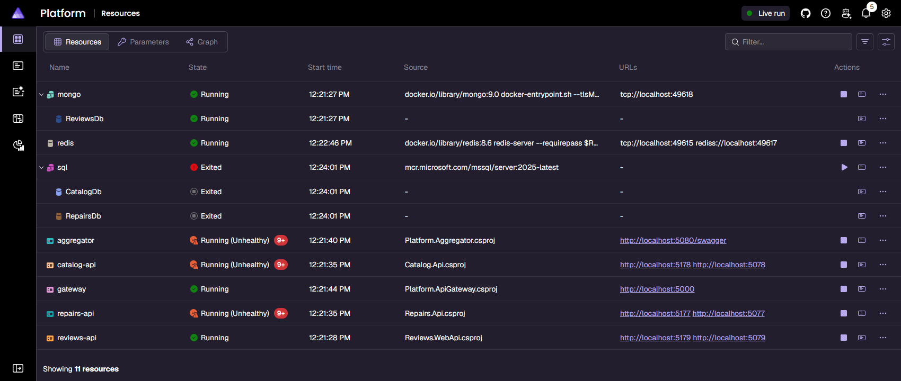

Типові фільтри Dashboard:

- *Structured logs*, ресурс `aggregator`, пошук `Circuit breaker of` показує переходи ланцюга, а
  категорія `Polly` — повтори й таймаути.
- *Metrics*, `aggregator` → `Polly` → `resilience.polly.strategy.events`, фільтри `event.name` і
  `pipeline.name`.
- *Metrics*, `repairs-api` → `Repairs.Api` → `repair_orders.created`, фільтр `device.type`.
- *Resources*: клік на ресурс показує його health checks.

## Схема рішення

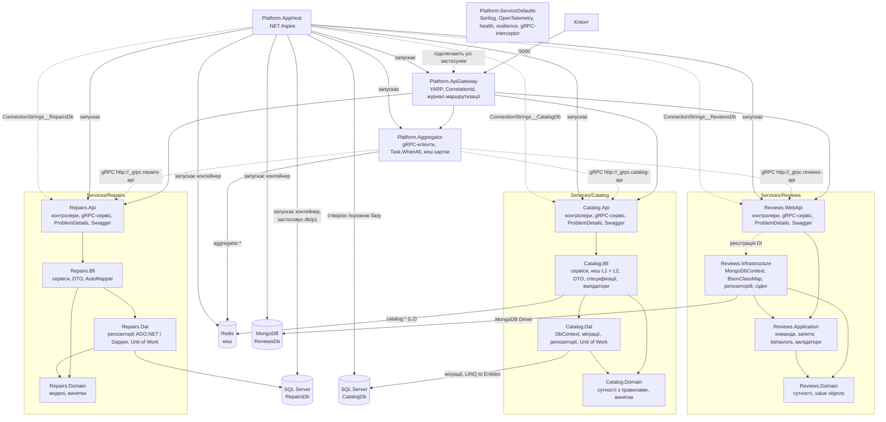

- **Repairs.Api** — тонкі асинхронні контролери: приймають DTO, викликають сервіс, повертають статус.
  Винятки перетворює на відповіді один глобальний обробник.
- **Repairs.Bll** — бізнес-правила й транзакційні операції через Unit of Work.
- **Repairs.Dal** — єдине місце із SQL: один репозиторій на чистому ADO.NET (`CustomerRepository`),
  два на Dapper зі спільною базою `BaseDapperRepository<T>` (`RepairOrderRepository`,
  `CatalogItemRepository`), `UnitOfWork` з одним з'єднанням і транзакцією на запит.
- **Repairs.Domain** — моделі таблиць і доменні винятки, спільні для DAL і BLL.

Транзакції, рівень ізоляції, таймаути й перетворення помилок описано в
[`docs/repairs-service.md`](docs/repairs-service.md).

Сервіс Catalog має таку саму будову шарів, але доступ до даних побудовано на EF Core:

- **Catalog.Api** — асинхронні контролери, явний виклик валідаторів, глобальний обробник помилок;
  журнал і кореляцію запитів дає `Platform.ServiceDefaults`.
- **Catalog.Bll** — сервіси, що працюють лише через Unit of Work; DTO, профілі AutoMapper,
  специфікації запитів і валідатори FluentValidation; `Caching/` — дворівневий кеш (декоратори
  сервісів поверх `IMemoryCache` і Redis).
- **Catalog.Dal** — `CatalogDbContext`, конфігурації Fluent API, міграції, узагальнений і три
  спеціалізовані репозиторії, `UnitOfWork` з єдиним `SaveChangesAsync`, початкове наповнення.
- **Catalog.Domain** — сутності, які самі перевіряють свої правила, і доменні винятки.

Сервіс Reviews побудовано інакше — за Clean Architecture: залежності спрямовані до домену, а
доступ до бази — лише реалізація інтерфейсів, оголошених у внутрішніх шарах (див.
[Сервіс Reviews](#сервіс-reviews)).

## API сервісу Repairs

| Метод | Шлях | Призначення | Успіх |
|-------|------|-------------|-------|
| GET | `/api/customers?phone=` | клієнти, пошук за телефоном | 200 |
| GET | `/api/customers/{id}` | клієнт | 200 |
| POST | `/api/customers` | створити клієнта | 201 + `Location` |
| PUT | `/api/customers/{id}` | змінити клієнта | 204 |
| DELETE | `/api/customers/{id}` | м'яко видалити клієнта без незавершених замовлень | 204 |
| GET | `/api/catalog-items` | активні позиції локальної копії каталогу | 200 |
| GET | `/api/catalog-items/{id}` | позиція каталогу | 200 |
| PUT | `/api/catalog-items/{id}/stock` | задати залишок на складі | 204 |
| GET | `/api/repair-orders?status=&customerId=&page=&pageSize=` | список замовлень зі сторінками | 200 |
| GET | `/api/repair-orders/{id}` | замовлення з пристроєм, кошторисом та історією статусів | 200 |
| POST | `/api/repair-orders` | прийняти пристрій і скласти кошторис — **одна транзакція** | 201 + `Location` |
| POST | `/api/repair-orders/{id}/items` | додати позицію зі знімком назви й ціни, списати залишок — **одна транзакція** | 201 + `Location` |
| POST | `/api/repair-orders/{id}/status` | змінити статус (`usp_ChangeRepairOrderStatus`) | 204 |
| PUT | `/api/repair-orders/{id}/details` | оновити опис дефекту й діагностику за `rowVersion` | 204 |
| DELETE | `/api/repair-orders/{id}` | м'яко видалити видане або скасоване замовлення | 204 |

Помилки повертаються у форматі ProblemDetails (`application/problem+json`): **400** — некоректні
вхідні дані, **404** — запис не знайдено, **409** — порушено бізнес-правило (недопустимий перехід
статусу, брак залишку, дубль ключа, застарілий `rowVersion`), **500** — непередбачена помилка.

```json
{
  "type": "https://tools.ietf.org/html/rfc9110#section-15.5.10",
  "title": "Conflict",
  "status": 409,
  "detail": "Status transition is not allowed: Approved -> Approved",
  "traceId": "b6e0c2a7a7867fc7d52ff86ec36d2573"
}
```

### Приклади запитів

Приклади розраховано на початкові дані. У PowerShell замість `curl` пишіть `curl.exe`, а тіло запиту
зручніше надсилати через Swagger UI.

Список замовлень у статусі `Diagnosed` і одне замовлення повністю:

```bash
curl "http://localhost:5077/api/repair-orders?status=Diagnosed&page=1&pageSize=10"
```

```bash
curl http://localhost:5077/api/repair-orders/1
```

Створити клієнта (апостроф у прізвищі передається параметром запиту, а не текстом SQL):

```bash
curl -i -X POST http://localhost:5077/api/customers -H "Content-Type: application/json" -d "{\"fullName\":\"Liam O'Brien\",\"email\":\"liam.obrien@example.com\",\"phone\":\"+380991234567\"}"
```

Прийняти пристрій із кошторисом — замовлення, деталі, історія, позиції та списання залишку в одній
транзакції; відповідь `201 Created` із заголовком `Location`:

```bash
curl -i -X POST http://localhost:5077/api/repair-orders -H "Content-Type: application/json" -d "{\"customerId\":2,\"deviceType\":\"Smartphone\",\"deviceBrand\":\"Apple\",\"deviceModel\":\"iPhone 13\",\"defectDescription\":\"Cracked screen\",\"createdBy\":\"reception\",\"items\":[{\"catalogItemId\":6,\"quantity\":1},{\"catalogItemId\":1,\"quantity\":2,\"discount\":100}]}"
```

Відкат транзакції: третьої позиції бракує на складі, тому відповідь `409`, замовлення не створено,
а залишок позиції 2 не змінився:

```bash
curl -i -X POST http://localhost:5077/api/repair-orders -H "Content-Type: application/json" -d "{\"customerId\":2,\"deviceType\":\"Smartphone\",\"deviceModel\":\"iPhone 13\",\"defectDescription\":\"Battery drains quickly\",\"items\":[{\"catalogItemId\":6,\"quantity\":1},{\"catalogItemId\":2,\"quantity\":1},{\"catalogItemId\":1,\"quantity\":99}]}"
```

```bash
curl http://localhost:5077/api/catalog-items/2
```

Погодити кошторис замовлення 3 — `204 No Content`; повторний такий самий запит — `409`:

```bash
curl -i -X POST http://localhost:5077/api/repair-orders/3/status -H "Content-Type: application/json" -d "{\"status\":\"Approved\",\"comment\":\"Approved by phone\",\"changedBy\":\"reception\"}"
```

Додати позицію до замовлення 4:

```bash
curl -i -X POST http://localhost:5077/api/repair-orders/4/items -H "Content-Type: application/json" -d "{\"catalogItemId\":5,\"quantity\":2,\"addedBy\":\"master.ivan\"}"
```

Неіснуючий ідентифікатор — `404 Not Found`:

```bash
curl -i http://localhost:5077/api/repair-orders/999
```

Видалити незавершене замовлення не можна — `409`; скасоване замовлення 5 видаляється з `204`:

```bash
curl -i -X DELETE http://localhost:5077/api/repair-orders/4
```

```bash
curl -i -X DELETE http://localhost:5077/api/repair-orders/5
```

## Сервіс Catalog

Сервіс контексту Catalog веде довідник запчастин і послуг: позиції, їхні розширені описи, бренди та
дерево категорій. Модель описано в коді (EF Core Code First), а схему `CatalogDb` створюють і
змінюють міграції. Будову шарів, правила сутностей, репозиторії та специфікації описано в
[`docs/catalog-service.md`](docs/catalog-service.md).

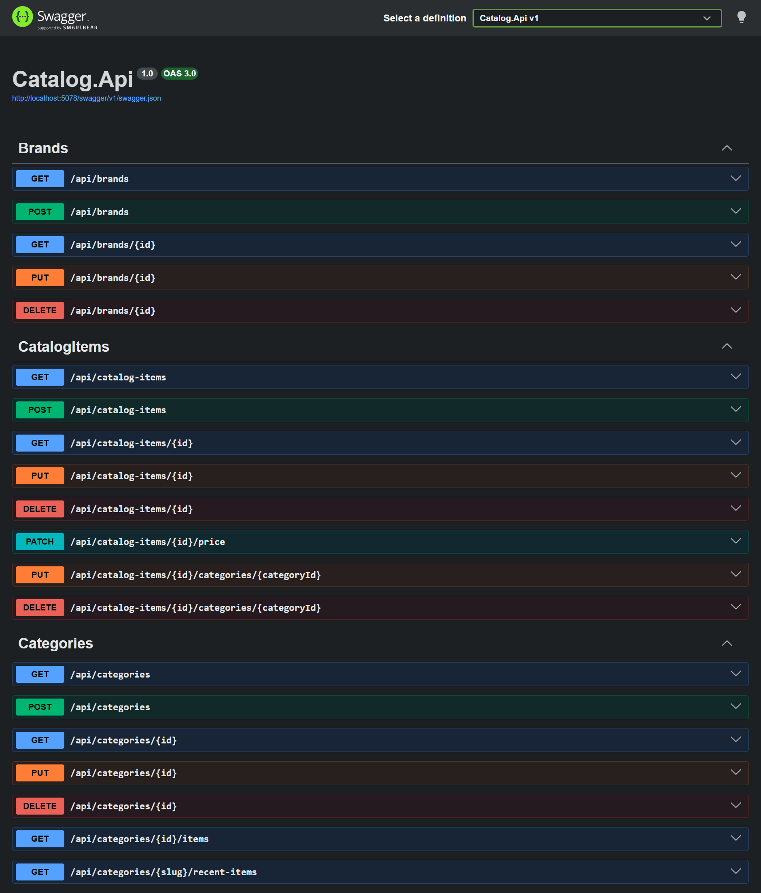

### Міграції

Інструмент `dotnet-ef` зафіксовано в `dotnet-tools.json`; один раз його треба відновити:

```bash
dotnet tool restore
```

`CatalogDbContext` і міграції лежать у `Catalog.Dal`, рядок підключення — у `Catalog.Api`, тому в
командах вказують обидва проєкти.

Застосувати міграції до бази:

```bash
dotnet ef database update --project Services/Catalog/Catalog.Dal --startup-project Services/Catalog/Catalog.Api
```

Додати міграцію після зміни моделі:

```bash
dotnet ef migrations add <Назва> --project Services/Catalog/Catalog.Dal --startup-project Services/Catalog/Catalog.Api
```

Згенерувати ідемпотентний SQL-скрипт усіх міграцій:

```bash
dotnet ef migrations script --idempotent --project Services/Catalog/Catalog.Dal --startup-project Services/Catalog/Catalog.Api --output Services/Catalog/Catalog.Dal/Migrations/CatalogDb.sql
```

Перевірити, що модель і міграції збігаються:

```bash
dotnet ef migrations has-pending-model-changes --project Services/Catalog/Catalog.Dal --startup-project Services/Catalog/Catalog.Api
```

Застосовувати міграції вручну не обов'язково: сервіс під час старту викликає `MigrateAsync()`.
Для ручного `database update` з SQL Server із `docker compose` задайте рядок підключення змінною
оточення `ConnectionStrings__CatalogDb` (приклад — у розділі
[Запуск сервісів через Aspire](#запуск-сервісів-через-aspire)).

| Міграція | Що робить |
|----------|-----------|
| `InitialCreate` | 5 таблиць, ключі, `CHECK`-обмеження, унікальні та фільтровані індекси, довідники брендів і категорій |
| `AddAppRole` | роль застосунку `catalog_app` з правами лише на дані |

Готовий SQL-скрипт обох міграцій —
[`Services/Catalog/Catalog.Dal/Migrations/CatalogDb.sql`](Services/Catalog/Catalog.Dal/Migrations/CatalogDb.sql);
його можна виконати вручну там, де сервісу не дозволено змінювати схему.

**Початкові дані.** Довідники з фіксованими Id (5 брендів, 11 категорій) описано через `HasData` —
вони потрапляють у базу разом із міграцією. Позиції каталогу з описами та зв'язками з категоріями
(10 / 10 / 15 записів) додає `DbInitializer` після `MigrateAsync()`: він спершу перевіряє, чи є в
таблиці хоч одна позиція, тож повторний запуск нічого не дублює. У середовищі `Production`
програмне наповнення не виконується.

### API сервісу Catalog

| Метод | Шлях | Призначення | Успіх |
|-------|------|-------------|-------|
| GET | `/api/catalog-items` | список позицій: сторінки, фільтри, сортування | 200 |
| GET | `/api/catalog-items/{id}` | позиція з брендом, описом і категоріями | 200 |
| POST | `/api/catalog-items` | створити позицію | 201 + `Location` |
| PUT | `/api/catalog-items/{id}` | змінити назву, бренд, активність, опис | 204 |
| PATCH | `/api/catalog-items/{id}/price` | змінити ціну | 200 |
| DELETE | `/api/catalog-items/{id}` | м'яко видалити позицію | 204 |
| PUT | `/api/catalog-items/{id}/categories/{categoryId}` | додати позицію до категорії або змінити ознаку основної | 204 |
| DELETE | `/api/catalog-items/{id}/categories/{categoryId}` | прибрати позицію з категорії | 204 |
| GET | `/api/categories` | список категорій: сторінки, пошук, батьківська категорія | 200 |
| GET | `/api/categories/{id}` | категорія | 200 |
| GET | `/api/categories/{id}/items` | категорія разом із її позиціями | 200 |
| GET | `/api/categories/{slug}/recent-items?since=` | позиції, додані до категорії після вказаної дати | 200 |
| POST | `/api/categories` | створити категорію | 201 + `Location` |
| PUT | `/api/categories/{id}` | змінити категорію | 204 |
| DELETE | `/api/categories/{id}` | видалити категорію без підкатегорій | 204 |
| GET | `/api/brands` | список брендів: сторінки, пошук | 200 |
| GET | `/api/brands/{id}` | бренд | 200 |
| POST | `/api/brands` | створити бренд | 201 + `Location` |
| PUT | `/api/brands/{id}` | змінити бренд | 204 |
| DELETE | `/api/brands/{id}` | видалити бренд, який не використовують позиції | 204 |

### Пагінація, фільтрація й сортування

Параметри списку позицій (усі необов'язкові):

| Параметр | Значення |
|----------|----------|
| `page` | номер сторінки, з 1 (типово 1) |
| `pageSize` | розмір сторінки, типово 20; значення понад 100 зменшується до 100 |
| `search` | фрагмент назви або SKU |
| `itemType` | `Part` або `Service` |
| `brandId`, `categoryId` | позиції бренду, позиції категорії |
| `minPrice`, `maxPrice` | діапазон ціни |
| `isActive` | лише активні або лише неактивні |
| `sortBy` | `name` (типово), `price`, `sku`, `createdAt` — інші значення відхиляються з 400 |
| `sortDir` | `asc` (типово) або `desc` |

Метадані сторінки повертаються і в тілі відповіді, і в заголовку `X-Pagination` — заголовок дає
змогу дізнатися кількість сторінок, не розбираючи тіло.

```bash
curl -i "http://localhost:5078/api/catalog-items?page=2&pageSize=5&sortBy=price&sortDir=desc"
```

```json
{
  "items": [
    { "id": 10, "sku": "SRV-SSD-MIGR", "name": "Встановлення SSD з перенесенням даних", "itemType": "Service", "price": 700.00, "brandId": null, "brandName": null, "isActive": true }
  ],
  "totalCount": 10,
  "page": 2,
  "pageSize": 5,
  "totalPages": 2,
  "hasNext": false,
  "hasPrevious": true
}
```

```text
X-Pagination: {"totalCount":10,"page":2,"pageSize":5,"totalPages":2,"hasNext":false,"hasPrevious":true}
```

У прикладі тіла показано одну позицію з п'яти. Фільтри, сортування й `OFFSET … FETCH` виконує
SQL Server; `totalCount` рахує окремий `COUNT(*)` з тими самими фільтрами, тому він дорівнює
кількості всіх відповідних записів, а не розміру сторінки.

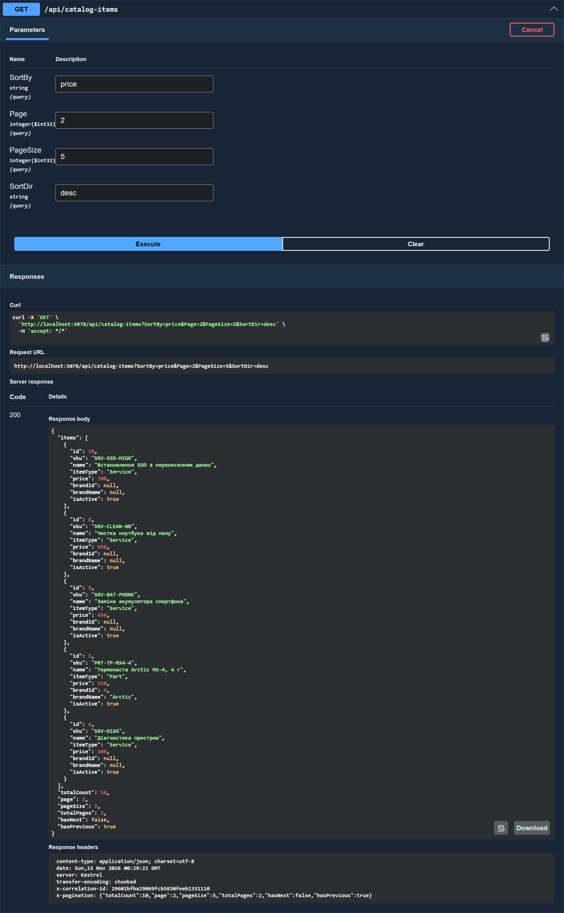

### Валідація та помилки

Вхідні дані перевіряються у два кроки. Прості правила (обов'язковість, довжина, діапазон) задано
атрибутами DataAnnotations на DTO. Складніші — формат SKU і slug, точність ціни, «послуга не має
бренду», «мінімальна ціна не більша за максимальну», коректність JSON у характеристиках — описано
валідаторами FluentValidation, які контролер викликає явно. В обох випадках відповідь — **400** у
форматі `ValidationProblemDetails` з переліком помилок за полями.

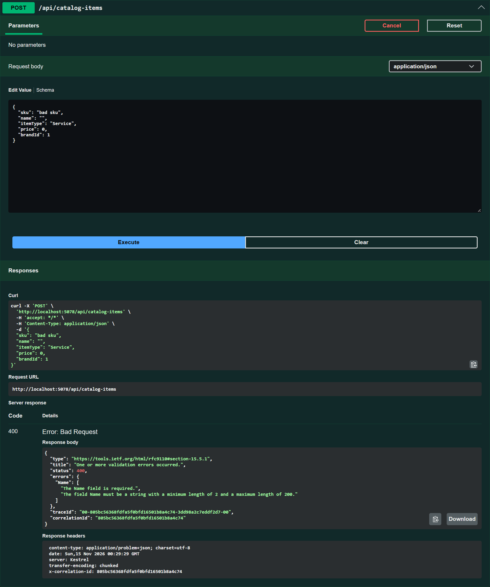

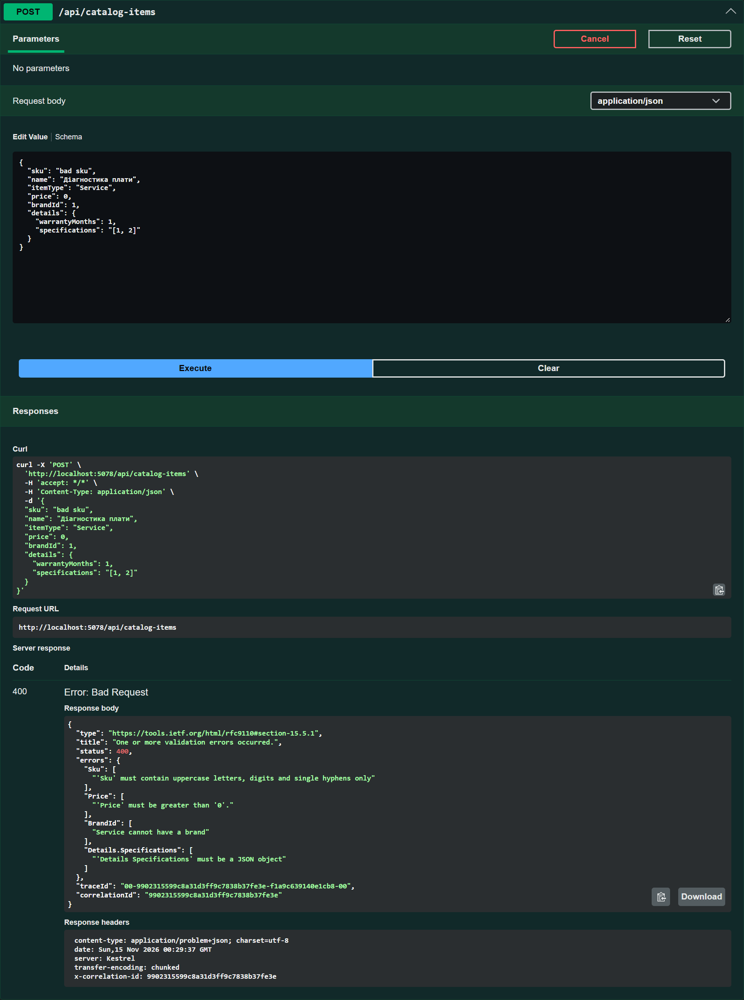

Решта помилок — `ProblemDetails` (`application/problem+json`): **404** — запис не знайдено,
**409** — конфлікт (SKU, назва бренду чи slug уже зайняті; бренд використовують позиції; порушено
правило сутності, наприклад друга основна категорія), **500** — непередбачена помилка без технічних
подробиць поза середовищем `Development`. Кожна відповідь містить `correlationId` — той самий, що
в заголовку `X-Correlation-Id` і в журналі.

```json
{
  "type": "https://tools.ietf.org/html/rfc9110#section-15.5.10",
  "title": "Conflict",
  "status": 409,
  "detail": "Catalog item with SKU 'SRV-DIAG' already exists",
  "traceId": "00-63ce2e10bbc85cc6d8fd38d70c3970ec-4f0c1e9d0b7a2c11-00",
  "correlationId": "63ce2e10bbc85cc6d8fd38d70c3970ec"
}
```

### Приклади запитів до Catalog

Створити позицію (201 і заголовок `Location`); повторний запит із тим самим SKU повертає 409:

```bash
curl -i -X POST http://localhost:5078/api/catalog-items -H "Content-Type: application/json" -d '{"sku":"PRT-CBL-USBC","name":"USB-C cable 1 m","itemType":"Part","price":199.90,"brandId":2,"details":{"warrantyMonths":12}}'
```

Запчастини для смартфонів від 1000 грн, найдорожчі спочатку:

```bash
curl "http://localhost:5078/api/catalog-items?itemType=Part&categoryId=7&minPrice=1000&sortBy=price&sortDir=desc"
```

Змінити ціну:

```bash
curl -i -X PATCH http://localhost:5078/api/catalog-items/5/price -H "Content-Type: application/json" -d '{"price":349.00,"updatedBy":"manager"}'
```

Позиції категорії та нещодавно додані до неї:

```bash
curl http://localhost:5078/api/categories/4/items
```

```bash
curl "http://localhost:5078/api/categories/for-laptops/recent-items?since=2026-09-12"
```

### Журнал

Журнал веде Serilog, налаштований у `Platform.ServiceDefaults` однаково для всіх сервісів (див.
[`docs/platform.md`](docs/platform.md)). У `Services/Catalog/Catalog.Api/appsettings.json` лишилося
тільки те, що стосується саме Catalog: файловий приймач і рівень SQL-команд EF Core.

| Що | Значення |
|----|----------|
| Приймачі | консоль (JSON, вкладка *Console logs* у Dashboard), OpenTelemetry (вкладка *Structured logs*) і файл `logs/catalog-api-<дата>.log` (JSON, один запис на рядок, зберігається 7 днів) |
| Рівні | `Debug` у Development, `Information` в інших середовищах; `Microsoft.AspNetCore`, `Microsoft.EntityFrameworkCore` — `Warning`; SQL-команди EF Core — `Information` |
| Властивості | `ServiceName`, `CorrelationId` (із заголовка `X-Correlation-Id` або новий GUID), `EnvironmentName`, `MachineName`, `ThreadId`, `TraceId`, `SpanId` |
| Запити HTTP | `Request started` і `Request finished` зі статусом і тривалістю — для кожного запиту |
| Помилки | один запис на виняток — у глобальному обробнику |

У журналі видно різницю між способами завантаження пов'язаних даних: `GET /api/catalog-items/1`
виконує один запит із `JOIN` (eager loading), а `GET /api/categories/4/items` — два окремі запити
(explicit loading).

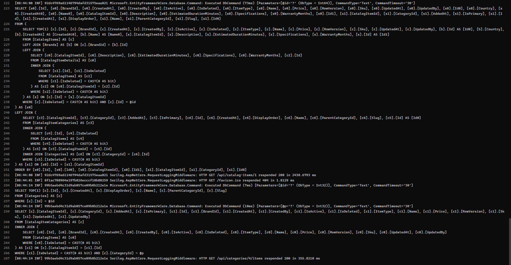

## Сервіс Reviews

Сервіс контексту Reviews приймає відгуки клієнтів про ремонт і про позиції каталогу, коментарі до
них і відповідь сервісного центру. Дані зберігаються в MongoDB (база `ReviewsDb`, колекція
`reviews`) у структурі, описаній у [`docs/p3-mongo-model.md`](docs/p3-mongo-model.md). Докладно
про шари, домен, CQRS, behaviors і мапінг — [`docs/reviews-service.md`](docs/reviews-service.md).

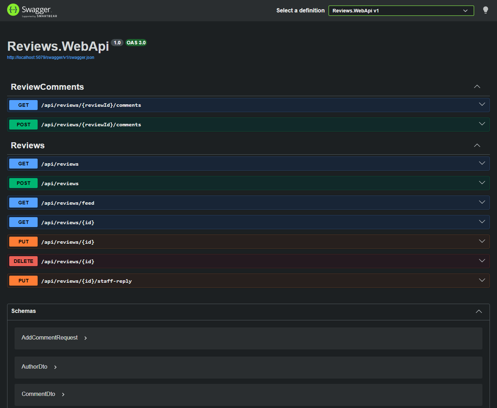

### Шари Clean Architecture

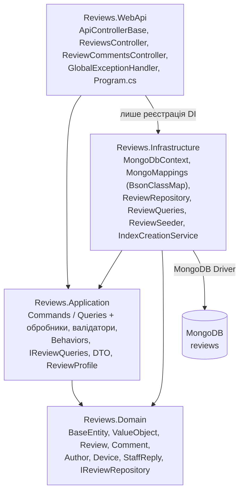

Правило залежностей: внутрішній шар не знає про зовнішні. `Reviews.Domain` не посилається на жоден
проєкт рішення і з пакетів має лише `MongoDB.Bson` (тип `ObjectId`) — без драйвера бази. Інтерфейси
доступу до даних оголошено всередині (`IReviewRepository` у Domain, `IReviewQueries` в Application),
реалізації — в Infrastructure. Кожен шар реєструє свої сервіси власним методом: `AddApplication`
(MediatR, behaviors, валідатори) і `AddInfrastructure` (MongoDB, мапінг, репозиторій, сідінг,
індекси, health check).

Кожна операція API — команда або запит MediatR з окремим обробником. Запит проходить ланцюжок
behaviors: `LoggingBehavior` → `ExceptionHandlingBehavior` → `ValidationBehavior` →
`PerformanceBehavior` → обробник. Некоректні дані відхиляє `ValidationBehavior`, і обробник не
викликається.

### API сервісу Reviews

| Метод | Шлях | Команда / запит | Успіх |
|-------|------|-----------------|-------|
| GET | `/api/reviews?catalogItemId=&repairOrderId=&customerId=&reviewType=&minRating=&search=&page=&pageSize=` | `GetReviewsListQuery` — фільтри, текстовий пошук, пагінація `$skip`/`$limit` | 200 |
| GET | `/api/reviews/feed?catalogItemId=&customerId=&after=&limit=` | `GetReviewsFeedQuery` — курсорна пагінація | 200 |
| GET | `/api/reviews/{id}` | `GetReviewByIdQuery`; версія в `ETag` | 200 |
| POST | `/api/reviews` | `CreateReviewCommand` | 201 + `Location` |
| PUT | `/api/reviews/{id}` + `If-Match` | `UpdateReviewCommand` | 200 + `ETag` |
| DELETE | `/api/reviews/{id}` + `If-Match` | `DeleteReviewCommand` (м'яке видалення) | 204 |
| PUT | `/api/reviews/{id}/staff-reply` | `ReplyToReviewCommand` | 200 |
| GET | `/api/reviews/{reviewId}/comments` | `GetReviewCommentsQuery` | 200 |
| POST | `/api/reviews/{reviewId}/comments` | `AddCommentCommand` | 201 |

Помилки повертаються у форматі ProblemDetails: **400** — валідація (зокрема некоректний `ObjectId`)
чи порушене доменне правило, **404** — відгук не знайдено, **409** — застаріла версія в `If-Match`
або дубль, який зупинив унікальний індекс, **503** — MongoDB недоступна. Повна таблиця —
[`docs/reviews-service.md`](docs/reviews-service.md#обробка-помилок).

### Приклади запитів до Reviews

Створити відгук про позицію каталогу — 201, у `Location` рядковий `ObjectId`:

```bash
curl -i -X POST http://localhost:5079/api/reviews -H "Content-Type: application/json" -d '{"reviewType":"item","customerId":3,"authorName":"Maria Bondarenko","rating":5,"title":"Like new","text":"Bright and sharp","catalogItemId":1,"itemName":"OLED screen for iPhone 13","pros":["Colors"]}'
```

```text
HTTP/1.1 201 Created
ETag: "1"
Location: http://localhost:5079/api/reviews/6af9e49ba668924b117656cc

{"id":"6af9e49ba668924b117656cc"}
```

Повторний відгук того самого клієнта на ту саму позицію — 400 від асинхронного правила валідатора:

```json
{"title":"One or more validation errors occurred.","status":400,"errors":{"CatalogItemId":["The customer has already reviewed this catalog item"]}}
```

Змінити відгук: передати версію з `ETag` у `If-Match`. Повтор зі старою версією — 409:

```bash
curl -i -X PUT http://localhost:5079/api/reviews/<id> -H "Content-Type: application/json" -H 'If-Match: "1"' -d '{"rating":4,"title":"Still good","text":"Bright, a bit pricey","pros":["Colors"],"cons":["Price"]}'
```

```json
{"title":"Conflict","status":409,"detail":"Review 6af9e49ba668924b117656cc has version 2, but version 1 was expected"}
```

Відгуки про позицію 1 і повнотекстовий пошук:

```bash
curl "http://localhost:5079/api/reviews?catalogItemId=1&page=1&pageSize=5"
```

```bash
curl "http://localhost:5079/api/reviews?search=екран"
```

Стрічка з курсором — наступна сторінка після останнього отриманого відгуку:

```bash
curl "http://localhost:5079/api/reviews/feed?limit=3&after=671000000000000000000005"
```

### Журнал і індекси

Журнал веде Serilog зі спільними налаштуваннями `Platform.ServiceDefaults`: консоль, *Structured logs*
у Dashboard і файл `logs/reviews-api-<дата>.log` (JSON). `LoggingBehavior` пише
кожен запит MediatR і відповідь на нього, `PerformanceBehavior` — попередження про обробники,
повільніші за 500 мс. Для команди з `rating: 10` у журналі є `Handling CreateReviewCommand` і
попередження валідації, але немає `Handled` — обробник не виконувався:


Документи колекції `reviews` у MongoDB Compass — структура з [`docs/p3-mongo-model.md`](docs/p3-mongo-model.md):
поля в camelCase, вкладені `author`, `comments`, `device`, `staffReply`, ідентифікатори інших
контекстів типу `Long`, без службових полів .NET:

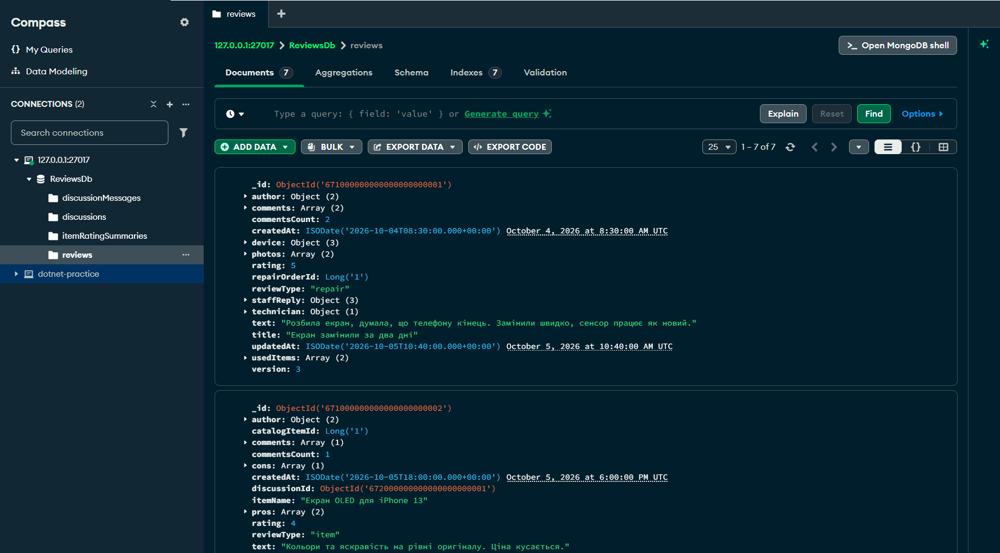

Індекси колекції `reviews` сервіс створює сам під час старту (`IndexCreationService`), тестові
відгуки — `ReviewSeeder`, якщо колекція порожня:


## ERD-діаграми

### Проєкт №1 — RepairsDb

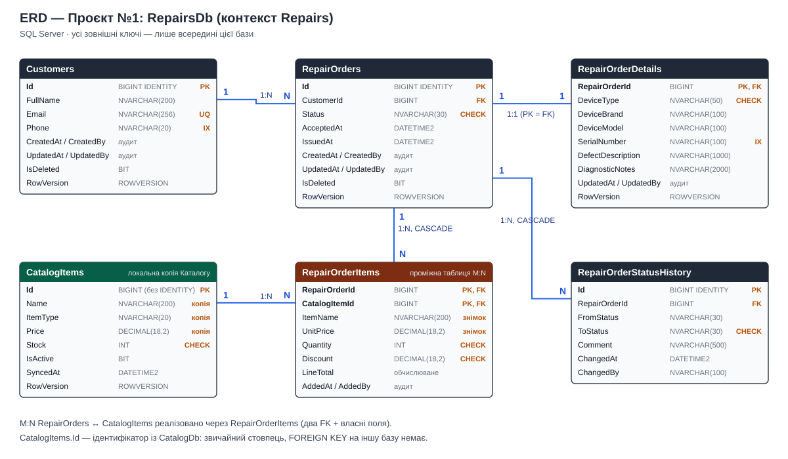

| Тип | Зв'язок | Реалізація |
|-----|---------|------------|
| 1:1 | `RepairOrders` ↔ `RepairOrderDetails` | FK є водночас PK залежної таблиці |
| 1:N | `Customers` → `RepairOrders`, `RepairOrders` → `RepairOrderStatusHistory` | FK на боці «багатьох» |
| M:N | `RepairOrders` ↔ `CatalogItems` | проміжна таблиця `RepairOrderItems` з двома FK |

Ключі, обмеження, індекси із запитами та діаграма Mermaid — [`docs/erd-p1.md`](docs/erd-p1.md).

### Проєкт №2 — CatalogDb

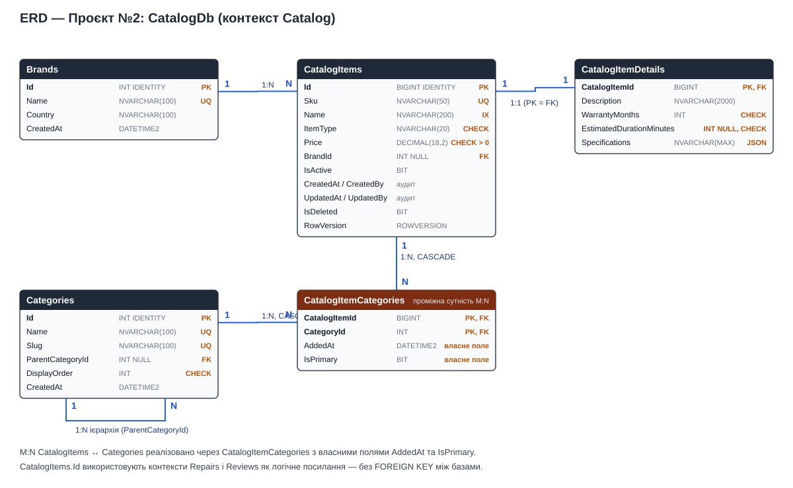

| Тип | Зв'язок | Реалізація |
|-----|---------|------------|
| 1:1 | `CatalogItems` ↔ `CatalogItemDetails` | FK є водночас PK залежної таблиці |
| 1:N | `Brands` → `CatalogItems`, `Categories` → `Categories` | FK на боці «багатьох» |
| M:N | `CatalogItems` ↔ `Categories` | проміжна сутність `CatalogItemCategories` з власними полями `AddedAt`, `IsPrimary` |

Схему створюють міграції EF Core; `db/p2/schema.sql` — її еталонний опис. Докладно —
[`docs/erd-p2.md`](docs/erd-p2.md).

### Проєкт №3 — MongoDB

Структура колекцій, вбудовування, посилання й гібридний підхід — [`docs/p3-mongo-model.md`](docs/p3-mongo-model.md);
приклади документів — [`docs/p3-documents/`](docs/p3-documents/).

## Таблиця політики дублювання даних

Дублювання між базами свідоме: воно прибирає синхронні міжсервісні виклики під час читання.
**Знімок** фіксується в момент події й не оновлюється; **копія для читання** оновлюється подіями від
сервісу-власника. У кожного поля рівно один власник.

| № | Поле (дублікат) | Де зберігається | Джерело (власник даних) | Політика узгодженості |
|---|-----------------|-----------------|-------------------------|----------------------|
| 1 | `RepairOrderItems.ItemName`, `UnitPrice` | `RepairsDb` | `CatalogItems.Name`, `Price` — Catalog | **знімок** на момент додавання позиції до кошторису — не оновлюється |
| 2 | `CatalogItems.Name`, `ItemType`, `Price`, `IsActive` (локальна копія довідника) | `RepairsDb` | `CatalogItems` — Catalog | **оновлюється подіями** з Каталогу |
| 3 | `reviews.itemName`, `discussions.itemName`, `itemRatingSummaries.itemName` | `reviews` (MongoDB) | `CatalogItems.Name` — Catalog | **оновлюється подіями** з Каталогу |
| 4 | `reviews.author.displayName`, `discussions.startedBy.displayName`, `discussionMessages.author.displayName` | `reviews` (MongoDB) | `Customers.FullName` — Repairs | **оновлюється подіями** з Repairs |
| 5 | `reviews.device` (`type`, `brand`, `model`) | `reviews` (MongoDB) | `RepairOrderDetails` — Repairs | **знімок** на момент створення відгуку — не оновлюється |
| 6 | `reviews.usedItems[].itemName` | `reviews` (MongoDB) | `RepairOrderItems.ItemName` — Repairs | **знімок** на момент створення відгуку — не оновлюється |

Ідентифікатори чужих сутностей (`RepairsDb.CatalogItems.Id`, `catalogItemId`, `repairOrderId`,
`customerId`) — звичайні стовпці та поля без `FOREIGN KEY` на іншу базу. Залишок на складі
(`RepairsDb.dbo.CatalogItems.Stock`) дублікатом не є: його єдиний власник — Repairs, у `CatalogDb`
цього поля немає. Пояснення та перелік логічних посилань — [`docs/duplication-policy.md`](docs/duplication-policy.md).

## Розгортання баз даних

Потрібен лише [Docker](https://docs.docker.com/get-docker/) з Docker Compose. Встановлювати SQL Server,
MongoDB, `sqlcmd` чи `mongosh` окремо не треба — усе є в контейнерах.

| Сервіс | Образ | Адреса з хоста |
|--------|-------|----------------|
| SQL Server (база `RepairsDb`; `CatalogDb` створює сервіс Catalog) | `mcr.microsoft.com/mssql/server:2025-latest` | `127.0.0.1,1433` |
| MongoDB (база `ReviewsDb`) | `mongo:9.0` | `127.0.0.1:27017` |

### Крок 1. Задати паролі

Скопіюйте шаблон і задайте власні паролі у файлі `.env`:

```bash
cp .env.example .env
```

Пароль SQL Server має містити щонайменше 8 символів: великі й малі літери, цифри та спецсимвол.

### Крок 2. Розгорнути бази

```bash
docker compose up -d
```

Команда запускає SQL Server і MongoDB, чекає на їхню готовність і виконує скрипти в такому порядку:

1. `db/p1/schema.sql` — створює `RepairsDb`, таблиці, ключі, обмеження, індекси;
2. `db/p1/procedures.sql` — створює 6 збережуваних процедур;
3. `db/p1/seed.sql` — тестові дані Проєкту №1;
4. `db/p3/collections.js` — колекції, валідація та індекси MongoDB;
5. `db/p3/seed.js` — тестові документи Проєкту №3.

Базу `CatalogDb` скрипти не створюють: її схему ведуть міграції EF Core, а самі таблиці й початкові
дані з'являються під час першого запуску сервісу Catalog (або після `dotnet ef database update`,
див. [Міграції](#міграції)). Скрипти `db/p2/schema.sql` і `db/p2/seed.sql` лишаються еталонним
описом цієї схеми й даних; виконувати їх на базі, якою керують міграції, не можна.

Переконатися, що скрипти відпрацювали без помилок:

```bash
docker logs sc-sql-init
docker logs sc-mongo-init
```

Останні рядки журналів — `>>> SQL-бази розгорнуто` та `>>> MongoDB-базу розгорнуто`.

### Розгортання вручну, крок за кроком

Те саме можна виконати окремими командами (наприклад, щоб застосувати один змінений скрипт).
Замініть `<SA_PASSWORD>` і `<MONGO_PASSWORD>` значеннями з `.env`.

```bash
# 1) запустити лише сервери баз даних
docker compose up -d sqlserver mongo

# 2) Проєкт №1 — RepairsDb: схема -> процедури -> тестові дані
docker exec sc-sqlserver /opt/mssql-tools18/bin/sqlcmd -S localhost -U sa -P "<SA_PASSWORD>" -C -b -I -i /db/p1/schema.sql
docker exec sc-sqlserver /opt/mssql-tools18/bin/sqlcmd -S localhost -U sa -P "<SA_PASSWORD>" -C -b -I -i /db/p1/procedures.sql
docker exec sc-sqlserver /opt/mssql-tools18/bin/sqlcmd -S localhost -U sa -P "<SA_PASSWORD>" -C -b -I -i /db/p1/seed.sql

# 3) Проєкт №3 — MongoDB ReviewsDb: колекції та індекси -> тестові документи
docker exec sc-mongo mongosh --quiet -u root -p "<MONGO_PASSWORD>" --authenticationDatabase admin --file /db/p3/collections.js --file /db/p3/seed.js
```

У Git Bash на Windows додайте перед командами `MSYS_NO_PATHCONV=1`, щоб шляхи `/db/...` та `/opt/...`
не перетворювалися на Windows-шляхи; у PowerShell і `cmd` команди працюють без змін.

### Без Docker: наявні SQL Server і MongoDB

Скрипти не залежать від Docker. Для власних серверів виконайте їх у тому самому порядку:

```bash
sqlcmd -S 127.0.0.1,1433 -U sa -P "<SA_PASSWORD>" -C -b -I -f 65001 -i db/p1/schema.sql
sqlcmd -S 127.0.0.1,1433 -U sa -P "<SA_PASSWORD>" -C -b -I -f 65001 -i db/p1/procedures.sql
sqlcmd -S 127.0.0.1,1433 -U sa -P "<SA_PASSWORD>" -C -b -I -f 65001 -i db/p1/seed.sql
mongosh "mongodb://127.0.0.1:27017" --file db/p3/collections.js --file db/p3/seed.js
```

Параметр `-f 65001` обов'язковий у Windows: файли збережено в UTF-8, без нього кирилиця в тестових
даних зіпсується. `-I` вмикає `QUOTED_IDENTIFIER`, `-b` зупиняє виконання на першій помилці.
Базу `RepairsDb` створює сам скрипт `schema.sql`, базу `CatalogDb` — сервіс Catalog під час старту.

### Повторний запуск і розгортання з нуля

Усі скрипти ідемпотентні: схема створюється через `IF ... IS NULL` / `CREATE OR ALTER`, а seed-скрипти
перед кожною вставкою перевіряють наявність запису (`WHERE NOT EXISTS` у SQL, `upsert` з
`$setOnInsert` у MongoDB). Повторний `docker compose up -d` або повторне виконання будь-якого
скрипта не створює дублікатів — кількість рядків і документів лишається тією самою. Так само
поводиться сервіс Catalog: застосовані міграції записано в `__EFMigrationsHistory`, а початкове
наповнення пропускається, якщо позиції в базі вже є.

Видалити бази разом із даними й розгорнути наново:

```bash
docker compose down -v
docker compose up -d
```

## Перевірка після розгортання

### Запити перевірки

```bash
docker exec sc-sqlserver /opt/mssql-tools18/bin/sqlcmd -S localhost -U sa -P "<SA_PASSWORD>" -C -I -W -i /db/p1/queries.sql
docker exec sc-sqlserver /opt/mssql-tools18/bin/sqlcmd -S localhost -U sa -P "<SA_PASSWORD>" -C -I -W -i /db/p2/queries.sql
docker exec sc-mongo mongosh --quiet -u root -p "<MONGO_PASSWORD>" --authenticationDatabase admin --file /db/p3/queries.js
```

Скрипти дані не змінюють: сценарії із записом виконуються в транзакції з відкотом або на
тимчасовому документі. `db/p2/queries.sql` виконують після першого запуску сервісу Catalog, коли
`CatalogDb` уже створено міграціями.

### Що має вийти

| Перевірка | Як виконати | Очікуваний результат |
|-----------|-------------|----------------------|
| Немає FK за межі бази | `sys.foreign_keys` у `RepairsDb` (п. 13 у `p1/queries.sql`) і в `CatalogDb` (п. 5 у `p2/queries.sql`) | по 5 ключів, усі між таблицями тієї ж бази |
| Недопустимий перехід статусу | `EXEC dbo.usp_ChangeRepairOrderStatus @RepairOrderId = 2, @NewStatus = N'Issued'` (п. 8) | помилка `50002 Status transition is not allowed: Ready -> Issued`, статус лишається `Ready` |
| Оптимістична конкурентність | п. 11 у `p1/queries.sql` | другий запис зі старим `RowVersion` — помилка `50008` |
| Знімок ціни не оновлюється | п. 6 у `p1/queries.sql` | у замовленні 1 екран коштує 3900.00, у довіднику — 4200.00 |
| Індекси та обмеження | п. 12 і 14 у `p1/queries.sql`, п. 4 і 6 у `p2/queries.sql` | `CHECK`, `UNIQUE`, `FK` відхиляють некоректні дані; перелік індексів із фільтрами |
| Гнучка схема MongoDB | `db.reviews.find()` (п. 1 у `queries.js`) | 7 документів із різними наборами полів |
| Валідація MongoDB | п. 12 у `queries.js` | оцінка 9, відгук без обов'язкових полів і дубль відгуку на замовлення відхилено |
| Ідемпотентність seed | повторити `docker compose up -d` | `inserted 0, already existed N`; кількість рядків у SQL та сама |
| Ідемпотентність міграцій і наповнення Catalog | перезапустити сервіс Catalog | у журналі немає жодного `INSERT`; у `CatalogDb` та сама кількість рядків |
| Пагінація Catalog | `GET /api/catalog-items?page=2&pageSize=5` | 5 позицій, `totalCount` = 10, `totalPages` = 2 |
| Унікальність SKU | `POST /api/catalog-items` з наявним SKU | 409 у форматі ProblemDetails |
| Валідація Reviews до обробника | `POST /api/reviews` з `rating: 10` | 400; у журналі `Handling` і `failed validation, handler was not invoked`, без `Handled` |
| Повторний відгук | другий `POST /api/reviews` того самого клієнта на ту саму позицію | 400 від валідатора; одночасні запити — 409 від унікального індексу |
| Конфлікт версій | `PUT /api/reviews/{id}` із застарілим `If-Match` | 409 |
| Індекси й сідінг Reviews | `db.reviews.getIndexes()`; перезапуск сервісу | 7 індексів (з `_id`); у журналі `seeding skipped`, 7 документів |

Кількість записів після seed:

| База | Таблиця / колекція | Записів |
|------|--------------------|---------|
| `RepairsDb` | `Customers` / `CatalogItems` / `RepairOrders` / `RepairOrderDetails` / `RepairOrderItems` / `RepairOrderStatusHistory` | 4 / 10 / 5 / 5 / 8 / 18 |
| `CatalogDb` | `Brands` / `Categories` / `CatalogItems` / `CatalogItemDetails` / `CatalogItemCategories` | 5 / 11 / 10 / 10 / 15 |
| `ReviewsDb` | `reviews` / `discussions` / `discussionMessages` / `itemRatingSummaries` | 7 / 2 / 6 / 4 |

Підключення графічними інструментами (SSMS, Azure Data Studio, MongoDB Compass): SQL Server —
`127.0.0.1,1433`, логін `sa`; MongoDB — `mongodb://root:<MONGO_PASSWORD>@127.0.0.1:27017/?authSource=admin`.

## Збережувані процедури Проєкту №1

| № | Процедура | Призначення | Операція |
|---|-----------|-------------|----------|
| 1 | `usp_CreateRepairOrder` | приймання пристрою: замовлення, деталі й перший запис історії в одній транзакції | Create |
| 2 | `usp_AddRepairOrderItem` | додає запчастину або послугу зі знімком назви й ціни, списує залишок | Create / Update |
| 3 | `usp_ChangeRepairOrderStatus` | **транзакційна зміна статусу** з перевіркою допустимості переходу | Update |
| 4 | `usp_GetRepairOrderById` | повертає замовлення з деталями, позиціями та історією (3 набори результатів) | Read |
| 5 | `usp_UpdateRepairOrderDetails` | оновлення з оптимістичною конкурентністю за `RowVersion` | Update |
| 6 | `usp_SoftDeleteRepairOrder` | м'яке видалення завершеного замовлення | Delete |

Життєвий цикл замовлення:
`Accepted → Diagnosed → Approved → InRepair → Ready → Paid → Issued`; скасування (`Cancelled`) —
лише зі статусів `Accepted`, `Diagnosed`, `Approved`, тобто до початку ремонту.

`usp_ChangeRepairOrderStatus` працює в явній транзакції (`BEGIN TRANSACTION` … `COMMIT`,
`SET XACT_ABORT ON`), блокує рядок замовлення (`UPDLOCK`), звіряє перехід із матрицею допустимих
і на будь-якому іншому відмовляє керованою помилкою `THROW 50002` — зміни відкочуються. Не можна
видати неоплачений пристрій, перескочити етап чи скасувати ремонт, що вже триває.

Керовані помилки процедур: `50001` замовлення не знайдено · `50002` недопустимий перехід статусу ·
`50003` порожній кошторис · `50004` клієнта не знайдено · `50005` позиції не можна змінювати в цьому
статусі · `50006` позиції каталогу не знайдено · `50007` бракує залишку · `50008` конфлікт
конкурентності · `50009` видаляти можна лише завершені замовлення · `50010` некоректний аргумент.

## Безпека та зміни схеми

**Найменші привілеї.** Застосунки не працюють під `sa`. У кожній SQL-базі є власна роль
(`repairs_app`, `catalog_app`) з правами лише на свою базу; роль `repairs_app` не може фізично
видаляти рядки й змінювати схему. Роль `catalog_app` створює міграція; вона дає право читати й
змінювати дані, але не схему, тому міграції в розгорнутому середовищі застосовують окремим
обліковим записом або готовим SQL-скриптом. Логін сервісу створюється окремо для кожної бази:

```sql
CREATE LOGIN repairs_service WITH PASSWORD = '<пароль сервісу>';
USE RepairsDb;
CREATE USER repairs_service FOR LOGIN repairs_service;
ALTER ROLE repairs_app ADD MEMBER repairs_service;
```

Сервіс Repairs сумісний із цією роллю: він не виконує `DELETE` і не змінює схему. Під час
локального запуску через Aspire API підключається обліковим записом, який Aspire створює для
контейнера; у розгорнутому середовищі в рядку підключення вказують логін сервісу.

**Аудит, м'яке видалення, конкурентність.** Таблиці мають `CreatedAt`, `CreatedBy`, `UpdatedAt`,
`UpdatedBy`, `IsDeleted`; там, де один рядок можуть одночасно змінювати двоє користувачів, —
`RowVersion` (`ROWVERSION`). У MongoDB ту саму роль виконують `createdAt`, `updatedAt`, `isDeleted`
і ціле поле `version`.

**Версіонування схем.** Спільних схем між сервісами немає; скрипти кожної бази лежать у власній
теці `db/pN/`. Ревізії схеми `RepairsDb` фіксуються в таблиці `dbo.SchemaVersions`; схему
`CatalogDb` ведуть міграції EF Core, а застосовані ревізії записано в `__EFMigrationsHistory`. Структуру документів MongoDB контролює JSON Schema-валідатор,
який `collections.js` оновлює командою `collMod` без втрати даних.
