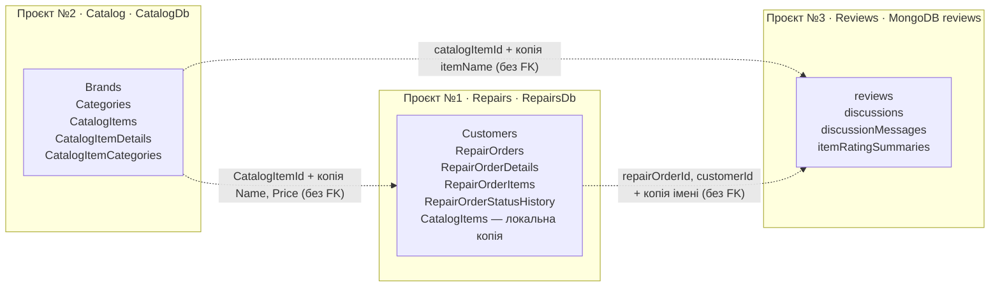
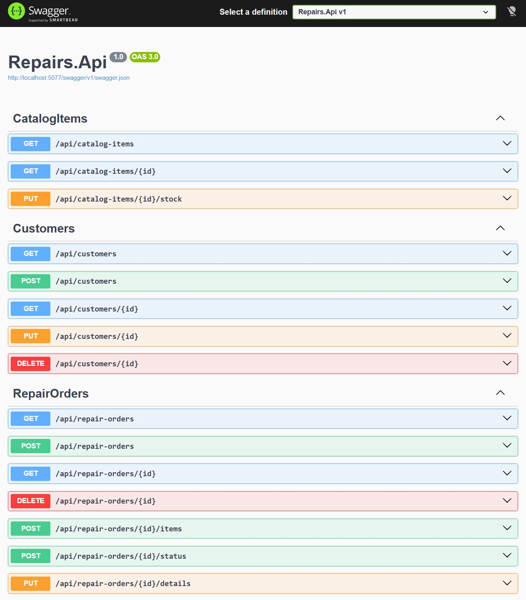
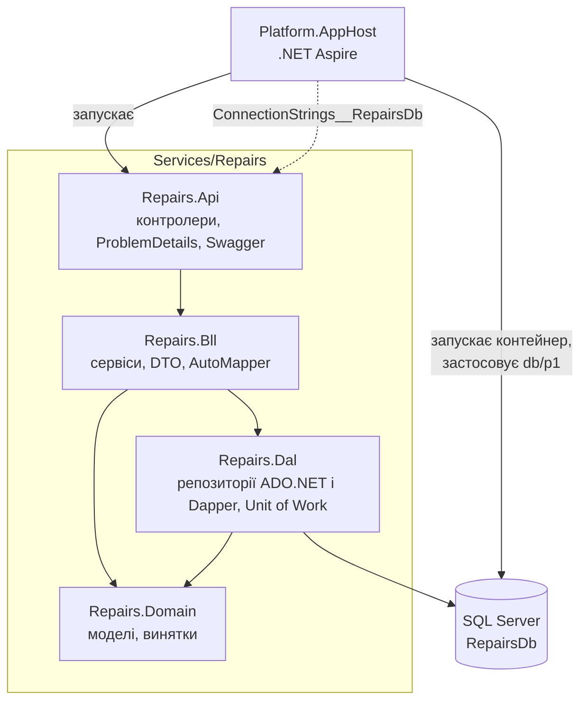

# Сервісний центр з ремонту техніки — платформа мікросервісів

Платформа складається з трьох контекстів однієї предметної області, кожен із власною базою даних —
дві реляційні (SQL Server) та одна документна (MongoDB). Сервіс **Repairs** реалізовано як
тришаровий веб-API на ADO.NET і Dapper; він запускається разом зі своєю базою однією командою
через .NET Aspire.

## Зміст

1. [Предметна область](#предметна-область)
2. [Три контексти та їхні сутності](#три-контексти-та-їхні-сутності)
3. [Структура репозиторію](#структура-репозиторію)
4. [Запуск сервісу Repairs через Aspire](#запуск-сервісу-repairs-через-aspire)
5. [Схема рішення](#схема-рішення)
6. [API сервісу Repairs](#api-сервісу-repairs)
7. [ERD-діаграми](#erd-діаграми)
8. [Таблиця політики дублювання даних](#таблиця-політики-дублювання-даних)
9. [Розгортання баз даних](#розгортання-баз-даних)
10. [Перевірка після розгортання](#перевірка-після-розгортання)
11. [Збережувані процедури Проєкту №1](#збережувані-процедури-проєкту-1)
12. [Безпека та зміни схеми](#безпека-та-зміни-схеми)

## Предметна область

Сервісний центр приймає в ремонт смартфони, ноутбуки та іншу техніку. Приймальник оформлює
замовлення, майстер проводить діагностику, складає кошторис із запчастин і послуг та виконує
ремонт, касир приймає оплату, після чого пристрій видають клієнтові. Система веде замовлення від
приймання до видачі, підтримує каталог запчастин і послуг з цінами та збирає відгуки клієнтів.

## Три контексти та їхні сутності

Кожен контекст (Bounded Context) — окремий мікросервіс із **власною базою даних**. Спільних таблиць
немає, `FOREIGN KEY` між базами немає: на сутність іншого контексту посилається звичайний
стовпець (поле) з її ідентифікатором.

| Проєкт | Контекст | База даних | Технологія | Сутності, якими володіє контекст |
|--------|----------|-----------|------------|----------------------------------|
| №1 | **Repairs** — ремонти | SQL Server, `RepairsDb` | ADO.NET + Dapper, збережувані процедури | `Customer`, `RepairOrder`, `RepairOrderDetails`, `RepairOrderItem`, `RepairOrderStatusHistory`, залишок на складі |
| №2 | **Catalog** — каталог | SQL Server, `CatalogDb` | EF Core, Code First, Fluent API | `Brand`, `Category`, `CatalogItem`, `CatalogItemDetail`, `CatalogItemCategory` |
| №3 | **Reviews** — відгуки | MongoDB, `reviews` | MongoDB Driver, CQRS | `Review` (з вбудованими коментарями), `Discussion`, `DiscussionMessage`, `ItemRatingSummary` |

Кожна сутність належить рівно одному контексту. Позиція каталогу (`CatalogItem`) потрібна всім
трьом, але її власник — лише Catalog: Repairs тримає локальну копію для читання, Reviews —
ідентифікатор і копію назви. Докладно про контексти, агрегати та вибір ключів —
[`docs/contexts.md`](docs/contexts.md).



Пунктир — логічне посилання за ідентифікатором між базами (без `FOREIGN KEY`); справжні зовнішні
ключі існують лише всередині кожної бази.

## Структура репозиторію

```text
README.md                 опис домену, запуск, API, розгортання БД, таблиця дублювання, ERD
Platform.slnx             рішення з усіма проєктами платформи
Platform.AppHost/         оркестрація .NET Aspire: SQL Server, база RepairsDb, сервіс Repairs
Services/
└── Repairs/              сервіс контексту Repairs — ADO.NET + Dapper
    ├── Repairs.Api/      контролери, обробник помилок, Program.cs, appsettings.json
    ├── Repairs.Bll/      сервіси, DTO, профілі AutoMapper, валідація
    ├── Repairs.Dal/      інтерфейси й реалізації репозиторіїв, Unit of Work
    ├── Repairs.Domain/   моделі, константи, доменні винятки
    └── Repairs.Tests/    модульні тести
docker-compose.yml        SQL Server 2025 + MongoDB 9.0 та автоматичний запуск скриптів
.env.example              шаблон паролів (.env у git не потрапляє)
global.json               версія .NET SDK
docs/
├── contexts.md           предметна область, контексти, сутності, агрегати
├── duplication-policy.md політика дублювання та логічні посилання між базами
├── repairs-service.md    сервіс Repairs: шари, транзакції, помилки, валідація
├── erd-p1.md             ERD Проєкту №1: зв'язки, обмеження, індекси
├── erd-p2.md             ERD Проєкту №2: зв'язки, обмеження, індекси
├── p3-mongo-model.md     модель MongoDB: вбудовування, посилання, гібрид
├── p3-documents/         приклади документів MongoDB у форматі JSON
└── img/                  зображення ERD, знімки Swagger і Aspire Dashboard
db/
├── p1/                   Проєкт №1 — RepairsDb
│   ├── schema.sql        таблиці, ключі, обмеження, індекси, view, роль застосунку
│   ├── procedures.sql    6 збережуваних процедур
│   ├── seed.sql          тестові дані (ідемпотентно)
│   └── queries.sql       запити перевірки: CRUD, пошук, пагінація, транзакції
├── p2/                   Проєкт №2 — CatalogDb
│   ├── schema.sql        таблиці, ключі, обмеження, індекси, view
│   ├── seed.sql          довідникові та початкові дані (ідемпотентно)
│   └── queries.sql       запити перевірки: зв'язки, пошук, обмеження
└── p3/                   Проєкт №3 — MongoDB reviews
    ├── collections.js    колекції, JSON Schema-валідація, індекси
    ├── seed.js           тестові документи (ідемпотентно)
    └── queries.js        запити перевірки та aggregation pipeline
```

## Запуск сервісу Repairs через Aspire

Потрібні [.NET SDK 10](https://dotnet.microsoft.com/download) і запущений
[Docker](https://docs.docker.com/get-docker/). Файл `.env` для цього не потрібен.

```bash
dotnet run --project Platform.AppHost
```

Команда піднімає контейнер SQL Server, створює в ньому базу `RepairsDb` зі скриптів
`db/p1/schema.sql`, `procedures.sql`, `seed.sql` і запускає API. У консолі з'являється посилання на
Aspire Dashboard; ресурси `sql`, `RepairsDb` і `repairs-api` мають перейти в стан **Running**.
Перший запуск триває довше: завантажується образ і стартує SQL Server.


| Що | Адреса |
|----|--------|
| Swagger UI | `http://localhost:5077/swagger` |
| API | `http://localhost:5077/api/...` |
| Aspire Dashboard | посилання з консолі (`https://localhost:17028/login?t=...`) |



Ресурс бази в AppHost має ім'я `RepairsDb` — те саме, що й рядок підключення в
`Services/Repairs/Repairs.Api/appsettings.json`, тому Aspire передає його в API змінною оточення
`ConnectionStrings__RepairsDb` без змін у коді сервісу. Пароль SQL Server Aspire генерує сам і
зберігає в секретах користувача.

Дані зберігаються в томі Docker і переживають перезапуск; скрипти ідемпотентні, тож повторний старт
нічого не дублює. Повернутися до початкових даних — зупинити AppHost і видалити том:

```bash
docker volume ls --filter name=sql-data
```

```bash
docker volume rm <назва тому>
```

Запустити API без Aspire, з базою з `docker compose`, можна, перевизначивши рядок підключення
змінною оточення (PowerShell):

```powershell
$env:ConnectionStrings__RepairsDb = "Server=127.0.0.1,1433;Database=RepairsDb;User Id=sa;Password=<SA_PASSWORD>;TrustServerCertificate=True"
dotnet run --project Services/Repairs/Repairs.Api
```

Модульні тести:

```bash
dotnet test Platform.slnx
```

## Схема рішення



- **Repairs.Api** — тонкі асинхронні контролери: приймають DTO, викликають сервіс, повертають статус.
  Винятки перетворює на відповіді один глобальний обробник.
- **Repairs.Bll** — бізнес-правила й транзакційні операції через Unit of Work.
- **Repairs.Dal** — єдине місце із SQL: один репозиторій на чистому ADO.NET (`CustomerRepository`),
  два на Dapper зі спільною базою `BaseDapperRepository<T>` (`RepairOrderRepository`,
  `CatalogItemRepository`), `UnitOfWork` з одним з'єднанням і транзакцією на запит.
- **Repairs.Domain** — моделі таблиць і доменні винятки, спільні для DAL і BLL.

Транзакції, рівень ізоляції, таймаути й перетворення помилок описано в
[`docs/repairs-service.md`](docs/repairs-service.md).

## API сервісу Repairs

| Метод | Шлях | Призначення | Успіх |
|-------|------|-------------|-------|
| GET | `/api/customers?phone=` | клієнти, пошук за телефоном | 200 |
| GET | `/api/customers/{id}` | клієнт | 200 |
| POST | `/api/customers` | створити клієнта | 201 + `Location` |
| PUT | `/api/customers/{id}` | змінити клієнта | 204 |
| DELETE | `/api/customers/{id}` | м'яко видалити клієнта без незавершених замовлень | 204 |
| GET | `/api/catalog-items` | активні позиції локальної копії каталогу | 200 |
| GET | `/api/catalog-items/{id}` | позиція каталогу | 200 |
| PUT | `/api/catalog-items/{id}/stock` | задати залишок на складі | 204 |
| GET | `/api/repair-orders?status=&customerId=&page=&pageSize=` | список замовлень зі сторінками | 200 |
| GET | `/api/repair-orders/{id}` | замовлення з пристроєм, кошторисом та історією статусів | 200 |
| POST | `/api/repair-orders` | прийняти пристрій і скласти кошторис — **одна транзакція** | 201 + `Location` |
| POST | `/api/repair-orders/{id}/items` | додати позицію зі знімком назви й ціни, списати залишок — **одна транзакція** | 201 + `Location` |
| POST | `/api/repair-orders/{id}/status` | змінити статус (`usp_ChangeRepairOrderStatus`) | 204 |
| PUT | `/api/repair-orders/{id}/details` | оновити опис дефекту й діагностику за `rowVersion` | 204 |
| DELETE | `/api/repair-orders/{id}` | м'яко видалити видане або скасоване замовлення | 204 |

Помилки повертаються у форматі ProblemDetails (`application/problem+json`): **400** — некоректні
вхідні дані, **404** — запис не знайдено, **409** — порушено бізнес-правило (недопустимий перехід
статусу, брак залишку, дубль ключа, застарілий `rowVersion`), **500** — непередбачена помилка.

```json
{
  "type": "https://tools.ietf.org/html/rfc9110#section-15.5.10",
  "title": "Conflict",
  "status": 409,
  "detail": "Status transition is not allowed: Approved -> Approved",
  "traceId": "b6e0c2a7a7867fc7d52ff86ec36d2573"
}
```

### Приклади запитів

Приклади розраховано на початкові дані. У PowerShell замість `curl` пишіть `curl.exe`, а тіло запиту
зручніше надсилати через Swagger UI.

Список замовлень у статусі `Diagnosed` і одне замовлення повністю:

```bash
curl "http://localhost:5077/api/repair-orders?status=Diagnosed&page=1&pageSize=10"
```

```bash
curl http://localhost:5077/api/repair-orders/1
```

Створити клієнта (апостроф у прізвищі передається параметром запиту, а не текстом SQL):

```bash
curl -i -X POST http://localhost:5077/api/customers -H "Content-Type: application/json" -d "{\"fullName\":\"Liam O'Brien\",\"email\":\"liam.obrien@example.com\",\"phone\":\"+380991234567\"}"
```

Прийняти пристрій із кошторисом — замовлення, деталі, історія, позиції та списання залишку в одній
транзакції; відповідь `201 Created` із заголовком `Location`:

```bash
curl -i -X POST http://localhost:5077/api/repair-orders -H "Content-Type: application/json" -d "{\"customerId\":2,\"deviceType\":\"Smartphone\",\"deviceBrand\":\"Apple\",\"deviceModel\":\"iPhone 13\",\"defectDescription\":\"Cracked screen\",\"createdBy\":\"reception\",\"items\":[{\"catalogItemId\":6,\"quantity\":1},{\"catalogItemId\":1,\"quantity\":2,\"discount\":100}]}"
```

Відкат транзакції: третьої позиції бракує на складі, тому відповідь `409`, замовлення не створено,
а залишок позиції 2 не змінився:

```bash
curl -i -X POST http://localhost:5077/api/repair-orders -H "Content-Type: application/json" -d "{\"customerId\":2,\"deviceType\":\"Smartphone\",\"deviceModel\":\"iPhone 13\",\"defectDescription\":\"Battery drains quickly\",\"items\":[{\"catalogItemId\":6,\"quantity\":1},{\"catalogItemId\":2,\"quantity\":1},{\"catalogItemId\":1,\"quantity\":99}]}"
```

```bash
curl http://localhost:5077/api/catalog-items/2
```

Погодити кошторис замовлення 3 — `204 No Content`; повторний такий самий запит — `409`:

```bash
curl -i -X POST http://localhost:5077/api/repair-orders/3/status -H "Content-Type: application/json" -d "{\"status\":\"Approved\",\"comment\":\"Approved by phone\",\"changedBy\":\"reception\"}"
```

Додати позицію до замовлення 4:

```bash
curl -i -X POST http://localhost:5077/api/repair-orders/4/items -H "Content-Type: application/json" -d "{\"catalogItemId\":5,\"quantity\":2,\"addedBy\":\"master.ivan\"}"
```

Неіснуючий ідентифікатор — `404 Not Found`:

```bash
curl -i http://localhost:5077/api/repair-orders/999
```

Видалити незавершене замовлення не можна — `409`; скасоване замовлення 5 видаляється з `204`:

```bash
curl -i -X DELETE http://localhost:5077/api/repair-orders/4
```

```bash
curl -i -X DELETE http://localhost:5077/api/repair-orders/5
```

## ERD-діаграми

### Проєкт №1 — RepairsDb


| Тип | Зв'язок | Реалізація |
|-----|---------|------------|
| 1:1 | `RepairOrders` ↔ `RepairOrderDetails` | FK є водночас PK залежної таблиці |
| 1:N | `Customers` → `RepairOrders`, `RepairOrders` → `RepairOrderStatusHistory` | FK на боці «багатьох» |
| M:N | `RepairOrders` ↔ `CatalogItems` | проміжна таблиця `RepairOrderItems` з двома FK |

Ключі, обмеження, індекси із запитами та діаграма Mermaid — [`docs/erd-p1.md`](docs/erd-p1.md).

### Проєкт №2 — CatalogDb


| Тип | Зв'язок | Реалізація |
|-----|---------|------------|
| 1:1 | `CatalogItems` ↔ `CatalogItemDetails` | FK є водночас PK залежної таблиці |
| 1:N | `Brands` → `CatalogItems`, `Categories` → `Categories` | FK на боці «багатьох» |
| M:N | `CatalogItems` ↔ `Categories` | проміжна сутність `CatalogItemCategories` з власними полями `AddedAt`, `IsPrimary` |

Докладно — [`docs/erd-p2.md`](docs/erd-p2.md).

### Проєкт №3 — MongoDB

Структура колекцій, вбудовування, посилання й гібридний підхід — [`docs/p3-mongo-model.md`](docs/p3-mongo-model.md);
приклади документів — [`docs/p3-documents/`](docs/p3-documents/).

## Таблиця політики дублювання даних

Дублювання між базами свідоме: воно прибирає синхронні міжсервісні виклики під час читання.
**Знімок** фіксується в момент події й не оновлюється; **копія для читання** оновлюється подіями від
сервісу-власника. У кожного поля рівно один власник.

| № | Поле (дублікат) | Де зберігається | Джерело (власник даних) | Політика узгодженості |
|---|-----------------|-----------------|-------------------------|----------------------|
| 1 | `RepairOrderItems.ItemName`, `UnitPrice` | `RepairsDb` | `CatalogItems.Name`, `Price` — Catalog | **знімок** на момент додавання позиції до кошторису — не оновлюється |
| 2 | `CatalogItems.Name`, `ItemType`, `Price`, `IsActive` (локальна копія довідника) | `RepairsDb` | `CatalogItems` — Catalog | **оновлюється подіями** з Каталогу |
| 3 | `reviews.itemName`, `discussions.itemName`, `itemRatingSummaries.itemName` | `reviews` (MongoDB) | `CatalogItems.Name` — Catalog | **оновлюється подіями** з Каталогу |
| 4 | `reviews.author.displayName`, `discussions.startedBy.displayName`, `discussionMessages.author.displayName` | `reviews` (MongoDB) | `Customers.FullName` — Repairs | **оновлюється подіями** з Repairs |
| 5 | `reviews.device` (`type`, `brand`, `model`) | `reviews` (MongoDB) | `RepairOrderDetails` — Repairs | **знімок** на момент створення відгуку — не оновлюється |
| 6 | `reviews.usedItems[].itemName` | `reviews` (MongoDB) | `RepairOrderItems.ItemName` — Repairs | **знімок** на момент створення відгуку — не оновлюється |

Ідентифікатори чужих сутностей (`RepairsDb.CatalogItems.Id`, `catalogItemId`, `repairOrderId`,
`customerId`) — звичайні стовпці та поля без `FOREIGN KEY` на іншу базу. Залишок на складі
(`RepairsDb.dbo.CatalogItems.Stock`) дублікатом не є: його єдиний власник — Repairs, у `CatalogDb`
цього поля немає. Пояснення та перелік логічних посилань — [`docs/duplication-policy.md`](docs/duplication-policy.md).

## Розгортання баз даних

Потрібен лише [Docker](https://docs.docker.com/get-docker/) з Docker Compose. Встановлювати SQL Server,
MongoDB, `sqlcmd` чи `mongosh` окремо не треба — усе є в контейнерах.

| Сервіс | Образ | Адреса з хоста |
|--------|-------|----------------|
| SQL Server (бази `RepairsDb`, `CatalogDb`) | `mcr.microsoft.com/mssql/server:2025-latest` | `127.0.0.1,1433` |
| MongoDB (база `reviews`) | `mongo:9.0` | `127.0.0.1:27017` |

### Крок 1. Задати паролі

Скопіюйте шаблон і задайте власні паролі у файлі `.env`:

```bash
cp .env.example .env
```

Пароль SQL Server має містити щонайменше 8 символів: великі й малі літери, цифри та спецсимвол.

### Крок 2. Розгорнути всі три бази

```bash
docker compose up -d
```

Команда запускає SQL Server і MongoDB, чекає на їхню готовність і виконує скрипти в такому порядку:

1. `db/p1/schema.sql` — створює `RepairsDb`, таблиці, ключі, обмеження, індекси;
2. `db/p1/procedures.sql` — створює 6 збережуваних процедур;
3. `db/p1/seed.sql` — тестові дані Проєкту №1;
4. `db/p2/schema.sql` — створює `CatalogDb`, таблиці, ключі, обмеження, індекси;
5. `db/p2/seed.sql` — довідникові та початкові дані Проєкту №2;
6. `db/p3/collections.js` — колекції, валідація та індекси MongoDB;
7. `db/p3/seed.js` — тестові документи Проєкту №3.

Переконатися, що скрипти відпрацювали без помилок:

```bash
docker logs sc-sql-init
docker logs sc-mongo-init
```

Останні рядки журналів — `>>> SQL-бази розгорнуто` та `>>> MongoDB-базу розгорнуто`.

### Розгортання вручну, крок за кроком

Те саме можна виконати окремими командами (наприклад, щоб застосувати один змінений скрипт).
Замініть `<SA_PASSWORD>` і `<MONGO_PASSWORD>` значеннями з `.env`.

```bash
# 1) запустити лише сервери баз даних
docker compose up -d sqlserver mongo

# 2) Проєкт №1 — RepairsDb: схема -> процедури -> тестові дані
docker exec sc-sqlserver /opt/mssql-tools18/bin/sqlcmd -S localhost -U sa -P "<SA_PASSWORD>" -C -b -I -i /db/p1/schema.sql
docker exec sc-sqlserver /opt/mssql-tools18/bin/sqlcmd -S localhost -U sa -P "<SA_PASSWORD>" -C -b -I -i /db/p1/procedures.sql
docker exec sc-sqlserver /opt/mssql-tools18/bin/sqlcmd -S localhost -U sa -P "<SA_PASSWORD>" -C -b -I -i /db/p1/seed.sql

# 3) Проєкт №2 — CatalogDb: схема -> початкові дані
docker exec sc-sqlserver /opt/mssql-tools18/bin/sqlcmd -S localhost -U sa -P "<SA_PASSWORD>" -C -b -I -i /db/p2/schema.sql
docker exec sc-sqlserver /opt/mssql-tools18/bin/sqlcmd -S localhost -U sa -P "<SA_PASSWORD>" -C -b -I -i /db/p2/seed.sql

# 4) Проєкт №3 — MongoDB reviews: колекції та індекси -> тестові документи
docker exec sc-mongo mongosh --quiet -u root -p "<MONGO_PASSWORD>" --authenticationDatabase admin --file /db/p3/collections.js --file /db/p3/seed.js
```

У Git Bash на Windows додайте перед командами `MSYS_NO_PATHCONV=1`, щоб шляхи `/db/...` та `/opt/...`
не перетворювалися на Windows-шляхи; у PowerShell і `cmd` команди працюють без змін.

### Без Docker: наявні SQL Server і MongoDB

Скрипти не залежать від Docker. Для власних серверів виконайте їх у тому самому порядку:

```bash
sqlcmd -S 127.0.0.1,1433 -U sa -P "<SA_PASSWORD>" -C -b -I -f 65001 -i db/p1/schema.sql
sqlcmd -S 127.0.0.1,1433 -U sa -P "<SA_PASSWORD>" -C -b -I -f 65001 -i db/p1/procedures.sql
sqlcmd -S 127.0.0.1,1433 -U sa -P "<SA_PASSWORD>" -C -b -I -f 65001 -i db/p1/seed.sql
sqlcmd -S 127.0.0.1,1433 -U sa -P "<SA_PASSWORD>" -C -b -I -f 65001 -i db/p2/schema.sql
sqlcmd -S 127.0.0.1,1433 -U sa -P "<SA_PASSWORD>" -C -b -I -f 65001 -i db/p2/seed.sql
mongosh "mongodb://127.0.0.1:27017" --file db/p3/collections.js --file db/p3/seed.js
```

Параметр `-f 65001` обов'язковий у Windows: файли збережено в UTF-8, без нього кирилиця в тестових
даних зіпсується. `-I` вмикає `QUOTED_IDENTIFIER`, `-b` зупиняє виконання на першій помилці.
Бази `RepairsDb` і `CatalogDb` створюються самими скриптами `schema.sql`.

### Повторний запуск і розгортання з нуля

Усі скрипти ідемпотентні: схема створюється через `IF ... IS NULL` / `CREATE OR ALTER`, а seed-скрипти
перед кожною вставкою перевіряють наявність запису (`WHERE NOT EXISTS` у SQL, `upsert` з
`$setOnInsert` у MongoDB). Повторний `docker compose up -d` або повторне виконання будь-якого
скрипта не створює дублікатів — кількість рядків і документів лишається тією самою.

Видалити бази разом із даними й розгорнути наново:

```bash
docker compose down -v
docker compose up -d
```

## Перевірка після розгортання

### Запити перевірки

```bash
docker exec sc-sqlserver /opt/mssql-tools18/bin/sqlcmd -S localhost -U sa -P "<SA_PASSWORD>" -C -I -W -i /db/p1/queries.sql
docker exec sc-sqlserver /opt/mssql-tools18/bin/sqlcmd -S localhost -U sa -P "<SA_PASSWORD>" -C -I -W -i /db/p2/queries.sql
docker exec sc-mongo mongosh --quiet -u root -p "<MONGO_PASSWORD>" --authenticationDatabase admin --file /db/p3/queries.js
```

Скрипти дані не змінюють: сценарії із записом виконуються в транзакції з відкотом або на
тимчасовому документі.

### Що має вийти

| Перевірка | Як виконати | Очікуваний результат |
|-----------|-------------|----------------------|
| Немає FK за межі бази | `sys.foreign_keys` у `RepairsDb` (п. 13 у `p1/queries.sql`) і в `CatalogDb` (п. 6 у `p2/queries.sql`) | по 5 ключів, усі між таблицями тієї ж бази |
| Недопустимий перехід статусу | `EXEC dbo.usp_ChangeRepairOrderStatus @RepairOrderId = 2, @NewStatus = N'Issued'` (п. 8) | помилка `50002 Status transition is not allowed: Ready -> Issued`, статус лишається `Ready` |
| Оптимістична конкурентність | п. 11 у `p1/queries.sql` | другий запис зі старим `RowVersion` — помилка `50008` |
| Знімок ціни не оновлюється | п. 6 у `p1/queries.sql` | у замовленні 1 екран коштує 3900.00, у довіднику — 4200.00 |
| Індекси та обмеження | п. 12 і 14 у `p1/queries.sql`, п. 5 і 7 у `p2/queries.sql` | `CHECK`, `UNIQUE`, `FK` відхиляють некоректні дані; перелік індексів із фільтрами |
| Гнучка схема MongoDB | `db.reviews.find()` (п. 1 у `queries.js`) | 7 документів із різними наборами полів |
| Валідація MongoDB | п. 12 у `queries.js` | оцінка 9, відгук без обов'язкових полів і дубль відгуку на замовлення відхилено |
| Ідемпотентність seed | повторити `docker compose up -d` | `inserted 0, already existed N`; кількість рядків у SQL та сама |

Кількість записів після seed:

| База | Таблиця / колекція | Записів |
|------|--------------------|---------|
| `RepairsDb` | `Customers` / `CatalogItems` / `RepairOrders` / `RepairOrderDetails` / `RepairOrderItems` / `RepairOrderStatusHistory` | 4 / 10 / 5 / 5 / 8 / 18 |
| `CatalogDb` | `Brands` / `Categories` / `CatalogItems` / `CatalogItemDetails` / `CatalogItemCategories` | 5 / 11 / 10 / 10 / 15 |
| `reviews` | `reviews` / `discussions` / `discussionMessages` / `itemRatingSummaries` | 7 / 2 / 6 / 4 |

Підключення графічними інструментами (SSMS, Azure Data Studio, MongoDB Compass): SQL Server —
`127.0.0.1,1433`, логін `sa`; MongoDB — `mongodb://root:<MONGO_PASSWORD>@127.0.0.1:27017/?authSource=admin`.

## Збережувані процедури Проєкту №1

| № | Процедура | Призначення | Операція |
|---|-----------|-------------|----------|
| 1 | `usp_CreateRepairOrder` | приймання пристрою: замовлення, деталі й перший запис історії в одній транзакції | Create |
| 2 | `usp_AddRepairOrderItem` | додає запчастину або послугу зі знімком назви й ціни, списує залишок | Create / Update |
| 3 | `usp_ChangeRepairOrderStatus` | **транзакційна зміна статусу** з перевіркою допустимості переходу | Update |
| 4 | `usp_GetRepairOrderById` | повертає замовлення з деталями, позиціями та історією (3 набори результатів) | Read |
| 5 | `usp_UpdateRepairOrderDetails` | оновлення з оптимістичною конкурентністю за `RowVersion` | Update |
| 6 | `usp_SoftDeleteRepairOrder` | м'яке видалення завершеного замовлення | Delete |

Життєвий цикл замовлення:
`Accepted → Diagnosed → Approved → InRepair → Ready → Paid → Issued`; скасування (`Cancelled`) —
лише зі статусів `Accepted`, `Diagnosed`, `Approved`, тобто до початку ремонту.

`usp_ChangeRepairOrderStatus` працює в явній транзакції (`BEGIN TRANSACTION` … `COMMIT`,
`SET XACT_ABORT ON`), блокує рядок замовлення (`UPDLOCK`), звіряє перехід із матрицею допустимих
і на будь-якому іншому відмовляє керованою помилкою `THROW 50002` — зміни відкочуються. Не можна
видати неоплачений пристрій, перескочити етап чи скасувати ремонт, що вже триває.

Керовані помилки процедур: `50001` замовлення не знайдено · `50002` недопустимий перехід статусу ·
`50003` порожній кошторис · `50004` клієнта не знайдено · `50005` позиції не можна змінювати в цьому
статусі · `50006` позиції каталогу не знайдено · `50007` бракує залишку · `50008` конфлікт
конкурентності · `50009` видаляти можна лише завершені замовлення · `50010` некоректний аргумент.

## Безпека та зміни схеми

**Найменші привілеї.** Застосунки не працюють під `sa`. У кожній SQL-базі є власна роль
(`repairs_app`, `catalog_app`) з правами лише на свою базу; роль `repairs_app` не може фізично
видаляти рядки й змінювати схему. Логін сервісу створюється окремо для кожної бази:

```sql
CREATE LOGIN repairs_service WITH PASSWORD = '<пароль сервісу>';
USE RepairsDb;
CREATE USER repairs_service FOR LOGIN repairs_service;
ALTER ROLE repairs_app ADD MEMBER repairs_service;
```

Сервіс Repairs сумісний із цією роллю: він не виконує `DELETE` і не змінює схему. Під час
локального запуску через Aspire API підключається обліковим записом, який Aspire створює для
контейнера; у розгорнутому середовищі в рядку підключення вказують логін сервісу.

**Аудит, м'яке видалення, конкурентність.** Таблиці мають `CreatedAt`, `CreatedBy`, `UpdatedAt`,
`UpdatedBy`, `IsDeleted`; там, де один рядок можуть одночасно змінювати двоє користувачів, —
`RowVersion` (`ROWVERSION`). У MongoDB ту саму роль виконують `createdAt`, `updatedAt`, `isDeleted`
і ціле поле `version`.

**Версіонування схем.** Спільних схем між сервісами немає; скрипти кожної бази лежать у власній
теці `db/pN/`. Ревізії SQL-схем фіксуються в таблиці `dbo.SchemaVersions`; схему `CatalogDb` надалі
вестимуть міграції EF Core. Структуру документів MongoDB контролює JSON Schema-валідатор,
який `collections.js` оновлює командою `collMod` без втрати даних.
