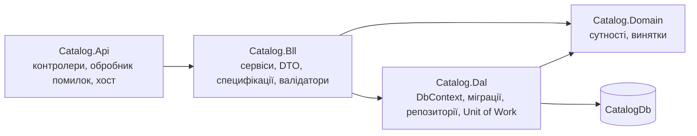

# Сервіс Catalog

Веб-API контексту Catalog: позиції каталогу (запчастини й послуги), їхні описи, бренди та дерево
категорій. Працює з базою `CatalogDb` через Entity Framework Core: модель описано в коді, схему
створюють міграції, запити пишуться на LINQ to Entities.

## Шари та залежності

Залежності спрямовані в один бік. Контролер звертається лише до сервісу, сервіс — лише до Unit of
Work; `CatalogDbContext` використовують тільки `Catalog.Dal` і стартовий код у `Program.cs`
(реєстрація, застосування міграцій, початкове наповнення).

| Проєкт | Вміст |
|--------|-------|
| `Catalog.Api` | контролери, `GlobalExceptionHandler`, `Program.cs`, `appsettings.json` |
| `Catalog.Bll` | сервіси та їхні інтерфейси, DTO, профілі AutoMapper, специфікації, валідатори FluentValidation |
| `Catalog.Dal` | `CatalogDbContext`, `Configurations/`, `Migrations/`, репозиторії, `UnitOfWork`, `Seeding/DbInitializer` |
| `Catalog.Domain` | сутності з бізнес-правилами, `DomainException`, `EntityNotFoundException`, `ConflictException`, `ValidationException` |
| `Catalog.Tests` | модульні тести сутностей, сервісів, специфікацій, валідаторів і мапінгу |

## Модель

Сутності не мають відкритих setter-ів: стан задається в конструкторі та змінюється лише методами,
які перевіряють правила й кидають `DomainException`.

| Сутність | Правила, які перевіряє сама сутність |
|----------|--------------------------------------|
| `CatalogItem` | ціна більша за нуль (`ChangePrice`); послуга не має бренду (`AssignBrand`); тривалість виконання задається лише для послуг (`Describe`); основна категорія одна (`AssignCategory`); видалену позицію не можна активувати (`Activate`); видалення м'яке (`MarkDeleted`) |
| `CatalogItemDetail` | гарантія від 0 до 60 місяців; тривалість додатна; характеристики — JSON-об'єкт |
| `Category` | slug без пробілів; порядок показу невід'ємний; категорія не може бути власною батьківською (`MoveTo`) |
| `Brand` | назва обов'язкова й не довша за 100 символів |
| `CatalogItemCategory` | створюється і змінюється лише через `CatalogItem.AssignCategory` |

| Тип | Зв'язок | Налаштування |
|-----|---------|--------------|
| 1:1 | `CatalogItem` ↔ `CatalogItemDetail` | `HasOne().WithOne().HasForeignKey<CatalogItemDetail>()`; ключ опису є водночас зовнішнім; каскад |
| 1:N | `Brand` → `CatalogItem`, `Category` → `Category` | `HasOne().WithMany()`; видалення заборонено, поки є залежні рядки |
| M:N | `CatalogItem` ↔ `Category` | явна проміжна сутність `CatalogItemCategory` зі складеним ключем і власними полями `AddedAt`, `IsPrimary`; каскад з обох боків |

Кожна сутність має окремий клас `IEntityTypeConfiguration<T>` у `Catalog.Dal/Configurations`;
`CatalogDbContext.OnModelCreating` підключає їх усі через `ApplyConfigurationsFromAssembly`.
Видалені позиції приховує глобальний фільтр `HasQueryFilter(i => !i.IsDeleted)`; такий самий фільтр
мають залежні від позиції опис і зв'язки з категоріями.

## Доступ до даних

`GenericRepository<TEntity, TKey>` працює через `DbSet<TEntity>`: `GetByIdAsync`, `GetAllAsync`,
`AddAsync` і запити за специфікацією (`ListAsync`, `FirstOrDefaultAsync`, `CountAsync`, `AnyAsync`)
асинхронні; `Update` і `Delete` лише змінюють стан сутності в контексті. Жоден репозиторій не
викликає збереження.

| Репозиторій | Запит | Спосіб завантаження |
|-------------|-------|---------------------|
| `CatalogItemRepository` | `GetWithDetailsAsync` — позиція з брендом, описом і категоріями | **eager loading**: `Include` / `ThenInclude`, один SQL-запит із `JOIN` |
| `CategoryRepository` | `GetWithItemsAsync` — категорія з її позиціями | **explicit loading**: спершу категорія, потім `Entry(category).Collection(...).Query().Include(...).LoadAsync()` — два запити |
| `CatalogItemCategoryRepository` | `GetRecentlyAddedAsync` — позиції, додані до категорії після дати | **LINQ to Entities** по проміжній сутності: фільтр за `Category.Slug` і власним полем `AddedAt`, сортування за `AddedAt`, проєкція в `CatalogItem` |

Бренди не мають власних запитів і обслуговуються узагальненим репозиторієм.

### Unit of Work

`UnitOfWork` створюється один на HTTP-запит і надає всі репозиторії поверх спільного
`CatalogDbContext`. Сервіс викликає `SaveChangesAsync` один раз наприкінці операції, тож усі зміни
потрапляють у базу однією транзакцією. Там само помилки бази перетворюються на доменні винятки:
порушення унікального індексу чи обмеження та конфлікт `RowVersion` стають `ConflictException`.

## Специфікації

Умови вибірки винесено із сервісів у класи `Specification<T>` (Ardalis.Specification) у
`Catalog.Bll/Specifications`. Специфікація описує `Where`, `Include`, `OrderBy`, `Skip`, `Take` і не
залежить від EF Core, тому перевіряється модульними тестами на звичайному списку. Репозиторій
застосовує будь-яку специфікацію однаково — `Set.WithSpecification(specification)`, а для
підрахунку бере з неї лише умови фільтрації.

| Специфікація | Що описує |
|--------------|-----------|
| `CatalogItemsFilterSpec` | сторінка списку позицій: пошук, тип, бренд, категорія, діапазон ціни, активність, сортування, `Skip`/`Take`, завантаження бренду |
| `CategoriesFilterSpec`, `BrandsFilterSpec` | сторінки списків категорій і брендів |
| `BrandByNameSpec`, `CategoryDuplicateSpec` | перевірка унікальності назви бренду, назви та slug категорії |
| `CategoryBySlugSpec`, `CategoryChildrenSpec` | категорія за slug; підкатегорії заданої категорії |
| `CatalogItemsByBrandSpec` | позиції бренду, включно з м'яко видаленими (`IgnoreQueryFilters`) |

## Пагінація

Запит списку приймає `page` (з 1) і `pageSize` (типово 20, не більше 100 — більші значення
зменшуються). Сервіс двічі звертається до репозиторію з однією специфікацією: `CountAsync` рахує
всі записи, що відповідають фільтрам, `ListAsync` повертає одну сторінку. Обидва запити виконує
SQL Server: фільтри стають `WHERE`, сортування — `ORDER BY`, сторінка — `OFFSET … FETCH`.
Сортувати можна лише за переліченими полями; невідоме значення відхиляє валідатор.

Відповідь — `PagedResult<T>`: `items`, `totalCount`, `page`, `pageSize`, `totalPages`, `hasNext`,
`hasPrevious`. Ті самі метадані дублюються в заголовку `X-Pagination`.

## Де перевіряється кожне правило

| Правило | Де перевіряється | Відповідь |
|---------|------------------|-----------|
| обов'язковість, довжина рядка, діапазон числа | атрибути DataAnnotations на DTO | 400 |
| формат SKU і slug, точність ціни, послуга без бренду, тривалість лише для послуг, `minPrice ≤ maxPrice`, дозволені поля сортування, характеристики як JSON-об'єкт | валідатори FluentValidation у `Catalog.Bll/Validation` | 400 |
| вказаний бренд або батьківська категорія існують | сервіс (потрібна база) | 400 |
| SKU, назва бренду, назва й slug категорії унікальні | сервіс (потрібна база) | 409 |
| бренд не використовується, категорія не має підкатегорій, немає циклу в дереві | сервіс (потрібна база) | 409 |
| інваріанти сутності (ціна, одна основна категорія тощо) | сутність | 409 |
| запис існує | сервіс | 404 |

Правила не дублюються між DataAnnotations і FluentValidation. Валідатори зареєстровано через
`AddValidatorsFromAssemblyContaining`, а викликає їх контролер явно; автоматичне підключення
FluentValidation до конвеєра MVC не використовується. Унікальні індекси та `CHECK`-обмеження бази —
останній рубіж: якщо два запити одночасно пройдуть перевірку сервісу, другий отримає 409 від бази.

## Обробка помилок

Винятки перехоплює один `GlobalExceptionHandler` (`IExceptionHandler` + `AddProblemDetails`).

| Виняток | Статус | Формат |
|---------|--------|--------|
| `EntityNotFoundException` | 404 | `ProblemDetails` |
| `ValidationException` | 400 | `ValidationProblemDetails` з помилками за полями |
| `ConflictException`, `DomainException` | 409 | `ProblemDetails` |
| будь-який інший | 500 | `ProblemDetails` |

Текст доменного винятку безпечний для клієнта й повертається в `detail`. Для непередбаченої помилки
поза середовищем `Development` повертається лише загальне повідомлення; у `Development` додаються
текст винятку та стек. Обробник записує кожен виняток у журнал один раз: очікувані відмови —
рівнем `Warning`, непередбачені — рівнем `Error` разом зі стеком.

## Журнал

Журнал, трасування й кореляцію запитів дає `Platform.ServiceDefaults` (див.
[`platform.md`](platform.md)): `builder.AddServiceDefaults()` підключає Serilog і OpenTelemetry, а
спільний `CorrelationIdMiddleware` бере ідентифікатор із заголовка `X-Correlation-Id` (або створює
новий), додає його до контексту журналу й повертає в заголовку відповіді; `Program.cs` додає його ж
у тіло `ProblemDetails`. Розділ `Serilog` в `appsettings.json` містить лише налаштування Catalog:
файловий приймач і рівень `Information` для категорії `Microsoft.EntityFrameworkCore.Database.Command`,
тому в журналі видно кожну SQL-команду. Бізнес-операції з позиціями (створення, зміна, зміна ціни)
мають власні spans `ActivitySource` `Catalog.Bll`.

## Початкові дані

| Спосіб | Дані | Коли виконується |
|--------|------|------------------|
| `HasData` у конфігураціях | 5 брендів, 11 категорій із фіксованими Id | у складі міграції `InitialCreate` |
| `DbInitializer.SeedAsync` | 10 позицій з описами та 15 зв'язків із категоріями | після `MigrateAsync()`, якщо таблиця позицій порожня; не виконується в `Production` |

Позиції створюються конструкторами й методами сутностей, тобто проходять ті самі перевірки, що й
дані з API. Їхні Id 1..10 задаються явно, бо на них посилаються `RepairsDb` і MongoDB.

## Тести

`dotnet test Platform.slnx` запускає модульні тести обох сервісів. Тести Catalog перевіряють правила
сутностей, сервіси на підставному Unit of Work (конфлікти, відсутні записи, одне збереження на
операцію, обмеження розміру сторінки), специфікації на списку в пам'яті, валідатори та
конфігурацію AutoMapper.
