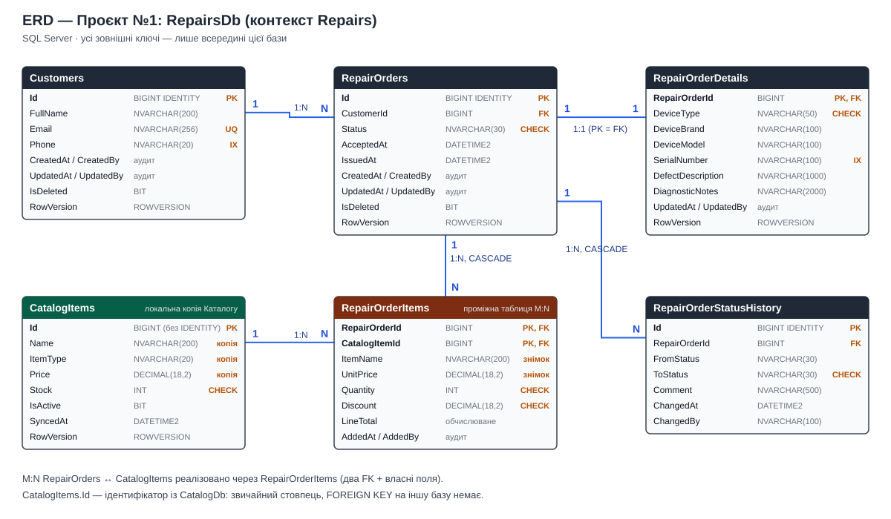
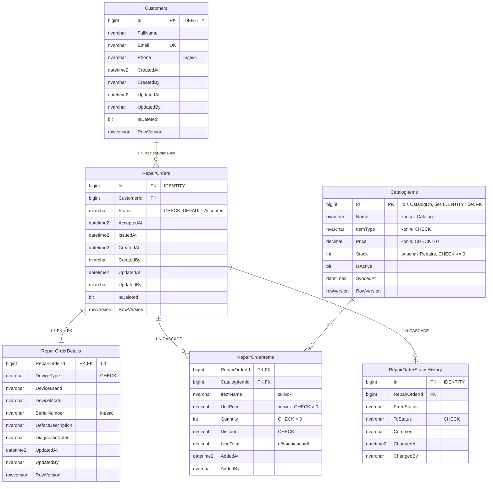
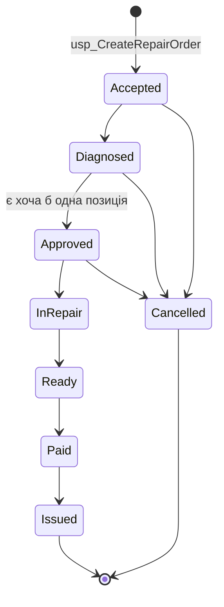

# ERD — Проєкт №1: RepairsDb (контекст Repairs)

SQL Server. DDL — [`db/p1/schema.sql`](../db/p1/schema.sql), процедури — [`db/p1/procedures.sql`](../db/p1/procedures.sql).

Формат Mermaid:

## Типи зв'язків

| Тип | Зв'язок | Як реалізовано | ON DELETE |
|-----|---------|----------------|-----------|
| **1:1** | `RepairOrders` ↔ `RepairOrderDetails` | `RepairOrderDetails.RepairOrderId` — водночас PK і FK | `CASCADE`: деталі не існують без замовлення |
| **1:N** | `Customers` → `RepairOrders` | FK `RepairOrders.CustomerId` на боці «багатьох» | `NO ACTION`: клієнта з історією ремонтів видалити не можна |
| **1:N** | `RepairOrders` → `RepairOrderStatusHistory` | FK `RepairOrderStatusHistory.RepairOrderId` | `CASCADE` |
| **M:N** | `RepairOrders` ↔ `CatalogItems` | проміжна таблиця `RepairOrderItems` з двома FK, складеним PK і власними полями | від замовлення — `CASCADE`, від позиції довідника — `NO ACTION` |

## Обмеження

| Вид | Де |
|-----|----|
| `PRIMARY KEY` | усі таблиці; складений — `RepairOrderItems (RepairOrderId, CatalogItemId)` |
| `FOREIGN KEY` | 5 ключів, усі — в межах `RepairsDb` |
| `UNIQUE` | `Customers.Email` |
| `CHECK` | статуси замовлення й історії, тип пристрою, тип позиції, `Price > 0`, `Stock >= 0`, `UnitPrice > 0`, `Quantity > 0`, `0 <= Discount <= UnitPrice * Quantity`, `IssuedAt >= AcceptedAt`, формат `Email`, довжина `Phone` |
| `DEFAULT` | `Status = 'Accepted'`, дати `SYSUTCDATETIME()`, `IsDeleted = 0`, `Stock = 0`, `IsActive = 1`, `Discount = 0` |

## Індекси та запити, під які їх створено

| Індекс | Вид | Запит |
|--------|-----|-------|
| `IX_RepairOrders_CustomerId_Status` | покриваючий, фільтрований (`IsDeleted = 0`) | активні замовлення клієнта з певним статусом |
| `IX_RepairOrders_Status_AcceptedAt` | покриваючий, фільтрований (`IsDeleted = 0`) | «черга майстра»: замовлення в заданому статусі від найстаріших |
| `IX_Customers_Phone` | покриваючий, фільтрований (`IsDeleted = 0`) | пошук клієнта за телефоном на рецепції |
| `IX_RepairOrderDetails_SerialNumber` | фільтрований (`SerialNumber IS NOT NULL`) | чи був пристрій із цим серійним номером у ремонті раніше |
| `IX_RepairOrderItems_CatalogItemId` | покриваючий | у яких замовленнях використано запчастину і скільки її списано |
| `IX_RepairOrderStatusHistory_RepairOrderId_ChangedAt` | складений | хронологія статусів одного замовлення |

## Життєвий цикл замовлення

Будь-який інший перехід `usp_ChangeRepairOrderStatus` відхиляє помилкою `50002`
(наприклад, `Ready → Issued` — видати неоплачений пристрій).
