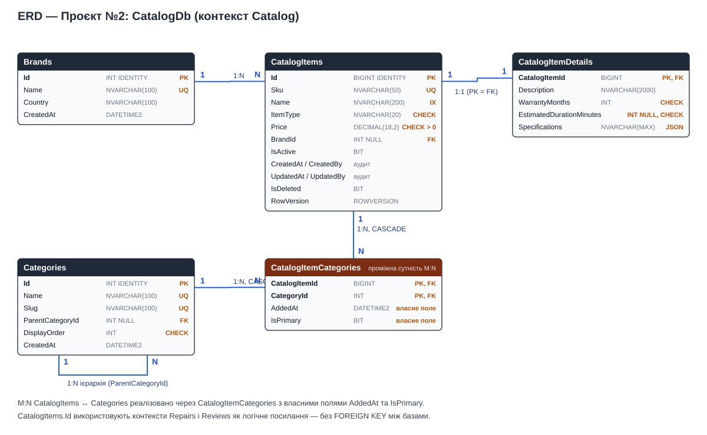
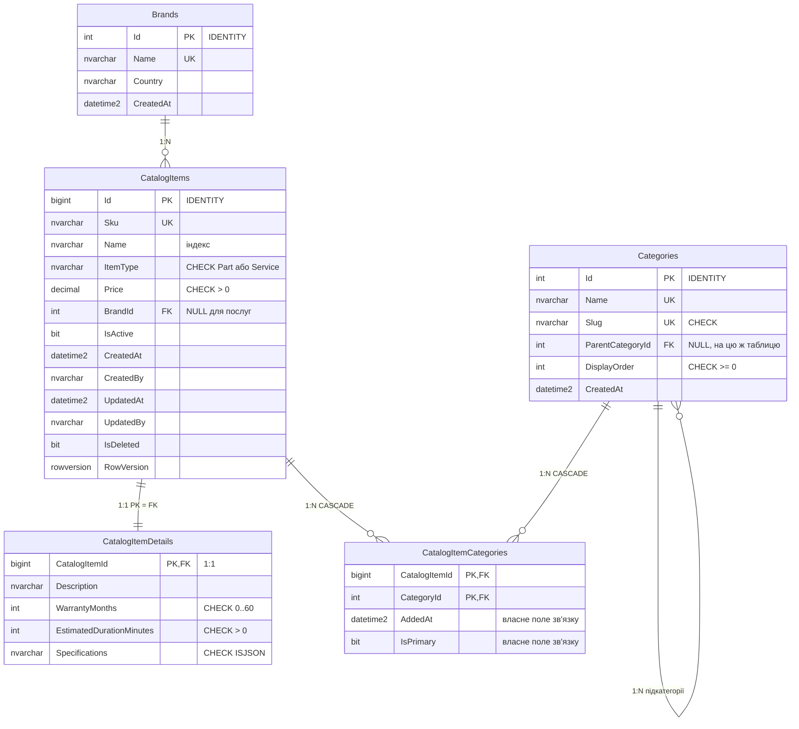

# ERD — Проєкт №2: CatalogDb (контекст Catalog)

SQL Server. На цьому етапі спроєктовано схему — [`db/p2/schema.sql`](../db/p2/schema.sql).

Формат Mermaid:

## Сутності (5)

| Сутність | Таблиця | Призначення |
|----------|---------|-------------|
| `Brand` | `Brands` | довідник брендів |
| `Category` | `Categories` | довідник категорій з ієрархією |
| `CatalogItem` | `CatalogItems` | позиція каталогу: запчастина або послуга (корінь агрегату) |
| `CatalogItemDetail` | `CatalogItemDetails` | розширений опис, гарантія, характеристики |
| `CatalogItemCategory` | `CatalogItemCategories` | проміжна сутність M:N з власними полями |

Службова таблиця `__EFMigrationsHistory` (перелік застосованих міграцій EF Core) сутністю домену не є.
В еталонному скрипті `db/p2/schema.sql` ту саму роль виконує `SchemaVersions`.

## Типи зв'язків

| Тип | Зв'язок | Як реалізовано | ON DELETE |
|-----|---------|----------------|-----------|
| **1:1** | `CatalogItems` ↔ `CatalogItemDetails` | `CatalogItemDetails.CatalogItemId` — водночас PK і FK | `CASCADE` |
| **1:N** | `Brands` → `CatalogItems` | FK `CatalogItems.BrandId` (необов'язковий: у послуг бренду немає) | `NO ACTION` |
| **1:N** | `Categories` → `Categories` | FK `ParentCategoryId` на ту саму таблицю | `NO ACTION` |
| **M:N** | `CatalogItems` ↔ `Categories` | проміжна сутність `CatalogItemCategories`: два FK, складений PK, власні поля `AddedAt` та `IsPrimary` | обидва — `CASCADE` |

## Обмеження

| Вид | Де |
|-----|----|
| `PRIMARY KEY` | усі таблиці; складений — `CatalogItemCategories (CatalogItemId, CategoryId)` |
| `FOREIGN KEY` | 5 ключів, усі — в межах `CatalogDb` |
| `UNIQUE` | `CatalogItems.Sku`, `Brands.Name`, `Categories.Name`, `Categories.Slug`; унікальний фільтрований індекс «одна основна категорія на позицію» |
| `CHECK` | `Price > 0`, `ItemType IN ('Part','Service')`, послуга без бренду, `WarrantyMonths` 0..60, `EstimatedDurationMinutes > 0`, `ISJSON(Specifications)`, `Slug` без пробілів, `DisplayOrder >= 0`, категорія не є власним батьком |
| `DEFAULT` | `IsActive = 1`, `IsDeleted = 0`, `WarrantyMonths = 0`, `DisplayOrder = 0`, `IsPrimary = 0`, дати `SYSUTCDATETIME()` |

## Індекси та запити, під які їх створено

| Індекс | Вид | Запит |
|--------|-----|-------|
| `UQ_CatalogItems_Sku` | унікальний (з обмеження) | пошук позиції за артикулом |
| `IX_CatalogItems_Name` | покриваючий, фільтрований (`IsDeleted = 0`) | пошук позиції за початком назви |
| `IX_CatalogItems_ItemType_Price` | покриваючий, фільтрований (активні) | позиції заданого типу, відсортовані за ціною |
| `IX_CatalogItems_BrandId` | фільтрований | усі позиції бренду |
| `IX_CatalogItemCategories_CategoryId_AddedAt` | складений | позиції категорії, спочатку нещодавно додані |
| `UX_CatalogItemCategories_CatalogItemId_Primary` | унікальний, фільтрований (`IsPrimary = 1`) | основна категорія позиції; гарантує, що вона одна |
| `IX_Categories_ParentCategoryId_DisplayOrder` | покриваючий | підкатегорії в порядку показу (дерево меню) |

## Міграції

Схему `CatalogDb` створюють міграції EF Core з моделі сервісу Catalog
(`Services/Catalog/Catalog.Dal/Migrations`); `db/p2/schema.sql` лишається її еталонним описом.

| Міграція | Вміст |
|----------|-------|
| `InitialCreate` | таблиці, ключі, `CHECK`-обмеження, індекси, довідники `Brands` і `Categories` (`HasData`) |
| `AddAppRole` | роль `catalog_app` з правами на дані схеми `dbo` |

- Імена таблиць, ключів (`FK_<Таблиця>_<Головна>_<Стовпець>`), обмежень та індексів у міграції ті самі,
  що й в еталонному скрипті. Колонки, типи, `CHECK`, зовнішні ключі з правилами видалення, індекси з
  фільтрами й включеними стовпцями збігаються повністю.
- Усе описано через Fluent API в окремих класах `IEntityTypeConfiguration<T>`: `HasColumnType("decimal(18,2)")`,
  `HasCheckConstraint`, `HasIndex().HasFilter().IncludeProperties()`, `IsRowVersion()`,
  `HasQueryFilter(x => !x.IsDeleted)`, складений ключ проміжної сутності.
- Відмінності від еталонного скрипта не впливають на поведінку: унікальність `Name`, `Slug`, `Sku`
  забезпечують унікальні індекси з тими самими іменами `UQ_*` (у скрипті — обмеження `UNIQUE`);
  обмеження `DEFAULT` мають автоматичні імена; замість `SchemaVersions` ревізії веде
  `__EFMigrationsHistory`; подання `vw_CatalogItemCards` у міграції не перенесено — сервіс читає дані
  запитами LINQ.
- Довідники брендів і категорій наповнює `HasData` з тими самими Id, що й `seed.sql`; позиції 1..10,
  їхні описи та зв'язки з категоріями додає `DbInitializer` після застосування міграцій.
- Роль EF Core з моделі не генерує, тому її додано окремою міграцією через `migrationBuilder.Sql`.
