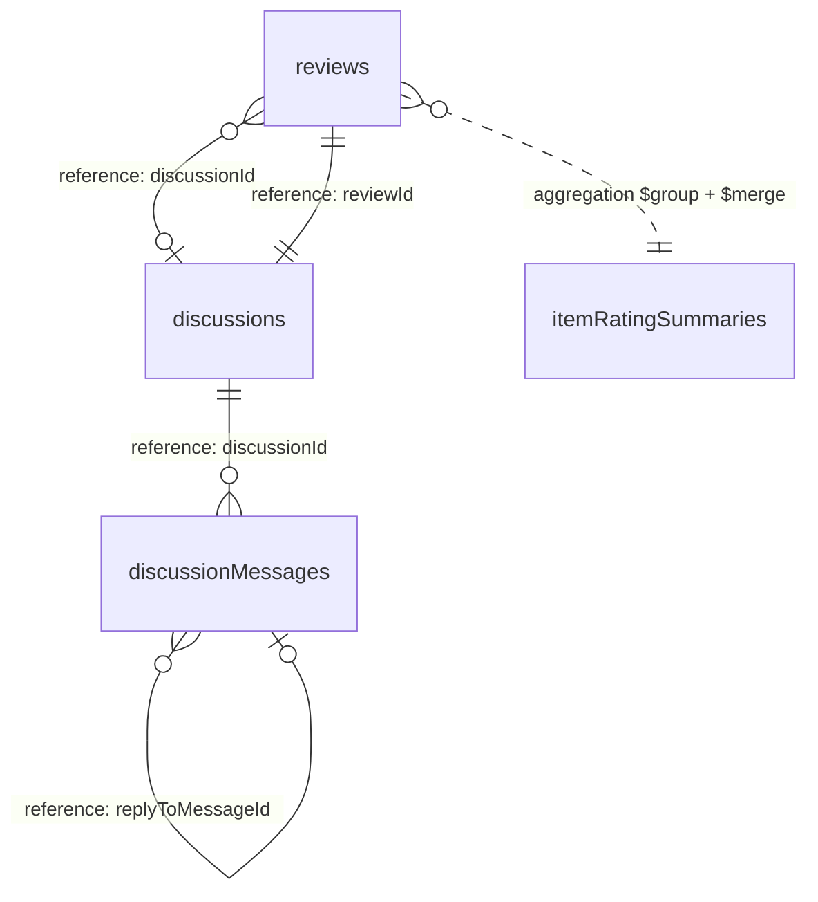

# Модель даних — Проєкт №3: MongoDB, база `ReviewsDb` (контекст Reviews)

## Колекції (4)

| Колекція | Що зберігає | Прийом моделювання |
|----------|-------------|--------------------|
| `reviews` | відгуки про ремонт і про позиції каталогу | **гібрид**: вбудовані піддокументи й масиви + посилання на `discussions`; гнучка схема |
| `discussions` | теми обговорень до відгуків | **посилання** `reviewId` на відгук; вбудована копія останнього повідомлення |
| `discussionMessages` | повідомлення обговорень | **посилання** `discussionId` (і `replyToMessageId` на цю ж колекцію) |
| `itemRatingSummaries` | зведений рейтинг позиції каталогу | **денормалізація** для читання; `_id` = `catalogItemId` |

## Вбудовування, посилання, гібрид

| Дані | Рішення | Чому |
|------|---------|------|
| `reviews.author` | **вбудований об'єкт** | автор завжди показується разом із відгуком |
| `reviews.comments[]` | **вбудований масив**, не більше 20 останніх | короткі коментарі читаються разом із відгуком; обмеження не дає документу рости безмежно |
| `reviews.staffReply`, `reviews.device`, `reviews.technician` | **вбудовані об'єкти** | належать лише цьому відгуку, окремо не існують |
| `reviews.usedItems[]` | **вбудований масив об'єктів** | перелік запчастин ремонту — частина відгуку |
| `reviews.discussionId` → `discussions` | **посилання** | обговорення слабко пов'язане з відгуком, має власний життєвий цикл (відкрите/закрите) |
| `discussionMessages.discussionId` → `discussions` | **посилання** | повідомлень може бути тисячі — вбудований масив перевищив би ліміт документа 16 МБ |
| `discussions.lastMessage` | **гібрид** (extended reference) | повідомлення лежать окремо, але копія останнього вбудована, щоб список тем не робив `$lookup` |
| `reviews` загалом | **гібрид** | в одному документі поєднано вбудовані коментарі й посилання на повну гілку обговорення |

## Гнучка схема: різні набори полів в одній колекції

У колекції `reviews` є обов'язкове спільне ядро (`reviewType`, `rating`, `text`, `author`, `createdAt`,
`version`), а решта полів залежить від типу відгуку й від того, що заповнив клієнт:

| Поле | Відгук про ремонт (`repair`) | Відгук про позицію (`item`) |
|------|------------------------------|-----------------------------|
| `repairOrderId`, `device` | обов'язкові | відсутні |
| `technician`, `usedItems[]` | необов'язкові | відсутні |
| `catalogItemId`, `itemName` | відсутні | обов'язкові |
| `pros[]`, `cons[]` | відсутні | необов'язкові |
| `title`, `photos[]`, `comments[]`, `staffReply`, `discussionId`, `updatedAt` | необов'язкові | необов'язкові |

Сім тестових документів мають сім різних наборів полів (запит 1 у `queries.js`). Гнучкість
контрольована: JSON Schema-валідатор перевіряє типи, межі (`rating` 1..5) і через `oneOf` вимагає
свій набір обов'язкових полів для кожного типу відгуку, не забороняючи додаткові поля.

## Денормалізація та посилання на інші контексти

| Поле | Що це | Політика |
|------|-------|----------|
| `catalogItemId`, `usedItems[].catalogItemId`, `itemRatingSummaries._id` | Id позиції з `CatalogDb` | логічне посилання, без зв'язку на рівні бази |
| `repairOrderId`, `author.customerId` | Id замовлення та клієнта з `RepairsDb` | логічне посилання, без зв'язку на рівні бази |
| `itemName` | копія назви позиції каталогу | оновлюється подіями з Каталогу |
| `author.displayName` | копія імені клієнта | оновлюється подіями з Repairs |
| `device`, `usedItems[].itemName` | знімок із замовлення на ремонт | не оновлюється |

Повна таблиця — у [`duplication-policy.md`](duplication-policy.md).

## Індекси та запити, під які їх створено

| Індекс | Колекція | Запит |
|--------|----------|-------|
| `ix_reviews_catalogItemId_createdAt` (частковий, лише `item`) | `reviews` | відгуки про позицію каталогу, новіші спочатку, з пагінацією |
| `ux_reviews_repairOrderId` (унікальний, частковий) | `reviews` | відгук за замовленням; гарантує один відгук на замовлення |
| `ux_reviews_catalogItemId_customerId` (унікальний, частковий, лише `item`) | `reviews` | гарантує один відгук клієнта на позицію каталогу, зокрема при одночасних запитах |
| `ix_reviews_author_createdAt` | `reviews` | «мої відгуки» — за полем вбудованого об'єкта `author.customerId` |
| `ix_reviews_rating_createdAt` | `reviews` | найкращі / найгірші відгуки |
| `ix_reviews_text` (текстовий) | `reviews` | повнотекстовий пошук у заголовку й тексті |
| `ix_discussions_reviewId` | `discussions` | обговорення до відгуку |
| `ix_discussions_status_lastActivity` | `discussions` | відкриті теми з найсвіжішою активністю |
| `ix_messages_discussionId_createdAt` | `discussionMessages` | повідомлення теми в хронологічному порядку |
| `ix_summaries_rating` | `itemRatingSummaries` | рейтинг позицій каталогу |

## Aggregation pipeline (`queries.js`)

| № | Запит | Стадії |
|---|-------|--------|
| 5 | відгук → обговорення → повідомлення | `$match`, два `$lookup`, `$unwind`, `$project` |
| 6 | середній рейтинг за позиціями каталогу | `$match`, `$group`, `$sort` |
| 7 | найактивніші коментатори | `$unwind` вбудованого масиву, `$group`, `$sort` |
| 8 | зведення за типом і розподіл оцінок одним запитом | `$facet` |
| — | перерахунок `itemRatingSummaries` (`seed.js`) | `$match`, `$sort`, `$group`, `$project`, `$merge` |

## Службові поля

`createdAt`, `updatedAt`, `isDeleted` (м'яке видалення) та `version` — токен оптимістичної
конкурентності: оновлення виконується з фільтром `{ _id, version }` і `$inc: { version: 1 }`; якщо
документ уже змінив хтось інший, `modifiedCount = 0` (сценарій 11 у `queries.js`).

Ті самі індекси сервіс Reviews створює під час старту (`IndexCreationService`), а тестові відгуки
вставляє, якщо колекція порожня (`ReviewSeeder`). Тому база, розгорнута скриптами, і база, яку
сервіс наповнює сам (наприклад, в Aspire), однакові. Як сервіс читає й записує документи — у
[`reviews-service.md`](reviews-service.md).

## Приклади документів

| Файл | Що показує |
|------|-----------|
| [`review-repair.json`](p3-documents/review-repair.json) | відгук про ремонт: вбудовані `author`, `device`, `technician`, `usedItems[]`, `comments[]`, `staffReply`, `photos[]` |
| [`review-item.json`](p3-documents/review-item.json) | відгук про позицію: `pros`/`cons`, денормалізована `itemName`, посилання `discussionId` |
| [`review-minimal.json`](p3-documents/review-minimal.json) | відгук лише з обов'язковими полями |
| [`discussion.json`](p3-documents/discussion.json) | обговорення: посилання `reviewId`, вбудований `lastMessage` |
| [`discussion-message.json`](p3-documents/discussion-message.json) | повідомлення: посилання `discussionId`, `replyToMessageId`, вкладення |
| [`item-rating-summary.json`](p3-documents/item-rating-summary.json) | зведений рейтинг із вбудованою гістограмою |

Документи вивантажено з бази у форматі Extended JSON: `{"$oid": ...}` — це `ObjectId`, `{"$date": ...}` — дата,
`{"$numberLong": "..."}` — 64-бітне ціле (`long`, так зберігаються посилання `customerId`, `catalogItemId`, `repairOrderId`).
