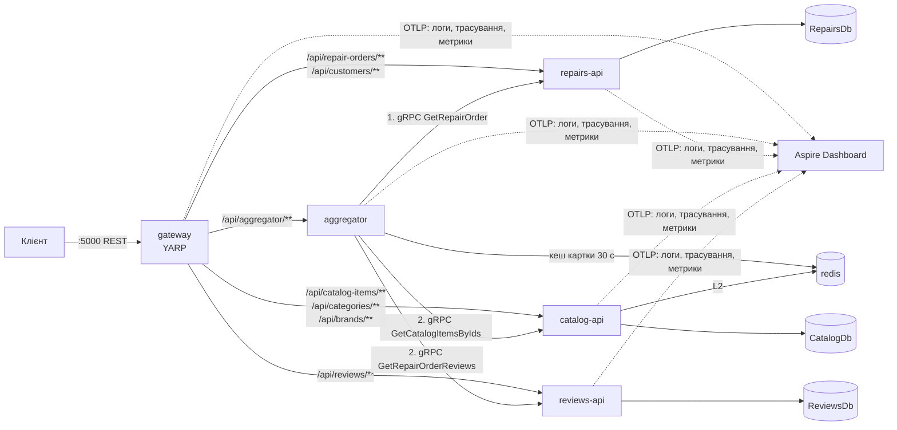
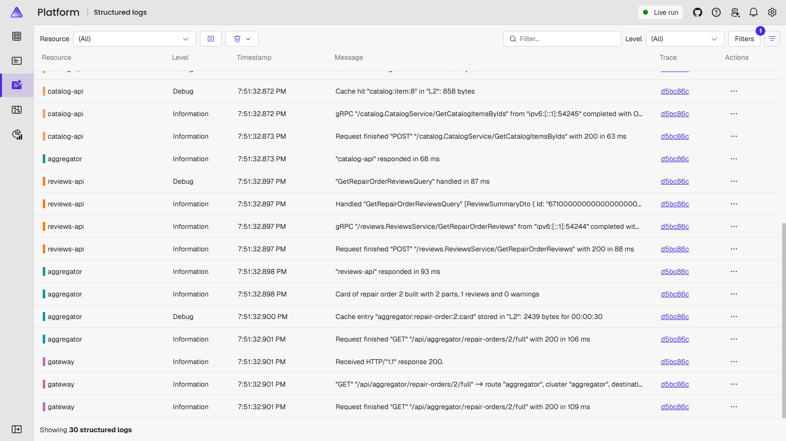

# Платформа: AppHost, ServiceDefaults, Gateway, gRPC, Aggregator

Три сервіси (Repairs, Catalog, Reviews) працюють як одна платформа на .NET Aspire. Клієнт звертається
лише до шлюзу (REST), шлюз маршрутизує запити за логічними іменами сервісів, а агрегатор збирає
картку ремонтного замовлення з трьох сервісів одночасно — внутрішніми gRPC-викликами — і кешує готову
картку в Redis. Логи, трасування й метрики всіх компонентів збирає Aspire Dashboard.

| Компонент | Проєкт | Ресурс AppHost | Роль |
|-----------|--------|----------------|------|
| AppHost | `Platform.AppHost` | — | запускає контейнери баз і Redis, сервіси, агрегатор і шлюз; задає порядок старту й service discovery |
| ServiceDefaults | `Platform.ServiceDefaults` | — | спільна бібліотека: Serilog, OpenTelemetry, health checks, service discovery, resilience, CorrelationId, gRPC-interceptor |
| Gateway | `Platform.ApiGateway` | `gateway` | єдина точка входу на YARP: маршрути, CorrelationId, журнал і метрики трафіку |
| Aggregator | `Platform.Aggregator` | `aggregator` | Aggregator Pattern: картка замовлення з паралельних gRPC-викликів до трьох сервісів, кеш картки в Redis |
| Repairs | `Services/Repairs/Repairs.Api` | `repairs-api` | замовлення, клієнти, склад; SQL Server `RepairsDb`; REST + gRPC |
| Catalog | `Services/Catalog/Catalog.Api` | `catalog-api` | позиції каталогу, бренди, категорії; SQL Server `CatalogDb`; REST + gRPC; дворівневий кеш |
| Reviews | `Services/Reviews/Reviews.WebApi` | `reviews-api` | відгуки й коментарі; MongoDB `ReviewsDb`; REST + gRPC |
| Redis | — | `redis` | розподілений кеш (L2) Catalog і кеш карток агрегатора |



## AppHost

`Platform.AppHost/AppHost.cs` — лише конфігурація, бізнес-логіки в ньому немає. Посилання
односпрямовані: AppHost посилається на всі проєкти, а сервіси, шлюз і агрегатор — тільки на
`Platform.ServiceDefaults`.

- **Бази.** `AddSqlServer("sql", sqlPassword)` з томом даних і базами `RepairsDb`, `CatalogDb`;
  `AddMongoDB("mongo")` з окремим томом і базою `ReviewsDb`. `RepairsDb` AppHost наповнює скриптами
  `db/p1`, схему `CatalogDb` створюють міграції сервісу Catalog, індекси й тестові відгуки в
  `ReviewsDb` — сам сервіс Reviews.
- **Секрети.** Пароль SQL Server — параметр-секрет `sql-password`; значення лежить у секретах
  користувача AppHost (`Parameters:sql-password`), а якщо його немає — Dashboard попросить ввести
  його під час першого запуску. Пароль MongoDB Aspire генерує сам. Необов'язковий параметр
  `luckypenny-license-key` передає ключ ліцензії AutoMapper і MediatR усім трьом сервісам; без нього
  бібліотеки лише пишуть попередження в журнал.
- **Рядки підключення.** Імена ресурсів баз збігаються з іменами рядків підключення, які читають
  сервіси, тому `WithReference` передає їх змінними `ConnectionStrings__RepairsDb`,
  `ConnectionStrings__CatalogDb` і `ConnectionStrings__ReviewsDb`.
- **Redis.** `AddRedis("redis").WithDataVolume()` — контейнер Redis з томом, тож кеш переживає
  перезапуск. Пароль і TLS Aspire генерує й налаштовує сам. `WithReference(redis).WaitFor(redis)`
  отримують лише `catalog-api` (сервіс із кешем) і `aggregator`; ім'я ресурсу `redis` стає рядком
  підключення `ConnectionStrings:redis`, який читає `AddRedisDistributedCache("redis")`.
- **Порядок старту** задають ланцюжки `WaitFor`: бази й Redis → сервіси → агрегатор → шлюз. Кожен
  сервіс має `WithHttpHealthCheck("/health")`, тож «готовий» означає, що він відповідає на `/health`
  (для Reviews — і що MongoDB доступна), а не просто що процес стартував.
- **Порти.** Кожен сервіс має два endpoints з розділу `Kestrel:Endpoints` свого `appsettings.json`:
  `http` (REST, HTTP/1.1) — 5077, 5078, 5079 і `grpc` (лише HTTP/2) — 5177, 5178, 5179. Aspire
  бачить обидва за іменами й перевизначає їхні адреси змінними `Kestrel__Endpoints__*__Url`. Агрегатор
  — 5080, шлюз — фіксований 5000 (`WithHttpEndpoint(port: 5000, name: "public")`). Ім'я ресурсу — це
  логічне ім'я для service discovery: `http://catalog-api` (endpoint `http`) замість
  `localhost:5078`, `http://_grpc.catalog-api` — endpoint `grpc` того самого ресурсу.

## Інтеграція сервісів

Зміни в сервісах обмежено підключенням спільних налаштувань:

| Сервіс | Що змінилося |
|--------|--------------|
| усі три | `Program.cs`: `builder.AddServiceDefaults()`, `app.UseMiddleware<CorrelationIdMiddleware>()`, `app.MapDefaultEndpoints()`; прибрано власну конфігурацію Serilog і `UseSerilogRequestLogging` |
| усі три | `appsettings*.json`: прибрано рівні журналу, які тепер задає ServiceDefaults; лишилися лише специфічні для сервісу налаштування (файловий приймач, рівень SQL-команд EF Core у Catalog, обмеження деструктуризації в Reviews) |
| Catalog | власний `CorrelationIdMiddleware` видалено — його замінив спільний; `correlationId` у `ProblemDetails` береться зі спільного |
| Reviews | рядок підключення читається з `ConnectionStrings:ReviewsDb` і має пріоритет над резервним `MongoDb:ConnectionString`; база — `ReviewsDb`; власний `MapHealthChecks("/health")` замінено на `MapDefaultEndpoints` (перевірка `mongodb` лишилася в `/health`); драйвер MongoDB підписано на трасування в `MongoDbContext` |
| усі три | `Protos/*.proto` (`GrpcServices="Server"`), `Grpc/` — gRPC-сервіс-адаптер над BLL, `AddGrpc` з `GrpcServerLoggingInterceptor`, `MapGrpcService`, endpoint `grpc` лише з HTTP/2 |
| Catalog | дворівневий кеш у `Catalog.Bll/Caching/`, `AddMemoryCache` з `SizeLimit`, `AddRedisDistributedCache("redis")` — див. [`catalog-service.md`](catalog-service.md#кешування) |
| Reviews | запит `GetRepairOrderReviews` (відгуки про ремонт і про його позиції одним викликом) для gRPC-методу агрегатора |

Бізнес-логіку не змінено: до сервісів додано лише власні spans і структуровані логи бізнес-подій.

| Сервіс | `ActivitySource` | Spans | Властивості логів |
|--------|------------------|-------|-------------------|
| Repairs | `Repairs.Bll` (`RepairsTelemetry`) | `CreateRepairOrder`, `AddRepairOrderItem`, `ChangeRepairOrderStatus` | `RepairOrderId`, `CustomerId`, `ItemsCount`, `Amount`, `Status`, `FromStatus`, `ToStatus` |
| Catalog | `Catalog.Bll` (`CatalogTelemetry`) | `CreateCatalogItem`, `UpdateCatalogItem`, `ChangeCatalogItemPrice` | `CatalogItemId`, `Sku`, `ItemType`, `Price`, `OldPrice`, `NewPrice` |
| Reviews | `Reviews.Application` (`ReviewsTelemetry`) | `CreateReview`, `ReplyToReview`, `DeleteReview` | `ReviewId`, `ReviewType`, `CustomerId`, `Rating`, `CatalogItemId`, `RepairOrderId` |
| Aggregator | `Platform.Aggregator` | `AggregateRepairOrderCard` | `RepairOrderId`, `PartsCount`, `ReviewsCount`, `WarningsCount` |

Паролі, токени й контактні дані клієнтів (телефон, email) у логи не потрапляють.

## ServiceDefaults

`Platform.ServiceDefaults/Extensions.cs` — один метод `AddServiceDefaults()` для всіх застосунків.

### Serilog

- Serilog — основний провайдер логування (`AddSerilog`), стандартні провайдери вимкнено, щоб записи
  не дублювалися в консолі.
- Збагачення: `ServiceName` (ім'я застосунку), `EnvironmentName`, `MachineName`, `ThreadId`, а через
  `FromLogContext` — `CorrelationId` кожного запиту. `TraceId` і `SpanId` кожного запису беруться з
  поточного `Activity`.
- Рівні: `Debug` у Development, `Information` в інших середовищах; шумні категорії
  (`Microsoft.AspNetCore`, `Microsoft.EntityFrameworkCore`, `System.Net.Http.HttpClient`, health
  checks, Polly, `Grpc`) обмежено.
- Консоль — `CompactJsonFormatter` (вкладка *Console logs* у Dashboard). `writeToProviders: true`
  передає кожен запис провайдеру OpenTelemetry, і він потрапляє у вкладку *Structured logs* з
  окремими атрибутами — там можна шукати, наприклад, `CorrelationId` або `RepairOrderId`.
- Розділ `Serilog` конфігурації сервісу додає лише його власні налаштування (рівні, задані в коді,
  він не перекриває) — так Catalog і Reviews зберегли файлові журнали `logs/*.log`.

### OpenTelemetry

- Трасування: ASP.NET Core (вхідні запити, без `/health` і `/alive`), HttpClient (вихідні виклики),
  SqlClient (покриває і Dapper у Repairs, і EF Core у Catalog), MongoDB
  (`MongoDB.Driver.Core.Extensions.DiagnosticSources`), власні `ActivitySource`: ім'я застосунку й
  усі джерела з тим самим префіксом (`Repairs.*`, `Catalog.*`, `Reviews.*`, `Platform.*`).
- Метрики: ASP.NET Core, HttpClient, runtime, власний `Meter` застосунку (метрики шлюзу) і `Meter`
  кешу `<префікс>.Cache` — `Catalog.Cache` у catalog-api, `Platform.Cache` в агрегаторі
  (`cache.hits` / `cache.misses` з тегом `cache.level`).
- gRPC окремої інструментації не потребує: клієнтські виклики йдуть через `HttpClient` (span
  `HTTP POST` в агрегаторі), серверні — через ASP.NET Core (span `POST /catalog.CatalogService/...`
  виду Server з атрибутами `grpc.method`, `grpc.status_code`, `network.protocol.version` = `2` і
  `correlation.id`), а заголовок `traceparent` у метаданих виклику робить серверний span дочірнім до
  клієнтського.
- Атрибут ресурсу `deployment.environment.name`; `service.name` задає Aspire.
- Sampling: 100 % у Development; в інших середовищах — `ParentBasedSampler` з часткою
  `OpenTelemetry:TraceSamplingRatio` (типово 0.25).
- Експорт — `UseOtlpExporter()` з батчевою обробкою, якщо Aspire передав
  `OTEL_EXPORTER_OTLP_ENDPOINT`.

### Health checks, service discovery, resilience

- `MapDefaultEndpoints()` відкриває `/health` (усі перевірки) і `/alive` (лише `live`) у Development.
- Усі `HttpClient` отримують service discovery, стандартний resilience-handler і
  `CorrelationIdHandler`. Таймаути resilience-handler можна перевизначити розділом
  `HttpClientResilience` конфігурації — так зроблено в агрегаторі. gRPC-клієнти створюються тією самою
  фабрикою `HttpClient`, тож усе це діє і для них.

### gRPC-interceptor

`Grpc/GrpcServerLoggingInterceptor` — серверний interceptor, який сервіси підключають через
`AddGrpc(o => o.Interceptors.Add<GrpcServerLoggingInterceptor>())`. Для кожного unary-виклику він:

- відкриває scope журналу з `Transport = grpc` і `RpcMethod` — усе, що пишеться всередині виклику
  (зокрема попадання в кеш), можна відфільтрувати від REST-запитів;
- після виклику пише `gRPC {RpcMethod} from {Peer} completed with {GrpcStatus} in {ElapsedMs} ms`;
- для `RpcException` — той самий запис зі статусом і `StatusDetail`: рівень `Warning` для очікуваних
  відмов (`NotFound`, `InvalidArgument`, …), `Error` для `Internal`/`Unknown`/`DataLoss`; для
  непередбаченого винятку — `Error` зі стеком і статусом `Unknown`; скасування клієнтом — `Information`.

### CorrelationId

| | CorrelationId | TraceId |
|-|---------------|---------|
| Хто створює | застосунок: шлюз або перший сервіс, до якого прийшов запит | OpenTelemetry |
| Де передається | заголовок `X-Correlation-Id` | заголовок `traceparent` |
| Для чого | бізнес-ідентифікатор звернення, який клієнт може назвати підтримці | технічний зв'язок spans одного запиту |

`CorrelationIdMiddleware` бере `X-Correlation-Id` із запиту або створює новий GUID (і пише про це
в журнал), якщо заголовка немає чи значення некоректне (довше 64 символів або з символами, крім
літер, цифр, `-`, `_`, `.`). Ідентифікатор записується назад у заголовки запиту, у `LogContext`, у
тег span `correlation.id` і в заголовок відповіді; на початку й наприкінці запиту пишуться записи
`Request started` / `Request finished` зі статусом і тривалістю. `CorrelationIdHandler` додає той
самий заголовок до кожного вихідного HTTP-запиту. gRPC-виклик — це HTTP/2-запит, а заголовки запиту
— це метадані gRPC, тож агрегатор передає `X-Correlation-Id` у метаданих кожного gRPC-виклику без
окремого коду, а `CorrelationIdMiddleware` сервісу читає його так само, як для REST.

## Gateway (YARP)

Маршрути й кластери — у розділі `ReverseProxy` файлу `Platform.ApiGateway/appsettings.json`.
Адреси кластерів — логічні імена ресурсів (`http://repairs-api`), реальні адреси підставляє
`AddServiceDiscoveryDestinationResolver()`.

| Маршрут | Шлях | Кластер | Order |
|---------|------|---------|-------|
| `aggregator` | `/api/aggregator/{**catch-all}` | `http://aggregator` | 1 |
| `repairs-stock` | `/api/repairs/catalog-items/{**catch-all}` → `/api/catalog-items/{**catch-all}` | `http://repairs-api` | 5 |
| `repair-orders`, `customers` | `/api/repair-orders/**`, `/api/customers/**` | `http://repairs-api` | 10 |
| `catalog-items`, `categories`, `brands` | `/api/catalog-items/**`, `/api/categories/**`, `/api/brands/**` | `http://catalog-api` | 10 |
| `reviews` | `/api/reviews/{**catch-all}` | `http://reviews-api` | 10 |

- У YARP менше значення `Order` означає вищий пріоритет, тому маршрут агрегатора й маршрут із
  перезаписом шляху мають найменші значення.
- `/api/catalog-items` є і в Catalog (власник даних), і в Repairs (локальна копія із залишком на
  складі). Шлях без префікса веде до Catalog, копію Repairs шлюз відкриває як
  `/api/repairs/catalog-items/...` і трансформом `PathPattern` повертає їй початковий шлях.
- Для кожного кластера `ActivityTimeout` — 30 с, для маршрутів — ліміт тіла запиту 1 МБ і метадані
  `Team`, `Version`; кластер `catalog` має політику балансування `RoundRobin`.
- `CorrelationIdMiddleware` стоїть у конвеєрі до `MapReverseProxy()`, тож YARP пересилає
  сервісу вже заповнений заголовок `X-Correlation-Id`.
- `GatewayLoggingMiddleware` пише вхідний запит (метод, шлях, IP клієнта) і рішення
  маршрутизації (маршрут, кластер, адреса призначення, статус, тривалість, розмір відповіді).
  Помилки проксі (`IForwarderErrorFeature`: відмова з'єднання, таймаут) пишуться з рівнем `Error` і
  деталями винятку.
- Метрики `Platform.ApiGateway`: `gateway.requests`, `gateway.errors`, `gateway.request.duration`
  з тегами `route`, `cluster`, `status_code` — у вкладці *Metrics* з них видно кількість запитів за
  секунду, середній час відповіді й частку помилок.

## gRPC-контракти

Між собою сервіси спілкуються через gRPC, зовнішні клієнти — через REST за шлюзом. Контракти лежать
у `Protos/` API-проєкту сервісу й підключені в `.csproj` елементом
`<Protobuf Include="Protos\*.proto" GrpcServices="Server" />`; агрегатор підключає ті самі файли з
`GrpcServices="Client"`, тож клієнт і сервер генеруються з одного джерела.

| Файл | `package` / `csharp_namespace` | Сервіс | RPC |
|------|-------------------------------|--------|-----|
| `Services/Repairs/Repairs.Api/Protos/repairs.proto` | `repairs` / `Repairs.Grpc` | `RepairsService` | `GetRepairOrder` |
| `Services/Catalog/Catalog.Api/Protos/catalog.proto` | `catalog` / `Catalog.Grpc` | `CatalogService` | `GetCatalogItem`, `GetCatalogItemsByIds`, `ListCategories` |
| `Services/Reviews/Reviews.WebApi/Protos/reviews.proto` | `reviews` / `Reviews.Grpc` | `ReviewsService` | `GetReview`, `GetRepairOrderReviews` |

Рішення в контрактах:

- **Пакетні методи під агрегатора.** `GetCatalogItemsByIds` повертає всі позиції замовлення одним
  викликом, `GetRepairOrderReviews` — відгуки про ремонт і про кожну позицію. REST-агрегатор робив
  `1 + N + (N + 1)` запитів для замовлення з N позиціями, gRPC — завжди 3.
- **Гроші** — повідомлення `DecimalValue { int64 units; sfixed32 nanos; }` (точне десяткове значення
  без похибки `double`); перетворення — `partial`-доповнення згенерованого класу (`Grpc/DecimalValue.cs`
  у сервісах, `Clients/DecimalValueConversions.cs` в агрегаторі).
- **Дати** — `google.protobuf.Timestamp`; необов'язкові дати (`issued_at`, `updated_at`) просто не
  заповнюються.
- **Необов'язкові скалярні поля** — `optional` (`brand_name`, `title`, `catalog_item_id`), тож
  клієнт відрізняє «немає значення» від порожнього рядка чи нуля (`HasBrandName`).
- **Перелічення** (`CatalogItemType`, `RepairOrderStatus`, `ReviewType`) мають нульове значення
  `*_UNSPECIFIED`, як вимагає proto3.
- **Номери полів не змінюються** після публікації: саме вони визначають бінарний формат. Перевірено
  експериментом: якщо змінити номер поля `name` у `CatalogItemReply` з 3 на 30 лише на сервері,
  агрегатор зі старим контрактом не падає, але отримує `catalog.name = ""` — невідоме поле 30
  мовчки пропускається, а поле 3 відсутнє. Помилки немає, дані губляться тихо, тому нові поля
  отримують нові номери, а видалені номери резервуються (`reserved`).

gRPC-сервіси (`<Сервіс>.Api/Grpc/`) — адаптери над BLL, як контролери: наслідують згенерований
`*ServiceBase`, отримують сервіс BLL (у Reviews — `ISender` MediatR) через конструктор, перевіряють
вхід, передають `context.CancellationToken`, перетворюють DTO на повідомлення, а доменні винятки — на
`RpcException`:

| Ситуація | Статус gRPC |
|----------|-------------|
| Id ≤ 0, некоректний ObjectId, понад 100 Id, помилка валідації | `InvalidArgument` |
| запис не знайдено | `NotFound` |
| порушення бізнес-правила | `FailedPrecondition` |
| непередбачений виняток | `Unknown` (деталі — лише в Development через `EnableDetailedErrors`) |

**HTTP/2.** gRPC працює лише поверх HTTP/2. Без TLS режим `Http1AndHttp2` на одному порту
неможливий: без ALPN усі з'єднання стають HTTP/1.1. Тому кожен сервіс має окремий endpoint `grpc`
лише з HTTP/2 (HTTP/2 з prior knowledge), а REST для шлюзу й Swagger лишається на endpoint `http` з
`Protocols: Http1`. Адреси обох endpoints задає `Kestrel:Endpoints` в `appsettings.json` (їх
перевизначає Aspire), а протокол gRPC-endpoint — `Program.cs` поруч з `AddGrpc`:

```csharp
builder.WebHost.ConfigureKestrel(kestrel => kestrel
    .Configure(builder.Configuration.GetSection("Kestrel"), reloadOnChange: true)
    .Endpoint("grpc", endpoint => endpoint.ListenOptions.Protocols = HttpProtocols.Http2));
```

HTTP/1.1-запит на gRPC-порт Kestrel відхиляє з 400.

## Aggregator

`GET /api/aggregator/repair-orders/{id}/full` повертає картку ремонтного замовлення: замовлення з
Repairs, актуальні дані позицій з Catalog і відгуки з Reviews. Зовні це REST-ендпоінт за шлюзом,
усередині — три gRPC-виклики.

0. `RepairOrderCardCache` перевіряє Redis **до** будь-яких викликів: ключ
   `aggregator:repair-order:{id}:card`. Попадання повертається одразу (у trace лише `HMGET` Redis).
1. `RepairsService.GetRepairOrder` повертає замовлення. Без замовлення агрегувати нічого:
   `NotFound` → 404, `Unavailable`/`DeadlineExceeded` → 503 `ProblemDetails`.
2. `CatalogService.GetCatalogItemsByIds` і `ReviewsService.GetRepairOrderReviews` виконуються
   одночасно через `Task.WhenAll`. Кожен виклик отримує `CancellationToken` клієнта й deadline
   (`Aggregator:CallDeadline`, 8 с).
3. Кожен виклик логується (`catalog-api responded in 12 ms`). Якщо сервіс недоступний —
   `RpcException` зі статусом `Unavailable` чи `DeadlineExceeded` (або `Internal`, коли виклик
   відхилив resilience-handler: відкритий circuit breaker, вичерпаний таймаут), — картка
   повертається без його даних, а в `warnings` з'являється `catalog-api is unavailable`. Скасування
   запиту клієнтом не вважається відмовою сервісу й не ховається.
4. У картку потрапляють лише дані цього замовлення: позиції каталогу з тими самими Id і відгуки про
   це замовлення або його позиції. Позиція, якої немає в каталозі, дає попередження.
5. Повна картка кешується в Redis на 30 с (`Aggregator:CardCacheTimeToLive`, перевірка під час
   старту не дає задати понад 60 с). Часткова картка (є `warnings`) не кешується, щоб не віддавати її
   ще 30 с після відновлення сервісу. Якщо Redis недоступний, агрегатор на 30 с припиняє до нього
   звертатися і збирає картки з сервісів.

Типізовані gRPC-клієнти зареєстровано через `AddGrpcClient<...Client>` з адресами за логічними
іменами — `http://_grpc.repairs-api`, `http://_grpc.catalog-api`, `http://_grpc.reviews-api`
(`Clients/UpstreamServices.cs`). Service discovery, resilience-handler і `CorrelationIdHandler` з
ServiceDefaults діють і для них. Таймаути resilience-handler для агрегатора менші за стандартні
(`HttpClientResilience` в `appsettings.json`: спроба — 5 с, один повтор, увесь запит — 10 с), а
deadline виклику — 8 с, щоб недоступний сервіс давав часткову відповідь раніше, ніж спрацює таймаут
шлюзу (30 с).

TTL картки (30 с) коротший за L1-кеш Catalog (2 хв): агрегована відповідь не може виглядати
«свіжішою», ніж дані, з яких її зібрано. Інвалідацію між сервісами не реалізовано — після зміни ціни
в каталозі картка оновиться щонайпізніше за 30 с.

`Meter` `Platform.Cache`: `cache.hits`, `cache.misses`, `cache.skipped` (часткові картки), `cache.errors`
і `cache.operation.duration` з тегом `cache.level = L2`.

Картка — це DTO під сценарій «картка ремонту», а не копія відповідей сервісів: позиція містить
знімок ціни із замовлення і вкладений блок `catalog` з поточною ціною та ознакою `priceChanged`.
JSON у camelCase, `null`-значення не серіалізуються. Дати приходять із gRPC як `Timestamp`, тому
серіалізуються в UTC із суфіксом `Z`.

```json
{
  "order": {
    "id": 1, "customerId": 1, "status": "Issued",
    "acceptedAt": "2026-10-01T09:15:00Z", "issuedAt": "2026-10-03T17:40:00Z",
    "device": { "type": "Smartphone", "brand": "Apple", "model": "iPhone 13",
                "defectDescription": "Розбитий екран після падіння, сенсор не реагує",
                "diagnosticNotes": "Дисплейний модуль пошкоджено, корпус і плата без дефектів" },
    "totalAmount": 4700
  },
  "parts": [
    {
      "catalogItemId": 1, "itemName": "Екран OLED для iPhone 13", "quantity": 1,
      "unitPrice": 3900, "discount": 0, "lineTotal": 3900,
      "catalog": { "sku": "PRT-DSP-IP13", "name": "Екран OLED для iPhone 13", "itemType": "Part",
                   "brandName": "Apple", "currentPrice": 4200, "priceChanged": true,
                   "isActive": true, "warrantyMonths": 6 }
    }
  ],
  "reviews": [
    { "id": "671000000000000000000004", "reviewType": "item", "rating": 2,
      "text": "Через місяць на екрані з'явилася зелена смуга.", "authorName": "Тарас Мельник",
      "catalogItemId": 1, "createdAt": "2026-11-05T20:45:00Z" }
  ],
  "warnings": []
}
```

Коли reviews-api зупинено, та сама картка приходить зі статусом 200, без `reviews` і з
`"warnings": ["reviews-api is unavailable"]`; після запуску сервісу відповідь знову повна.

## HTTP проти gRPC

**Методика.** Той самий запит `GET /api/aggregator/repair-orders/{id}/full` через шлюз для 5
замовлень, 10 раундів (50 запитів), перед заміром — по 2 розігрівальні запити на замовлення. Між
раундами 31 с, щоб кеш картки (30 с) встиг спливти і gRPC-версія щоразу збирала картку заново.
Ноутбук від мережі живлення, Debug-збірка, усі ресурси на одній машині (localhost). HTTP-версія —
агрегатор із typed HttpClients і сервіси без кешів (стан до переходу на gRPC); gRPC-версія —
поточний код. Окремо виміряно повторні запити без пауз, коли картка приходить із Redis.

| Варіант | Викликів агрегатора до сервісів | Spans у trace (замовлення 1) | p50 | p95 |
|---------|---------------------------------|------------------------------|-----|-----|
| HTTP, без кешів | 8 (1 + 3 + 4) | 33 | 21,7 мс | 38,8 мс |
| gRPC, картку зібрано заново (промах кешу агрегатора) | 3 | 26 | 29,0 мс | 49,8 мс |
| gRPC, повторний запит (картка з Redis) | 0 | 5 | 6,4 мс | 25,9 мс |


**Що показують trace:**

- Викликів стало 3 замість 8, і це число не залежить від кількості позицій: для замовлення з 20
  позиціями HTTP-версія зробила б 42 виклики, gRPC — так само 3.
- Сам gRPC-виклик не повільніший за HTTP-виклик: серверна частина та сама, а різниця між клієнтським
  і серверним span — 0,6–1,3 мс для запитів один за одним (до 3 мс для першого після паузи) проти
  0,3–1 мс у HTTP.
- Картку, зібрану заново, gRPC-версія віддає повільніше через кеші, яких у HTTP-версії не було:
  агрегатор перед збиранням перевіряє Redis і після нього записує картку (`HMGET`, `HMSET`, `EXPIRE` —
  близько 4,6 мс), а за 31 с паузи в Catalog спливає L1 і позиції читаються з L2 (Redis).
- На localhost із повідомленнями в кілька кілобайтів більша частина часу припадає на SQL, MongoDB і
  Redis, а не на транспорт, тому перевага бінарного протоколу й одного HTTP/2-з'єднання тут майже не
  помітна. Вона росте разом із мережевою затримкою між машинами й кількістю позицій.
- Повторний запит у межах 30 с не звертається до сервісів узагалі й у 3,4 раза швидший за
  HTTP-версію за p50. Цей виграш дає кеш картки, а не протокол: на цьому шляху немає жодного
  gRPC-виклику, а HTTP-версію виміряно без кешів, тож порівняння показує «кеш + gRPC» проти
  «без кешу». Вплив самого протоколу видно в рядку про картку, зібрану заново.

## Спостереження в Dashboard

- **Traces** — trace агрегувального запиту: `gateway` → `aggregator` → `AggregateRepairOrderCard`
  → Redis `HMGET` → `POST /repairs.RepairsService/GetRepairOrder` (SQL), потім одночасно
  `POST /catalog.CatalogService/GetCatalogItemsByIds` (Redis або SQL) і
  `POST /reviews.ReviewsService/GetRepairOrderReviews` (MongoDB `aggregate`), наприкінці — запис
  картки в Redis. Серверні gRPC-spans — дочірні до клієнтських `HTTP POST` агрегатора (див. рисунок
  вище).

- **Structured logs** — фільтр `CorrelationId contains <значення із заголовка відповіді>` показує
  записи всіх сервісів ланцюжка, зокрема записи gRPC-interceptor (`gRPC ... completed with OK`) і
  кешу (`Cache hit "catalog:item:8" in "L2"`, `Cache entry "aggregator:repair-order:2:card" stored`):

  

- **Metrics** — `http.server.request.duration` кожного сервісу, метрики шлюзу `gateway.*`, кешу
  `Catalog.Cache` і `Platform.Cache` (`cache.hits`, `cache.misses` з тегом `cache.level`).

Запит напряму до сервісу (наприклад, `http://localhost:5077/api/repair-orders/1`) теж отримує
`X-Correlation-Id`, але сервіс створює його сам, і в журналі немає записів шлюзу про маршрутизацію.
