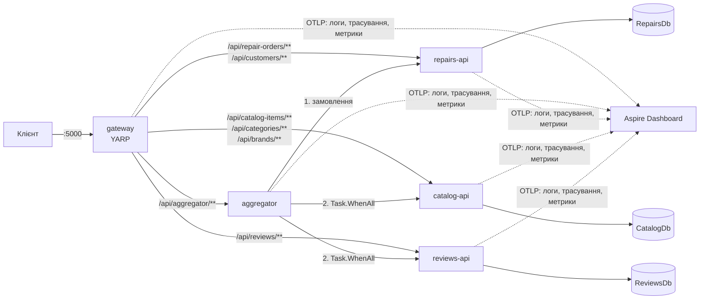
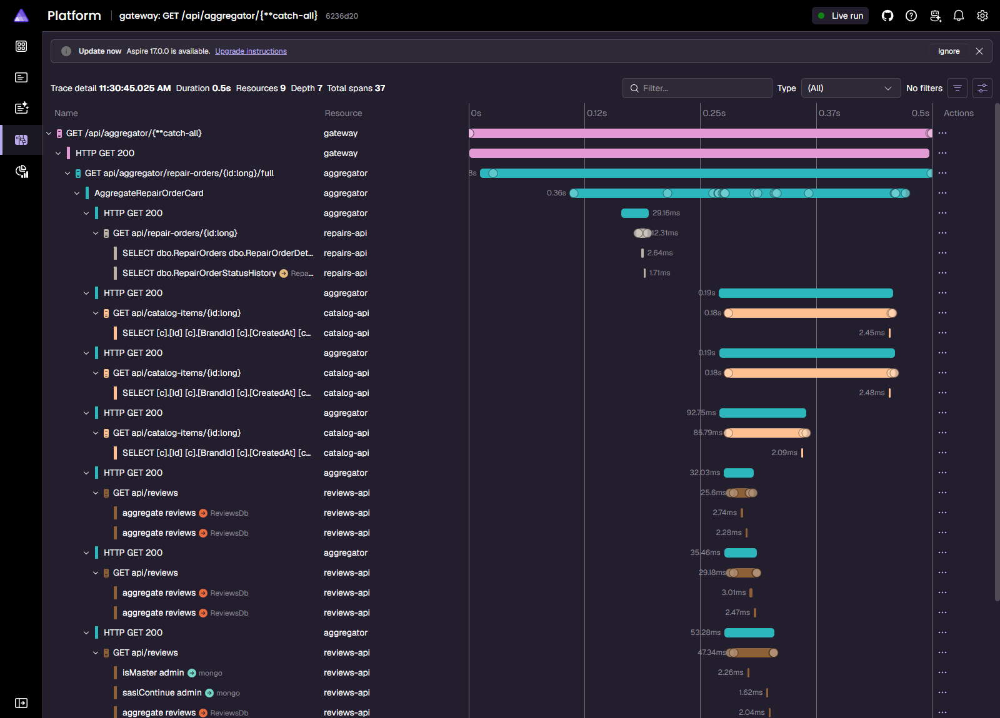
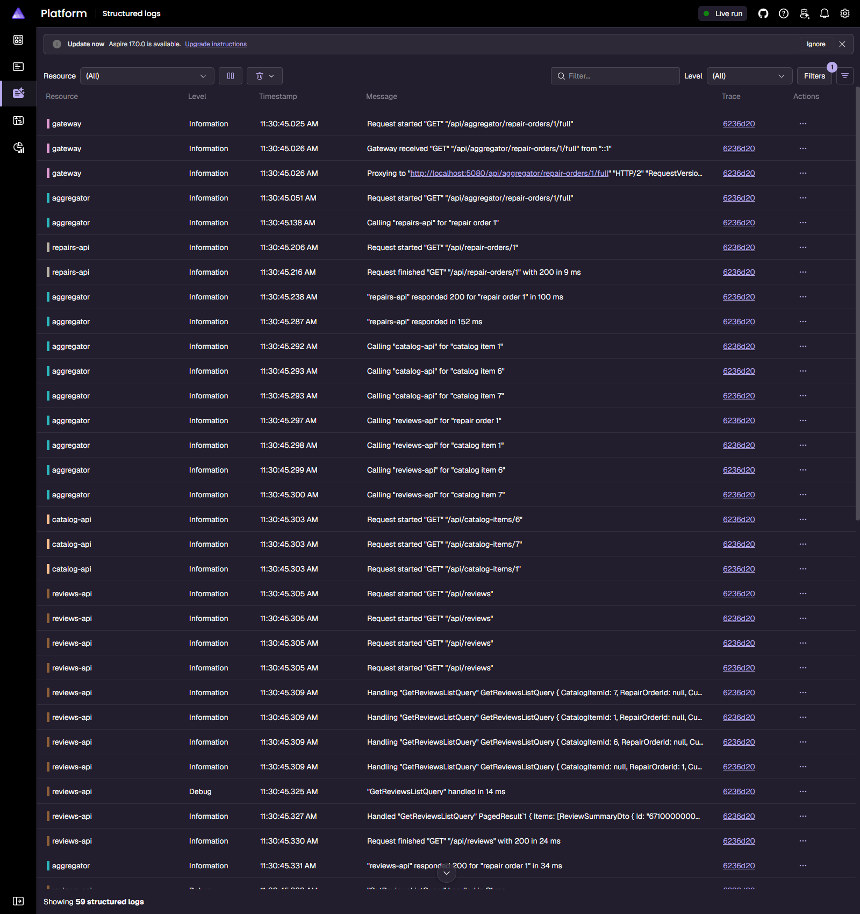

# Платформа: AppHost, ServiceDefaults, Gateway, Aggregator

Три сервіси (Repairs, Catalog, Reviews) працюють як одна платформа на .NET Aspire. Клієнт звертається
лише до шлюзу, шлюз маршрутизує запити за логічними іменами сервісів, а агрегатор збирає картку
ремонтного замовлення з трьох сервісів одночасно. Логи й трасування всіх компонентів збирає Aspire
Dashboard.

| Компонент | Проєкт | Ресурс AppHost | Роль |
|-----------|--------|----------------|------|
| AppHost | `Platform.AppHost` | — | запускає контейнери баз, сервіси, агрегатор і шлюз; задає порядок старту й service discovery |
| ServiceDefaults | `Platform.ServiceDefaults` | — | спільна бібліотека: Serilog, OpenTelemetry, health checks, service discovery, resilience, CorrelationId |
| Gateway | `Platform.ApiGateway` | `gateway` | єдина точка входу на YARP: маршрути, CorrelationId, журнал і метрики трафіку |
| Aggregator | `Platform.Aggregator` | `aggregator` | Aggregator Pattern: картка замовлення з паралельних запитів до трьох сервісів |
| Repairs | `Services/Repairs/Repairs.Api` | `repairs-api` | замовлення, клієнти, склад; SQL Server `RepairsDb` |
| Catalog | `Services/Catalog/Catalog.Api` | `catalog-api` | позиції каталогу, бренди, категорії; SQL Server `CatalogDb` |
| Reviews | `Services/Reviews/Reviews.WebApi` | `reviews-api` | відгуки й коментарі; MongoDB `ReviewsDb` |



## AppHost

`Platform.AppHost/AppHost.cs` — лише конфігурація, бізнес-логіки в ньому немає. Посилання
односпрямовані: AppHost посилається на всі проєкти, а сервіси, шлюз і агрегатор — тільки на
`Platform.ServiceDefaults`.

- **Бази.** `AddSqlServer("sql", sqlPassword)` з томом даних і базами `RepairsDb`, `CatalogDb`;
  `AddMongoDB("mongo")` з окремим томом і базою `ReviewsDb`. `RepairsDb` AppHost наповнює скриптами
  `db/p1`, схему `CatalogDb` створюють міграції сервісу Catalog, індекси й тестові відгуки в
  `ReviewsDb` — сам сервіс Reviews.
- **Секрети.** Пароль SQL Server — параметр-секрет `sql-password`; значення лежить у секретах
  користувача AppHost (`Parameters:sql-password`), а якщо його немає — Dashboard попросить ввести
  його під час першого запуску. Пароль MongoDB Aspire генерує сам. Необов'язковий параметр
  `luckypenny-license-key` передає ключ ліцензії AutoMapper і MediatR усім трьом сервісам; без нього
  бібліотеки лише пишуть попередження в журнал.
- **Рядки підключення.** Імена ресурсів баз збігаються з іменами рядків підключення, які читають
  сервіси, тому `WithReference` передає їх змінними `ConnectionStrings__RepairsDb`,
  `ConnectionStrings__CatalogDb` і `ConnectionStrings__ReviewsDb`.
- **Порядок старту** задають ланцюжки `WaitFor`: бази → сервіси → агрегатор → шлюз. Кожен сервіс
  має `WithHttpHealthCheck("/health")`, тож «готовий» означає, що він відповідає на `/health`
  (для Reviews — і що MongoDB доступна), а не просто що процес стартував.
- **Порти.** Сервіси — 5077, 5078, 5079, агрегатор — 5080, шлюз — фіксований 5000
  (`WithHttpEndpoint(port: 5000, name: "public")`). Ім'я ресурсу — це логічне ім'я для service
  discovery: `http://catalog-api` замість `localhost:5078`.

## Інтеграція сервісів

Зміни в сервісах обмежено підключенням спільних налаштувань:

| Сервіс | Що змінилося |
|--------|--------------|
| усі три | `Program.cs`: `builder.AddServiceDefaults()`, `app.UseMiddleware<CorrelationIdMiddleware>()`, `app.MapDefaultEndpoints()`; прибрано власну конфігурацію Serilog і `UseSerilogRequestLogging` |
| усі три | `appsettings*.json`: прибрано рівні журналу, які тепер задає ServiceDefaults; лишилися лише специфічні для сервісу налаштування (файловий приймач, рівень SQL-команд EF Core у Catalog, обмеження деструктуризації в Reviews) |
| Catalog | власний `CorrelationIdMiddleware` видалено — його замінив спільний; `correlationId` у `ProblemDetails` береться зі спільного |
| Reviews | рядок підключення читається з `ConnectionStrings:ReviewsDb` і має пріоритет над резервним `MongoDb:ConnectionString`; база — `ReviewsDb`; власний `MapHealthChecks("/health")` замінено на `MapDefaultEndpoints` (перевірка `mongodb` лишилася в `/health`); драйвер MongoDB підписано на трасування в `MongoDbContext` |

Бізнес-логіку не змінено: до сервісів додано лише власні spans і структуровані логи бізнес-подій.

| Сервіс | `ActivitySource` | Spans | Властивості логів |
|--------|------------------|-------|-------------------|
| Repairs | `Repairs.Bll` (`RepairsTelemetry`) | `CreateRepairOrder`, `AddRepairOrderItem`, `ChangeRepairOrderStatus` | `RepairOrderId`, `CustomerId`, `ItemsCount`, `Amount`, `Status`, `FromStatus`, `ToStatus` |
| Catalog | `Catalog.Bll` (`CatalogTelemetry`) | `CreateCatalogItem`, `UpdateCatalogItem`, `ChangeCatalogItemPrice` | `CatalogItemId`, `Sku`, `ItemType`, `Price`, `OldPrice`, `NewPrice` |
| Reviews | `Reviews.Application` (`ReviewsTelemetry`) | `CreateReview`, `ReplyToReview`, `DeleteReview` | `ReviewId`, `ReviewType`, `CustomerId`, `Rating`, `CatalogItemId`, `RepairOrderId` |
| Aggregator | `Platform.Aggregator` | `AggregateRepairOrderCard` | `RepairOrderId`, `PartsCount`, `ReviewsCount`, `WarningsCount` |

Паролі, токени й контактні дані клієнтів (телефон, email) у логи не потрапляють.

## ServiceDefaults

`Platform.ServiceDefaults/Extensions.cs` — один метод `AddServiceDefaults()` для всіх застосунків.

### Serilog

- Serilog — основний провайдер логування (`AddSerilog`), стандартні провайдери вимкнено, щоб записи
  не дублювалися в консолі.
- Збагачення: `ServiceName` (ім'я застосунку), `EnvironmentName`, `MachineName`, `ThreadId`, а через
  `FromLogContext` — `CorrelationId` кожного запиту. `TraceId` і `SpanId` кожного запису беруться з
  поточного `Activity`.
- Рівні: `Debug` у Development, `Information` в інших середовищах; шумні категорії
  (`Microsoft.AspNetCore`, `Microsoft.EntityFrameworkCore`, `System.Net.Http.HttpClient`, health
  checks, Polly) обмежено.
- Консоль — `CompactJsonFormatter` (вкладка *Console logs* у Dashboard). `writeToProviders: true`
  передає кожен запис провайдеру OpenTelemetry, і він потрапляє у вкладку *Structured logs* з
  окремими атрибутами — там можна шукати, наприклад, `CorrelationId` або `RepairOrderId`.
- Розділ `Serilog` конфігурації сервісу додає лише його власні налаштування (рівні, задані в коді,
  він не перекриває) — так Catalog і Reviews зберегли файлові журнали `logs/*.log`.

### OpenTelemetry

- Трасування: ASP.NET Core (вхідні запити, без `/health` і `/alive`), HttpClient (вихідні виклики),
  SqlClient (покриває і Dapper у Repairs, і EF Core у Catalog), MongoDB
  (`MongoDB.Driver.Core.Extensions.DiagnosticSources`), власні `ActivitySource`: ім'я застосунку й
  усі джерела з тим самим префіксом (`Repairs.*`, `Catalog.*`, `Reviews.*`, `Platform.*`).
- Метрики: ASP.NET Core, HttpClient, runtime і власний `Meter` застосунку (метрики шлюзу).
- Атрибут ресурсу `deployment.environment.name`; `service.name` задає Aspire.
- Sampling: 100 % у Development; в інших середовищах — `ParentBasedSampler` з часткою
  `OpenTelemetry:TraceSamplingRatio` (типово 0.25).
- Експорт — `UseOtlpExporter()` з батчевою обробкою, якщо Aspire передав
  `OTEL_EXPORTER_OTLP_ENDPOINT`.

### Health checks, service discovery, resilience

- `MapDefaultEndpoints()` відкриває `/health` (усі перевірки) і `/alive` (лише `live`) у Development.
- Усі `HttpClient` отримують service discovery, стандартний resilience-handler і
  `CorrelationIdHandler`. Таймаути resilience-handler можна перевизначити розділом
  `HttpClientResilience` конфігурації — так зроблено в агрегаторі.

### CorrelationId

| | CorrelationId | TraceId |
|-|---------------|---------|
| Хто створює | застосунок: шлюз або перший сервіс, до якого прийшов запит | OpenTelemetry |
| Де передається | заголовок `X-Correlation-Id` | заголовок `traceparent` |
| Для чого | бізнес-ідентифікатор звернення, який клієнт може назвати підтримці | технічний зв'язок spans одного запиту |

`CorrelationIdMiddleware` бере `X-Correlation-Id` із запиту або створює новий GUID (і пише про це
в журнал), якщо заголовка немає чи значення некоректне (довше 64 символів або з символами, крім
літер, цифр, `-`, `_`, `.`). Ідентифікатор записується назад у заголовки запиту, у `LogContext`, у
тег span `correlation.id` і в заголовок відповіді; на початку й наприкінці запиту пишуться записи
`Request started` / `Request finished` зі статусом і тривалістю. `CorrelationIdHandler` додає той
самий заголовок до кожного вихідного HTTP-запиту.

## Gateway (YARP)

Маршрути й кластери — у розділі `ReverseProxy` файлу `Platform.ApiGateway/appsettings.json`.
Адреси кластерів — логічні імена ресурсів (`http://repairs-api`), реальні адреси підставляє
`AddServiceDiscoveryDestinationResolver()`.

| Маршрут | Шлях | Кластер | Order |
|---------|------|---------|-------|
| `aggregator` | `/api/aggregator/{**catch-all}` | `http://aggregator` | 1 |
| `repairs-stock` | `/api/repairs/catalog-items/{**catch-all}` → `/api/catalog-items/{**catch-all}` | `http://repairs-api` | 5 |
| `repair-orders`, `customers` | `/api/repair-orders/**`, `/api/customers/**` | `http://repairs-api` | 10 |
| `catalog-items`, `categories`, `brands` | `/api/catalog-items/**`, `/api/categories/**`, `/api/brands/**` | `http://catalog-api` | 10 |
| `reviews` | `/api/reviews/{**catch-all}` | `http://reviews-api` | 10 |

- У YARP менше значення `Order` означає вищий пріоритет, тому маршрут агрегатора й маршрут із
  перезаписом шляху мають найменші значення.
- `/api/catalog-items` є і в Catalog (власник даних), і в Repairs (локальна копія із залишком на
  складі). Шлях без префікса веде до Catalog, копію Repairs шлюз відкриває як
  `/api/repairs/catalog-items/...` і трансформом `PathPattern` повертає їй початковий шлях.
- Для кожного кластера `ActivityTimeout` — 30 с, для маршрутів — ліміт тіла запиту 1 МБ і метадані
  `Team`, `Version`; кластер `catalog` має політику балансування `RoundRobin`.
- `CorrelationIdMiddleware` стоїть у конвеєрі до `MapReverseProxy()`, тож YARP пересилає
  сервісу вже заповнений заголовок `X-Correlation-Id`.
- `GatewayLoggingMiddleware` пише вхідний запит (метод, шлях, IP клієнта) і рішення
  маршрутизації (маршрут, кластер, адреса призначення, статус, тривалість, розмір відповіді).
  Помилки проксі (`IForwarderErrorFeature`: відмова з'єднання, таймаут) пишуться з рівнем `Error` і
  деталями винятку.
- Метрики `Platform.ApiGateway`: `gateway.requests`, `gateway.errors`, `gateway.request.duration`
  з тегами `route`, `cluster`, `status_code` — у вкладці *Metrics* з них видно кількість запитів за
  секунду, середній час відповіді й частку помилок.

## Aggregator

`GET /api/aggregator/repair-orders/{id}/full` повертає картку ремонтного замовлення: замовлення з
Repairs, актуальні дані позицій з Catalog і відгуки з Reviews.

1. `RepairsClient` отримує замовлення. Без замовлення агрегувати нічого: 404 → 404, недоступний
   repairs-api → 503 `ProblemDetails`.
2. `CatalogClient` (по запиту на кожну позицію) і `ReviewsClient` (відгук про ремонт і відгуки про
   кожну позицію) працюють одночасно через `Task.WhenAll`; `CancellationToken` клієнта передається
   в усі виклики.
3. Кожен виклик логується (`Calling catalog-api for catalog item 1` → `catalog-api responded 200
   ... in 85 ms`). Якщо сервіс недоступний (`HttpRequestException`, таймаут або відкритий circuit
   breaker resilience-handler, некоректний JSON), картка повертається без його даних, а в `warnings`
   з'являється `reviews-api is unavailable`. Скасування запиту клієнтом не вважається відмовою
   сервісу й не ховається.
4. У картку потрапляють лише дані цього замовлення: позиції каталогу з тими самими Id і відгуки про
   це замовлення або його позиції. Позиція, якої немає в каталозі, дає попередження.

Typed HttpClients зареєстровано з адресами `https+http://repairs-api`, `https+http://catalog-api`,
`https+http://reviews-api`. Таймаути для агрегатора менші за стандартні (`HttpClientResilience` в
`appsettings.json`: спроба — 5 с, один повтор, увесь запит — 10 с), щоб недоступний сервіс давав
часткову відповідь раніше, ніж спрацює таймаут шлюзу (30 с). 5 с на спробу вистачає і для першого
запиту після старту, коли сервіс ще відкриває з'єднання з базою.

Картка — це DTO під сценарій «картка ремонту», а не копія відповідей сервісів: позиція містить
знімок ціни із замовлення і вкладений блок `catalog` з поточною ціною та ознакою `priceChanged`.
JSON у camelCase, `null`-значення не серіалізуються.

```json
{
  "order": {
    "id": 1, "customerId": 1, "status": "Issued",
    "acceptedAt": "2026-10-01T09:15:00", "issuedAt": "2026-10-03T17:40:00",
    "device": { "type": "Smartphone", "brand": "Apple", "model": "iPhone 13",
                "defectDescription": "Розбитий екран після падіння, сенсор не реагує" },
    "totalAmount": 4700.0
  },
  "parts": [
    {
      "catalogItemId": 1, "itemName": "Екран OLED для iPhone 13", "quantity": 1,
      "unitPrice": 3900.0, "discount": 0.0, "lineTotal": 3900.0,
      "catalog": { "sku": "PRT-DSP-IP13", "name": "Екран OLED для iPhone 13", "itemType": "Part",
                   "brandName": "Apple", "currentPrice": 4200.0, "priceChanged": true,
                   "isActive": true, "warrantyMonths": 6 }
    }
  ],
  "reviews": [
    { "id": "671000000000000000000004", "reviewType": "item", "rating": 2,
      "text": "Через місяць на екрані з'явилася зелена смуга.", "authorName": "Тарас Мельник",
      "catalogItemId": 1, "createdAt": "2026-11-05T20:45:00Z" }
  ],
  "warnings": []
}
```

Коли reviews-api зупинено, та сама картка приходить зі статусом 200, без `reviews` і з
`"warnings": ["reviews-api is unavailable"]`; після запуску сервісу відповідь знову повна.

## Спостереження в Dashboard

- **Traces** — trace агрегувального запиту: `gateway` → `aggregator` → `AggregateRepairOrderCard`
  → `repairs-api` (SQL), потім одночасно `catalog-api` (SQL) і `reviews-api` (MongoDB `aggregate`).

  

- **Structured logs** — фільтр `CorrelationId contains <значення із заголовка відповіді>` показує
  записи всіх сервісів ланцюжка:

  

- **Metrics** — `http.server.request.duration` кожного сервісу й метрики шлюзу `gateway.*`.

Запит напряму до сервісу (наприклад, `http://localhost:5077/api/repair-orders/1`) теж отримує
`X-Correlation-Id`, але сервіс створює його сам, і в журналі немає записів шлюзу про маршрутизацію.
