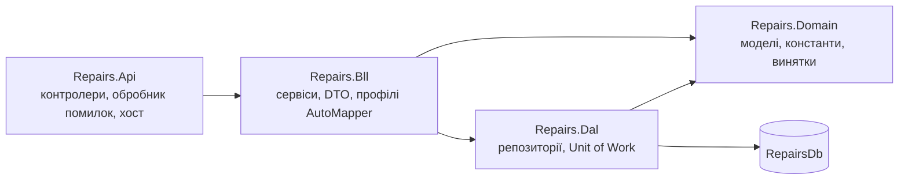

# Сервіс Repairs

Веб-API контексту Repairs: клієнти, замовлення на ремонт, кошторис і залишки запчастин. Працює з базою
`RepairsDb` через ADO.NET і Dapper, без ORM.

## Шари та залежності

Залежності спрямовані в один бік. Контролер звертається лише до сервісу, сервіс — лише до Unit of Work;
SQL є тільки в `Repairs.Dal`.

| Проєкт | Вміст |
|--------|-------|
| `Repairs.Api` | контролери з атрибутною маршрутизацією, `DomainExceptionHandler`, `Program.cs`, `appsettings.json` |
| `Repairs.Bll` | сервіси та їхні інтерфейси, DTO з `DataAnnotations`, профілі AutoMapper |
| `Repairs.Dal` | інтерфейси й реалізації репозиторіїв, `UnitOfWork`, перетворення `SqlException` на доменні винятки |
| `Repairs.Domain` | моделі таблиць, константи статусів і типів, `NotFoundException`, `BusinessConflictException`, `ValidationException` |
| `Repairs.Tests` | модульні тести сервісів і перевірка конфігурації мапінгу |

## Доступ до даних

| Репозиторій | Технологія | Особливості |
|-------------|------------|-------------|
| `CustomerRepository` | чистий ADO.NET: `SqlCommand`, типізовані параметри, ручне читання `SqlDataReader` | свідомо не успадковує `IGenericRepository<T>` і `BaseDapperRepository<T>` — показує роботу з підключенням без сторонніх бібліотек |
| `RepairOrderRepository` | Dapper | multi-mapping замовлення з деталями й позиціями, `QueryMultipleAsync` для сторінки списку, виклики `usp_ChangeRepairOrderStatus` і `usp_UpdateRepairOrderDetails` |
| `CatalogItemRepository` | Dapper | читання локальної копії каталогу, умовне списання залишку |

Спільний CRUD (`GetByIdAsync`, `GetAllAsync`, `AddAsync`, `DeleteAsync`) написано один раз у
`BaseDapperRepository<T>`. Назва таблиці, перелік стовпців для вставки й умова активності запису —
константи з коду конкретного репозиторію, тому їх підстановка в текст запиту безпечна. Усі значення,
що надходять іззовні, передаються лише параметрами.

Видалення скрізь м'яке (`IsDeleted = 1` або `IsActive = 0`): роль застосунку `repairs_app` не має права
на `DELETE`.

### Unit of Work

`UnitOfWork` створюється один на HTTP-запит (Scoped), тримає одне з'єднання й передає всім трьом
репозиторіям це з'єднання та доступ до поточної транзакції. З'єднання відкривається за першим
зверненням і повертається в пул наприкінці запиту в `DisposeAsync`.

## Транзакції

У транзакції Unit of Work виконуються операції, що змінюють кілька таблиць:

| Операція | Таблиці | Репозиторії |
|----------|---------|-------------|
| приймання замовлення з кошторисом | `RepairOrders`, `RepairOrderDetails`, `RepairOrderStatusHistory`, `RepairOrderItems`, `CatalogItems` | `Customers`, `RepairOrders`, `CatalogItems` |
| додавання позиції до замовлення | `RepairOrderItems`, `CatalogItems` | `RepairOrders`, `CatalogItems` |

Назва й ціна позиції беруться з локальної копії каталогу в момент додавання й записуються як знімок.
Якщо запчастини бракує, списання залишку не змінює жодного рядка, сервіс кидає
`BusinessConflictException`, і транзакція відкочується разом із уже вставленими рядками.

Зміна статусу та оновлення деталей виконуються збережуваними процедурами, які самі відкривають
транзакцію і блокують рядок замовлення (`UPDLOCK`).

**Рівень ізоляції — `ReadCommitted`.** Операції короткі й торкаються кількох рядків. Єдиний інваріант,
який можуть порушити конкурентні запити, — невід'ємний залишок; його захищає не рівень ізоляції, а
атомарна умова `WHERE Stock >= @Quantity` в самому `UPDATE` та обмеження `CHECK (Stock >= 0)`.
`RepeatableRead` чи `Serializable` прибрали б неповторювані й фантомні читання, але утримували б
блокування до кінця транзакції: за одночасного оформлення кількох замовлень з однією запчастиною це
означає довші черги й взаємні блокування, жертву яких довелося б повторювати. Обрано меншу кількість
блокувань, а узгодженість критичного поля забезпечено умовою в запиті.

**Таймаути.** Час очікування команди — 30 секунд (`RepositoryBase.CommandTimeoutSeconds`), він
застосовується і до команд ADO.NET, і до запитів Dapper. Час очікування підключення — стандартні
15 секунд `SqlClient`; за потреби змінюється параметром `Connect Timeout` у рядку підключення.
Скасування HTTP-запиту передається через `CancellationToken` аж до команди SQL.

## Помилки

`SqlException` перехоплюється в DAL і перетворюється на доменний виняток; глобальний обробник в API
перетворює його на статус і тіло у форматі ProblemDetails (`application/problem+json`) з полем
`traceId`.

| Джерело | Доменний виняток | HTTP |
|---------|------------------|------|
| `50001`, `50004`, `50006`; запис не знайдено сервісом | `NotFoundException` | 404 |
| `50002`, `50003`, `50005`, `50007`, `50008`, `50009`; порушення `UNIQUE` (`2601`, `2627`) та інших обмежень (`547`); бізнес-правила сервісів | `BusinessConflictException` | 409 |
| `50010`; перевірки сервісів, що потребують стану бази | `ValidationException` | 400 |
| некоректна модель запиту (`DataAnnotations`) | — | 400 |
| будь-що інше | — | 500 без подробиць у відповіді |

## Валідація

- **Модель запиту.** Атрибути `DataAnnotations` на DTO: обов'язковість, довжини, діапазони, перелік
  допустимих значень. Некоректний запит відхиляється до виклику сервісу.
- **Бізнес-правила.** Перевіряє сервіс, бо вони потребують стану бази: чи існує клієнт, чи активна
  позиція каталогу, чи вистачає залишку, чи дозволяє статус змінювати кошторис, чи не перевищує знижка
  суму рядка, чи можна видалити замовлення або клієнта.

## Конкурентність

Оновлення деталей замовлення використовує оптимістичну конкурентність: клієнт отримує `rowVersion`
разом із замовленням і повертає його в запиті на зміну. Якщо рядок тим часом змінили, процедура
повертає помилку `50008`, а API — 409. Залишок і статус, які змінюються часто й коротко, захищено
на боці бази: умовним `UPDATE` та блокуванням рядка в процедурі.

## Логування

Журнал і трасування налаштовує `Platform.ServiceDefaults` (див. [`platform.md`](platform.md)): Serilog
пише JSON у консоль і в OpenTelemetry, кожен запис містить `CorrelationId`, `TraceId` і `SpanId`
запиту — той самий `TraceId` повертається клієнтові в полі `traceId` відповіді з помилкою. Створення
замовлення, додавання позиції та зміна статусу мають власні spans `ActivitySource` `Repairs.Bll`, а
запити Dapper і ADO.NET видно в trace як spans SQL Server. У журнал потрапляють ідентифікатори сутностей і
статуси, без персональних даних і рядків підключення.
