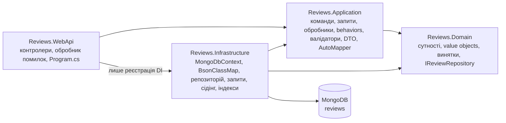
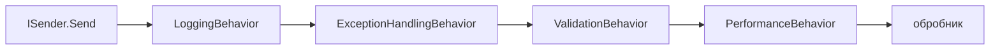
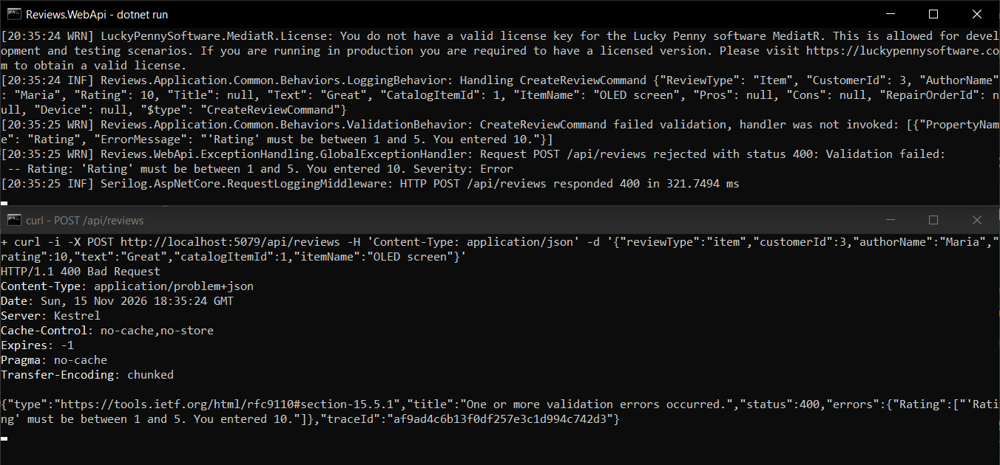
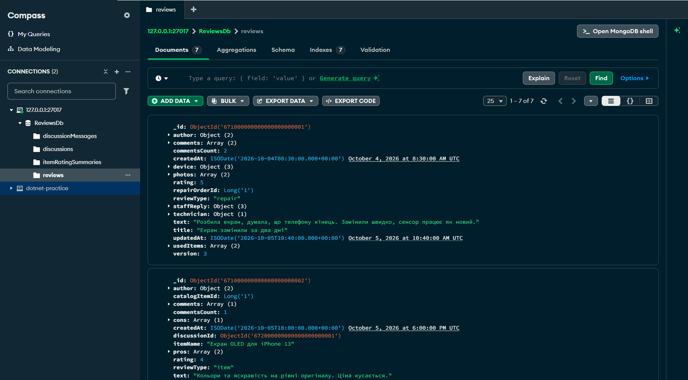
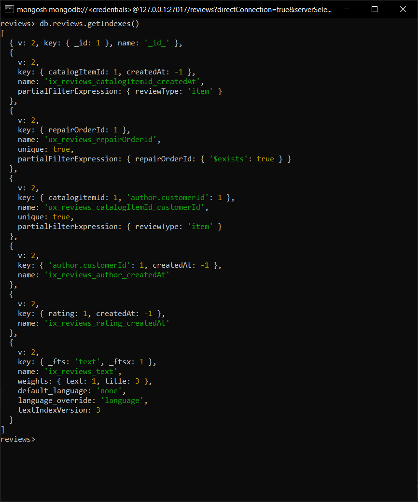

# Сервіс Reviews

Веб-API контексту Reviews: відгуки клієнтів про ремонт і про позиції каталогу, коментарі до них і
відповідь сервісного центру. Працює з документною базою MongoDB `ReviewsDb` (колекція `reviews`).
Сервіс побудовано за Clean Architecture: доменний шар у центрі, операції запису й читання розділено
на команди та запити MediatR (CQRS), наскрізні перевірки винесено в pipeline behaviors.

## Шари та правило залежностей



Залежності спрямовані лише всередину: зовнішні шари знають про внутрішні, але не навпаки.

| Проєкт | Посилається на | NuGet-пакети | Вміст |
|--------|----------------|--------------|-------|
| `Reviews.Domain` | — | `MongoDB.Bson` (лише тип `ObjectId`) | `BaseEntity`, `ValueObject`, сутності `Review` і `Comment`, value objects `Author`, `Device`, `StaffReply`, `DomainException`, `ConflictException`, `IReviewRepository` |
| `Reviews.Application` | Domain | MediatR, FluentValidation, AutoMapper | `ICommand`, `ICommand<T>`, `IQuery<T>`; команди, запити, їхні обробники й валідатори; behaviors; `IReviewQueries`; DTO; `ReviewProfile`; `ReviewsTelemetry`; `AddApplication` |
| `Reviews.Infrastructure` | Application, Domain | `MongoDB.Driver`, `MongoDB.Bson`, `MongoDB.Driver.Core.Extensions.DiagnosticSources`, `Microsoft.Extensions.Options.ConfigurationExtensions`, `AspNetCore.HealthChecks.MongoDb` | `MongoDbOptions`, `MongoDbContext`, `MongoMappings`, `ReviewRepository`, `ReviewQueries`, `IDataSeeder`, `ReviewSeeder`, `IndexCreationService`; `AddInfrastructure` |
| `Reviews.WebApi` | Application, Infrastructure, `Platform.ServiceDefaults` | Swashbuckle | `ApiControllerBase`, `ReviewsController`, `ReviewCommentsController`, `GlobalExceptionHandler`, `Program.cs`, `appsettings*.json` |

Домен не має драйвера MongoDB і не знає, як його зберігають: у класах немає BSON-атрибутів, мапінг
описано окремо в `Reviews.Infrastructure`. На Infrastructure посилається лише `Program.cs` — щоб
викликати `AddInfrastructure`; контролери й обробники працюють з інтерфейсами.

## Доменна модель

| Тип | Вид | Призначення |
|-----|-----|-------------|
| `BaseEntity` | базовий клас | `Id` (`ObjectId`), `CreatedAt`, `UpdatedAt`, `Version`; `Touch()`, `BumpVersion()`, `EnsureVersion()` |
| `Review` | сутність, корінь агрегату | відгук про позицію (`ForItem`) або про ремонт (`ForRepair`); оцінка, заголовок, текст, автор, плюси й мінуси, пристрій, коментарі, відповідь сервісу, м'яке видалення |
| `Comment` | сутність усередині агрегату | коментар у вбудованому масиві `comments` |
| `Author` | value object | `CustomerId` і `DisplayName` — автор відгуку |
| `Device` | value object | знімок пристрою з замовлення на ремонт: тип, бренд, модель |
| `StaffReply` | value object | відповідь сервісного центру: автор, текст, час |

Стан змінюється лише методами сутності: `Edit`, `AddComment`, `ReplyAsStaff`, `Delete`. Усі
властивості мають приватні setter-и, колекції назовні доступні тільки для читання. Порушення
правила — `DomainException`:

- оцінка лише від 1 до 5, текст обов'язковий (до 5000 символів), заголовок до 200;
- відгук про позицію має `catalogItemId` і назву; відгук про ремонт — `repairOrderId` і пристрій;
- плюси й мінуси є лише у відгуку про позицію, не більше 10 пунктів;
- у документі зберігаються останні 20 коментарів, а `commentsCount` рахує всі — так документ не
  росте безмежно (рішення з моделі даних, [`p3-mongo-model.md`](p3-mongo-model.md));
- видалений відгук змінити не можна.

Value objects незмінні: властивості без setter-ів, перевірка в конструкторі, порівняння за значенням
через `GetEqualityComponents()` у базовому `ValueObject`.

## CQRS: команди й запити

Кожна операція API — окремий об'єкт MediatR зі своїм обробником.

| Команда / запит | Обробник працює через | Результат |
|-----------------|----------------------|-----------|
| `CreateReviewCommand` | `IReviewRepository` | `Id` нового відгуку (рядок `ObjectId`) |
| `UpdateReviewCommand` | `IReviewRepository` | `ReviewDto` |
| `DeleteReviewCommand` | `IReviewRepository` | — |
| `AddCommentCommand` | `IReviewRepository` | `CommentDto` |
| `ReplyToReviewCommand` | `IReviewRepository` | `ReviewDto` |
| `GetReviewByIdQuery` | `IReviewQueries` | `ReviewDetailsDto` |
| `GetReviewsListQuery` | `IReviewQueries` | `PagedResult<ReviewSummaryDto>` |
| `GetReviewsFeedQuery` | `IReviewQueries` | `CursorPage<ReviewSummaryDto>` |
| `GetReviewCommentsQuery` | `IReviewQueries` | список `CommentDto` |

Сторона запису завантажує агрегат через `IReviewRepository` (інтерфейс у Domain), викликає метод
сутності й зберігає її. Обробник відповідає через AutoMapper: `ReviewProfile` перетворює `ObjectId`
на рядок, value objects — на `AuthorDto`, `DeviceDto`, `StaffReplyDto`, масив коментарів — на
список `CommentDto`.

Сторона читання доменну модель не використовує. Обробник запиту викликає `IReviewQueries`
(інтерфейс в Application), а реалізація в Infrastructure будує aggregation pipeline і проєктує
документ одразу в DTO — з бази приходять лише потрібні поля:

```text
$match   isDeleted != true + фільтри (catalogItemId, repairOrderId, author.customerId, reviewType, rating >=, $text)
$sort    createdAt: -1, _id: -1
$skip    (page - 1) * pageSize
$limit   pageSize
$project _id: { $toString: "$_id" }, ..., commentsCount: { $ifNull: [...] }
```

Через проєкцію `GET /api/reviews/{id}` показує й поля документа, якими сервіс не керує
(`technician`, `usedItems`, `photos`, `discussionId`). Загальну кількість рахує `countDocuments`
з тим самим фільтром.

**Курсорна пагінація** (`GET /api/reviews/feed`) не пропускає документи через `$skip`: наступна
сторінка починається після останнього `_id` попередньої (`_id < after`, сортування за `_id`).
`ObjectId` зростає разом із часом створення, тому стрічка йде від нових відгуків до старих і не
сповільнюється на далеких сторінках.

## Pipeline behaviors

`AddApplication` реєструє MediatR зі скануванням збірки та чотири behaviors. Порядок реєстрації —
це порядок виконання, від зовнішнього до найближчого до обробника:



| Behavior | Що робить |
|----------|-----------|
| `LoggingBehavior` | структурований запис `Handling {RequestName} {@Request}` до обробника і `Handled {RequestName} {@Response}` після нього |
| `ExceptionHandlingBehavior` | журналює винятки з назвою й вмістом запиту: очікувані (`DomainException`, `ConflictException`, `NotFoundException`) — `Warning`, решту — `Error`; виняток передає далі |
| `ValidationBehavior` | запускає всі валідатори FluentValidation для запиту, збирає всі помилки й кидає `ValidationException` — обробник не викликається |
| `PerformanceBehavior` | вимірює час обробника разом із запитами до MongoDB; понад 500 мс — `Warning` «Slow request» |

Валідатори є для кожної команди та для запитів із параметрами. Крім обов'язковості й довжин, вони
перевіряють MongoDB-специфіку: рядковий `Id` має бути коректним `ObjectId`, а `CreateReviewCommand`
має два асинхронні правила із запитом до бази — клієнт ще не відгукувався про цю позицію, замовлення
ще не має відгуку.

Команда з `rating: 10` у журналі виглядає так — запис `Handled` і час обробника відсутні:



## Інфраструктура MongoDB

**Контекст.** `MongoDbContext` отримує `MongoDbOptions` (рядок підключення й назву бази) через
`IOptions`, створює один `MongoClient` на застосунок і надає `IMongoCollection<Review>`.
Налаштування перевіряються під час старту.

**BSON-мапінг.** `MongoMappings.Register()` викликається один раз — у `AddInfrastructure`, до першого
звернення до бази:

- конвенції для типів сервісу: `camelCase`, ігнорування невідомих полів, пропуск `null`;
- `BsonClassMap` для `BaseEntity`, `Review`, `Comment` і value objects; приватні поля `_comments`,
  `_pros`, `_cons` мапляться на `comments`, `pros`, `cons` і записуються лише непорожніми;
  `commentsCount`, `isDeleted` і `isStaff` пропускаються, якщо мають типове значення;
- value objects і `Comment` створюються через конструктор (`MapCreator`), тому їхні правила
  перевіряються й під час читання;
- серіалізатори: `DateTime` — завжди UTC; `ReviewType` — рядок `"item"` / `"repair"`
  (`LowerCaseEnumSerializer`).

У результаті документ, записаний сервісом, має ту саму структуру, що й документи з `db/p3/seed.js`,
і проходить JSON Schema-валідатор колекції.



**Репозиторій і конкурентність.** `ReviewRepository.UpdateAsync` бере очікувану версію, збільшує
`version` і виконує `updateOne` з фільтром `{ _id, version: <очікувана> }`. Якщо документ уже змінив
інший запит, `MatchedCount = 0`, і репозиторій кидає `ConflictException` (409). Оновлення пише лише
поля, якими керує домен (`$set`, а для полів, що зникли, — `$unset`), тому поля документа, яких у
доменній моделі немає (`technician`, `usedItems`, `photos`, `discussionId`), не стираються.

Клієнт отримує версію в заголовку `ETag` (`GET`, `PUT`, `POST`) і передає її в `If-Match` для
`PUT` і `DELETE`. Застаріла версія — 409, відсутній заголовок — 400.

**Видалення м'яке.** `DELETE` ставить `isDeleted: true`; такі відгуки не повертають ні списки, ні
`GET /api/reviews/{id}` (404). Документ лишається для історії, тому повторний відгук того самого
клієнта на ту саму позицію не приймається.

## Індекси й початкові дані

`IndexCreationService` (`IHostedService`) під час старту викликає `createIndexes` з визначеннями з
коду. Імена й параметри збігаються з `db/p3/collections.js`, тому на базі, розгорнутій скриптами,
команда нічого не змінює, а на порожній базі створює той самий набір.

| Індекс | Тип | Для чого |
|--------|-----|----------|
| `ix_reviews_catalogItemId_createdAt` | складений, частковий (`item`) | відгуки про позицію, новіші спочатку |
| `ux_reviews_repairOrderId` | унікальний, частковий | один відгук на замовлення |
| `ux_reviews_catalogItemId_customerId` | унікальний складений, частковий (`item`) | один відгук клієнта на позицію |
| `ix_reviews_author_createdAt` | складений | «мої відгуки» |
| `ix_reviews_rating_createdAt` | складений | фільтр за оцінкою |
| `ix_reviews_text` | текстовий (`title` × 3, `text` × 1) | параметр `search` |



`ReviewSeeder` реалізує `IDataSeeder`: якщо колекція порожня, вставляє сім тестових відгуків одним
`InsertManyAsync`. Дані лежать у `Seeding/Data/reviews.json` (Extended JSON, вбудований ресурс) і
збігаються з `db/p3/seed.js`, включно з `_id`. Документи вставляються як `BsonDocument`, щоб
зберегти всі поля, зокрема ті, яких немає в доменній моделі. Повторний старт нічого не дублює.
Сідінг запускає `DataSeedingService` після створення індексів; у середовищі `Production` він
вимкнений.

## Обробка помилок

Усі винятки перетворює `GlobalExceptionHandler` (`IExceptionHandler` + `AddProblemDetails`) на
відповідь `application/problem+json` з `traceId`:

| Виняток | Статус | `detail` |
|---------|--------|----------|
| `ValidationException` (FluentValidation) | 400 | `errors` за полями (`ValidationProblemDetails`) |
| `DomainException` | 400 | текст правила |
| `NotFoundException` | 404 | `Review '<id>' was not found` |
| `ConflictException` (застаріла версія) | 409 | очікувана й поточна версії |
| `MongoWriteException` з `DuplicateKey` | 409 | `A review with the same unique key already exists` |
| `MongoWriteException` (інші, наприклад JSON Schema) | 400 | `The document was rejected by the database` |
| `MongoConnectionException`, `TimeoutException` вибору сервера | 503 | `The review storage is temporarily unavailable` |
| інші | 500 | без технічних подробиць поза `Development` |

`TimeoutException` віднесено до 503 свідомо: коли MongoDB недоступна, драйвер кидає саме його після
`serverSelectionTimeoutMS`, а не `MongoConnectionException`. Дубль, який проскочив асинхронну
перевірку валідатора через одночасні запити, зупиняє унікальний індекс — 409, а не 500.

## gRPC

Для агрегатора сервіс має gRPC-контракт `Reviews.WebApi/Protos/reviews.proto` (`ReviewsService`) на
окремому endpoint лише з HTTP/2 (порт 5179):

- `GetReview` — один відгук (`GetReviewByIdQuery`);
- `GetRepairOrderReviews` — відгуки про ремонт і останні відгуки про кожну його позицію одним
  викликом. Запит `GetRepairOrderReviewsQuery` (з валідатором: Id > 0, не більше 50 позицій, ліміти
  1..100) виконує вибірки для ремонту й кожної позиції паралельно, прибирає дублікати й сортує від
  нових до старих. Раніше агрегатор робив для цього окремий HTTP-запит на кожну позицію.

`Grpc/ReviewsGrpcService` — адаптер у WebApi-шарі: перевіряє ObjectId (`InvalidArgument`), надсилає
запит через `ISender` MediatR (тож працюють усі behaviors: журнал, валідація, вимір тривалості) і
перетворює винятки на `RpcException`: помилки FluentValidation → `InvalidArgument`, `NotFoundException`
→ `NotFound`, `DomainException`/`ConflictException` → `FailedPrecondition`.

## Конфігурація

| Файл | `MongoDb:ConnectionString` |
|------|----------------------------|
| `appsettings.json` | `mongodb://127.0.0.1:27017/?maxPoolSize=50&serverSelectionTimeoutMS=5000` |
| `appsettings.Development.json` | пул 20, тайм-аути 3 с, детальний журнал behaviors (`Debug`) |
| `appsettings.Staging.json` | хост `mongo`, пул 50, тайм-аути 5 с |
| `appsettings.Production.json` | хост `mongo`, пул 5–100, тайм-аути 5 с, `retryWrites=true` |

Назва бази — `MongoDb:DatabaseName` (`ReviewsDb`). Облікові дані в репозиторій не потрапляють: рядок
підключення з паролем передається змінною `ConnectionStrings__ReviewsDb` — в Aspire це робить
AppHost через `WithReference`; якщо такого рядка немає, використовується резервний
`MongoDb:ConnectionString`. Драйвер підписано на трасування (`DiagnosticsActivityEventSubscriber`),
тож кожна команда MongoDB — окремий span. Стан підключення показує `GET /health` (перевірка `mongodb`).

Ключ ліцензії MediatR і AutoMapper (Lucky Penny Software) читається з `LuckyPenny:LicenseKey`
(user-secrets або змінна `LuckyPenny__LicenseKey`; в Aspire її задає AppHost із параметра-секрету
`luckypenny-license-key`). Без ключа обидві бібліотеки працюють і лише пишуть попередження в журнал.

## Тести

`Services/Reviews/Reviews.Tests` (xUnit, NSubstitute) — 46 тестів без бази даних:

- gRPC-сервіс: некоректний ObjectId — `InvalidArgument` без запиту до MediatR, відсутній відгук —
  `NotFound`, помилка валідації — `InvalidArgument`, типові ліміти й перетворення відгуків у повідомлення;

- домен: оцінка поза 1..5 (зокрема 10) кидає `DomainException`, обмеження 20 коментарів, правила
  відгуку про ремонт, м'яке видалення, конфлікт версій, рівність value objects;
- валідатори: оцінка, `ObjectId`, обов'язковий `If-Match`, межі пагінації, асинхронна перевірка
  дубля через підставний репозиторій;
- `ValidationBehavior`: за невалідного запиту обробник не викликається, помилки всіх валідаторів
  збираються разом;
- обробники: створення, конфлікт версії без запису, 404;
- AutoMapper: конфігурація коректна, `ObjectId` → рядок, value objects і масив коментарів;
- BSON-мапінг: імена полів у camelCase, типи `int`/`long`/`date`, відсутність порожніх полів,
  читання seed-документів у доменні сутності, читання проєкції в DTO.
